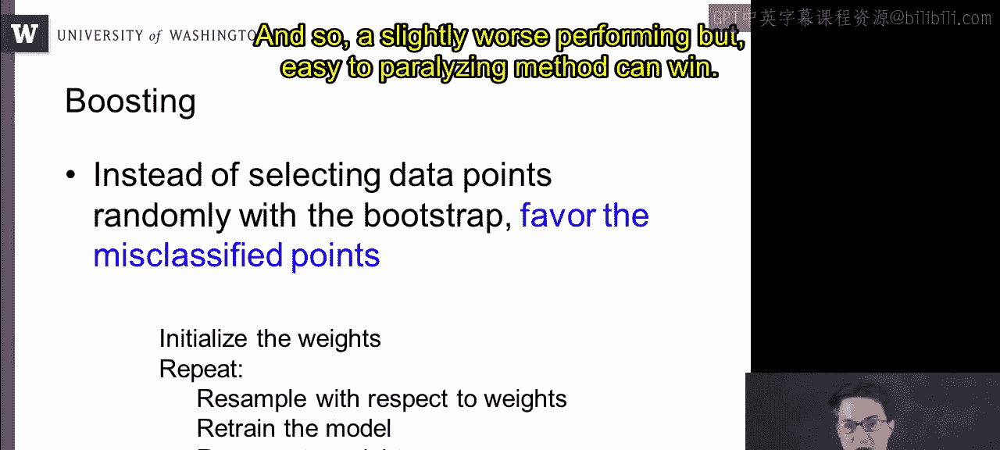

#  048：提升算法详解

在本节课中，我们将深入探讨提升算法的具体步骤和工作原理。提升是一种强大的集成学习方法，它通过顺序训练多个弱分类器并调整数据权重，最终组合成一个强分类器。

## 算法步骤详解

上一节我们介绍了提升算法的基本思想，本节中我们来看看其精确的数学描述和具体执行步骤。

对于每一个步骤 **T**，我们都有一个权重向量，它代表了在采样时选择第 **I** 个样本的概率。这个权重向量记作 **D**。因此，**D_T(I)** 表示在第 **T** 步采样时选择样本 **I** 的概率。这些权重在初始化时被设置为均匀概率。

**X_I** 和 **y_I** 分别代表你的数据记录和对应的标签。这里，“数据点”、“样本”和“记录”这几个词可以互换使用。

**H_T** 是在第 **T** 步时，使用根据权重 **D_T** 抽取的样本训练得到的分类器。

接下来，计算分类器的误差。误差 **ε_T** 是通过将所有被错误分类的样本的权重相加得到的。下面的公式描述了这一计算过程：对于模型 **H_T**，将其应用于 **X_I**，当分类器的预测结果与实际标签 **y_I** 不符时，将这些样本的权重 **D_T(I)** 累加起来。

然后，计算所谓的“几率”。给定一个概率 **p**，其几率为 **p / (1 - p)**。这里，我们计算错误分类的几率。

接着，根据这个几率来调整权重。具体来说，**只对正确分类的样本**应用权重更新函数，降低它们的权重。未被正确分类的样本权重保持不变。我为了表述清晰，没有在图中列出完整的表达式，这可能不是一个好主意。需要强调的是，权重更新仅应用于被正确分类的样本。

此外，还有一个步骤我在图中为了清晰也省略了，那就是权重归一化。因为调整部分权重后，所有权重之和不再等于1。虽然相对权重是已知的，但为了进行下一轮采样，需要将所有权重重新归一化，使其总和为1。这是一个简单的步骤，但加入一个除以归一化因子 **Z** 的表达式可能会让人困惑，所以我选择这样解释。归一化后，你就得到了用于下一轮迭代的新权重 **D_{T+1}**，然后重复这个过程。

## 提升与装袋的对比

了解了提升算法的步骤后，我们结合对大数据和可扩展性的理解，来比较一下提升和另一种集成方法——装袋的区别。

提升算法有许多优良特性，是一个非常成功的算法。它尤其酷的一点在于它是一个**元算法**。这意味着它可以应用于任何基础分类器，不限定分类器的具体类型。它可以是决策树，也可以是你想出的任何其他方法。提升算法所做的只是影响每一步训练分类器时使用的数据。

由于这种权重调整机制，算法会逐渐“聚焦”于之前犯错的样本，给错误分类的样本分配越来越多的权重。你可以直观地想象，分类器的整体强度会随着时间的推移变得非常强大。这很好，而且它确实有效。

但是，相对于更简单的装袋方法，提升在处理真正的大数据时有一个劣势。

这个劣势就是：提升本质上是**顺序执行**的。我们有“对于每个时间步T”的循环，第 **T+1** 步的权重依赖于第 **T** 步的权重。而在装袋中，我们可以完全并行地进行所有操作，同时训练所有基分类器。

这一点在讨论各种方法时并不常见，因为它们往往侧重于相关的数学性能。但在数据科学的背景下，我们需要记住，我们有时需要在非常大的数据集上工作。因此，一个性能稍差但易于并行化的方法可能会胜出。

---

本节课中我们一起学习了提升算法的具体工作流程，包括权重初始化、误差计算、权重更新与归一化等核心步骤。我们还分析了提升算法作为一种强大的顺序集成方法的优势，以及其在大数据场景下，由于顺序依赖性而相对于并行化方法（如装袋）存在的潜在可扩展性挑战。理解这些权衡对于在实际大规模数据科学项目中选择合适的算法至关重要。