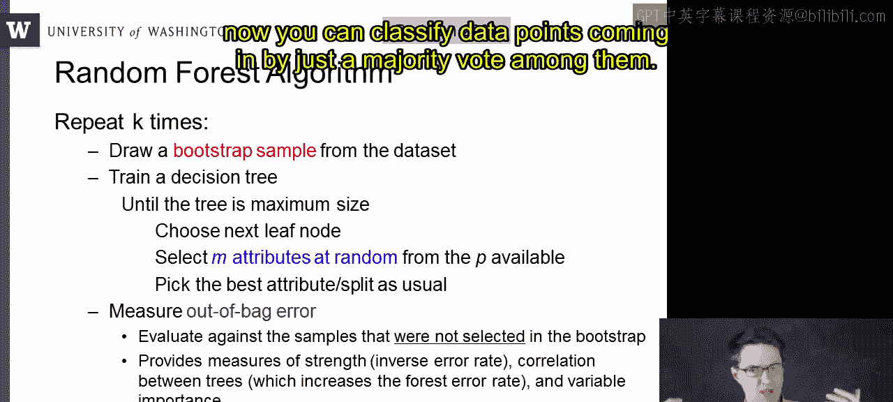
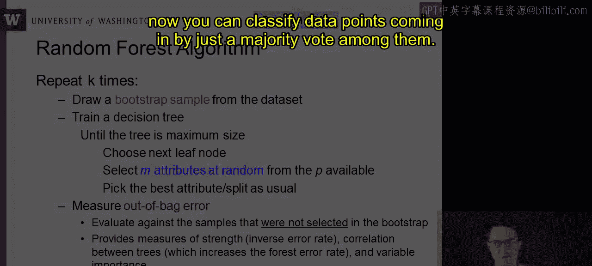

#  049：随机森林 🌲

在本节课中，我们将学习一种非常流行且强大的集成学习方法——随机森林。我们将了解其构建过程、核心思想以及如何评估其性能。

上一节我们介绍了提升法、装袋法等集成学习概念。本节中，我们将把这些思想结合起来，应用于决策树，从而创建一种基于决策树的集成方法。

## 算法构建过程 🛠️

随机森林由布雷曼于2001年提出。其核心思想是构建多棵决策树，并通过投票机制进行最终预测。以下是构建随机森林的具体步骤。

以下是构建随机森林的详细步骤：

1.  **重复K次**：K是一个需要指定的参数，代表森林中树的数量。
2.  **抽取自助样本**：从原始数据集中抽取一个自助样本。
3.  **训练决策树**：在该自助样本上训练一棵决策树，训练规则如下：
    *   持续分裂节点，直到树达到预设的最大尺寸（通常设置得较为保守）。
    *   对于每个待分裂的叶节点，执行以下操作：
        *   从全部P个可用特征中，**随机**选择M个特征。
        *   仅在这M个特征中，像往常一样（例如使用信息熵等方法）寻找最佳的特征或分裂点。
4.  **计算袋外误差**：由于自助抽样可能产生重复样本，这意味着有些原始数据未被抽中。这些未被抽中的数据构成了一个天然的测试集。用当前树在这个测试集上评估误差，即“袋外误差”。
5.  **形成森林**：重复以上步骤K次，最终得到K棵决策树。

## 袋外误差的用途 📊

在算法运行过程中计算的袋外误差有多种用途，它不仅仅是评估指标。

以下是袋外误差的几个主要用途：

*   **估计强度**：强度是错误率的倒数，袋外误差可用于估计单棵树的预测强度。
*   **衡量相关性**：每棵树使用不同的数据子集和特征子集生成。通过袋外误差可以衡量这些随机树之间的相关性。我们不希望所有树都做出相同的决策（高相关性），这会降低集成分类器的整体效能。
*   **评估变量重要性**：袋外误差还可用于评估不同特征（变量）对模型预测的重要性，我们将在下一张幻灯片详细讨论。

## 最终预测与总结 🎯

最终，我们得到了K棵希望是近似独立的决策树。当新的数据点需要分类时，随机森林通过一个简单的**多数投票**机制来做出最终预测。

本节课中，我们一起学习了随机森林算法。我们了解到，它通过结合**自助抽样**、**特征随机选择**来构建多棵差异化的决策树，并利用**袋外误差**进行即时评估，最后通过**多数投票**进行集成预测，从而成为一个强大且鲁棒的机器学习模型。