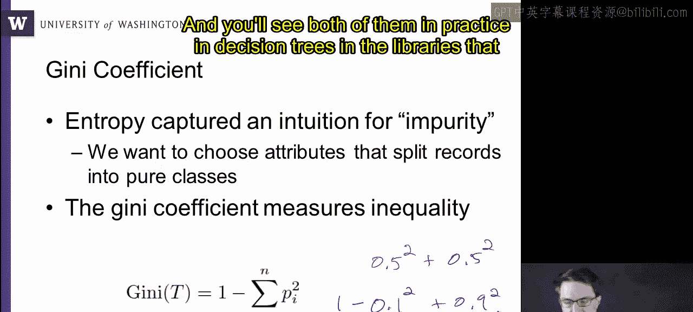

#  050：变量重要性

在本节课中，我们将要学习随机森林模型中的一个重要概念——变量重要性。我们将探讨如何衡量不同特征对模型预测准确性的贡献，并介绍两种用于决策树节点分裂的“不纯度”度量方法：熵和基尼系数。

## 变量重要性概述

上一节我们介绍了集成方法（如随机森林）在可解释性方面的弱点。一个单一的决策树很容易理解，但多个决策树协同工作时，其内部机制就不那么清晰了。如果你希望使用模型来获得对问题领域的洞察，仅凭随机森林输出的高精度结果可能是不够的，因为你不知道它为何有效。

变量重要性正是应对这一挑战的方法。其核心思想是，在运行随机森林算法后，你将获得一个衡量各个属性对模型准确性重要程度的指标。

## 如何衡量变量重要性

那么，如何衡量变量重要性呢？其基本方法是在训练每棵树时进行一种“置换实验”。

以下是具体步骤：
1.  对于数据集中的某个特定属性，随机打乱其所有值。
2.  使用打乱后的数据重新评估决策树的预测准确性（或错误率）。
3.  观察错误率的变化程度。

其背后的逻辑是：如果一个属性非常重要，打乱它的值会显著破坏模型原有的信息结构，从而导致错误率大幅上升。反之，如果一个属性不重要，打乱它的值对错误率的影响就很小。通过在所有树上聚合这种变化，就可以得到每个属性在整个随机森林中的重要性评分。

这有助于提升随机森林的整体可解释性，让你了解哪些特征在驱动所有决策。在一些应用中，例如医学领域，找到根本原因而非仅仅进行“发射后不管”式的治疗至关重要。

## 决策树中的不纯度度量

另一个相关概念是决策树算法中用于选择分裂属性的“不纯度”度量。我们之前讨论过使用熵来衡量不纯度。在选择每个节点上用于分裂的属性时，目标是找到能最大程度减少不确定性的属性，即分裂后能产生尽可能“纯净”的子节点。

除了熵，另一种常用的不纯度度量是**基尼系数**。其公式如下：

**Gini = 1 - Σ (p_i)²**

其中，`p_i` 是节点中第 `i` 个类别的比例。

我们可以思考一下这个公式的行为。假设一个二分类问题（例如生存/未生存）：
*   如果类别均匀分布（各占50%），则 Gini = 1 - (0.5² + 0.5²) = 1 - 0.5 = 0.5。
*   如果类别分布不均衡（例如10%和90%），则 Gini = 1 - (0.1² + 0.9²) = 1 - 0.82 = 0.18。

分布越不均衡（越纯净），基尼系数的值就越小。因此，基尼系数也是一个范围在0到1之间的函数，用于捕捉节点的纯度，其性质与熵类似。现在你知道了这两种测量不纯度的方法，在实际的决策树库中，你可能会看到它们都被使用。

## 总结

本节课中我们一起学习了随机森林中的变量重要性概念。我们了解到，通过“置换实验”可以量化每个特征对模型预测准确性的贡献，从而弥补集成模型可解释性不足的缺点。此外，我们还回顾并比较了决策树中用于选择分裂属性的两种不纯度度量方法：熵和基尼系数。理解这些概念有助于我们不仅使用模型进行预测，还能从中获得关于数据本身的洞察。