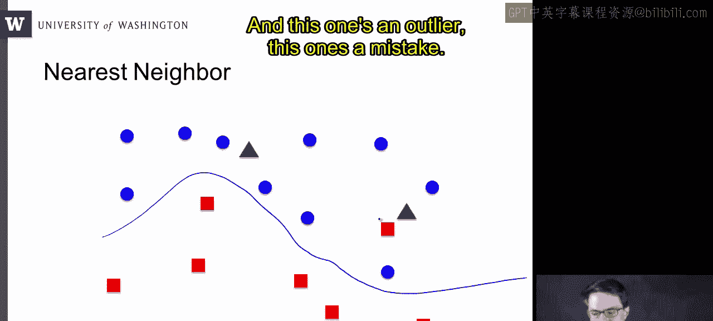

#  052：最近邻分类法 🧭


在本节课中，我们将要学习一种名为“最近邻分类”的监督学习方法。这是一种直观且简单的分类技术，尤其适用于处理数值型数据。我们将探讨其基本原理、应用场景以及潜在的优缺点。

---

上一节我们介绍了集成方法，如随机森林，它们通过组合多个模型来提升性能并避免过拟合。本节中，我们来看看一种基于完全不同原理的分类方法——最近邻分类法。

最近邻分类法是一种非常简单的算法。其核心思想是：将数据点绘制在一个多维空间中，每个点根据其属性值占据一个位置，并带有类别标签。当需要为一个新数据点分类时，只需将其放入同一空间，并找到距离它最近的已知数据点（即“最近邻”），然后将该最近邻的类别赋予新点。

以下是其工作原理的直观展示：


在上图中，红色方块和蓝色圆圈代表两个不同的类别。当出现一个新的待分类点（绿色三角形）时：
*   第一个绿色三角形距离最近的已知点是蓝色圆圈，因此它被分类为蓝色。
*   第二个绿色三角形距离最近的已知点是红色方块，因此它被分类为红色。

---

### 核心概念与公式

最近邻分类法的核心是计算数据点之间的距离。最常用的距离度量是**欧几里得距离**。

对于两个具有 `n` 个数值属性的点 `p` 和 `q`，其欧几里得距离公式为：

**`distance(p, q) = sqrt( (p₁ - q₁)² + (p₂ - q₂)² + ... + (pₙ - qₙ)² )`**

在代码中，这可以表示为：

```python
import numpy as np

def euclidean_distance(point1, point2):
    return np.sqrt(np.sum((np.array(point1) - np.array(point2)) ** 2))
```

算法步骤可以总结为：
1.  **存储**：存储所有训练数据（特征和标签）。
2.  **计算**：对于一个新的查询点，计算它与存储数据中每个点的距离。
3.  **查找**：找出距离最小的那个点（最近邻）。
4.  **分类**：将该最近邻的标签作为查询点的预测标签。

---

### 方法的优势与局限

了解了基本原理后，我们来看看这种方法的特性。

以下是最近邻分类法的主要特点：

*   **简单直观**：概念易于理解，实现相对简单。
*   **无需训练**：没有显式的模型训练阶段（“惰性学习”），所有计算发生在分类时。
*   **自然处理非线性边界**：可以适应非常复杂的类别边界。

然而，该方法也存在一些明显的局限性：

*   **对噪声敏感**：如上图第二个绿色三角形所示，如果最近邻恰好是一个标注错误或异常点（噪声），就会导致误分类。
*   **计算成本高**：分类时需要计算新点到所有训练点的距离，当数据集很大时，这会非常慢。
*   **需要数值型数据**：距离计算通常要求属性是数值型的。处理分类数据需要额外的转换（如独热编码），有时并不直观。
*   **维度灾难**：在高维空间中，所有点之间的距离可能变得相似，导致算法性能下降。
*   **需要特征缩放**：如果特征的量纲（单位）差异很大，距离计算会被数值大的特征主导，因此通常需要对数据进行标准化或归一化。

---

### 从单邻居到多邻居

为了克服对单个噪声点的敏感性，一个常见的改进是使用 **k-最近邻** 算法。

**k-最近邻** 算法不只看最近的一个点，而是考察距离最近的 `k` 个点（例如，`k=3` 或 `k=5`），然后通过投票决定新点的类别。这通常能产生更稳定、更鲁棒的结果。选择适当的 `k` 值（通常通过交叉验证确定）是使用该方法的关键。

---




本节课中我们一起学习了最近邻分类法。这是一种基于实例或记忆的学习方法，其核心是通过在特征空间中寻找最近邻来进行预测。我们讨论了其直观的工作原理、基于欧几里得距离的计算方式、以及其简单性背后对噪声敏感、计算效率低等缺点。最后，我们简要介绍了通过使用 `k` 个邻居进行投票来提升鲁棒性的 `k-最近邻` 改进算法。这种方法为处理数值型数据的分类问题提供了一个基础而有效的工具。