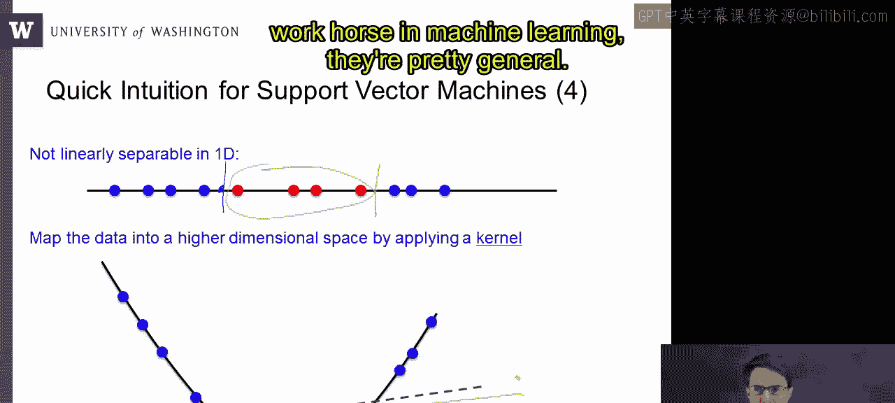

#  060：支持向量机直观理解 🧠

在本节课中，我们将学习支持向量机（SVM）的核心思想。这是一种强大的机器学习算法，用于分类任务。我们将从最简单的线性可分情况开始，逐步探讨如何处理更复杂的非线性问题。

## 概述：什么是支持向量机？

支持向量机的核心目标是在数据中找到一条“最佳”的直线（或超平面），将不同类别的数据点分开。我们将从直观理解入手，逐步构建其概念。

## 线性可分情况

上一节我们介绍了SVM的基本目标。本节中我们来看看最简单的情况：数据是线性可分的。

假设我们有一些数据点，例如红色点和蓝色点，分别代表“幸存”与“未幸存”的乘客。我们的目标是找到一条直线，能将这两类点完全分开。

当然，这样的直线并非总是存在，我们稍后会处理这种情况。但首先，假设它是存在的。

在众多可能的分隔线中，哪一条是最好的呢？直观上，最好的那条线应该位于两类数据的“正中间”。我们如何定义“正中间”？答案是最大化**间隔**。

**间隔**是指分隔线与离它最近的各类数据点之间的距离。支持向量机就是要找到那个**间隔最大**的分隔线。这个“最大化间隔”的思想，可以精确地写成一个数学优化问题，也就是我们之前提到的SVM成本函数。

## 处理噪声与异常值

上一节我们讨论了理想情况。但在现实中，数据可能并非完美线性可分，或者存在一些噪声点。本节中我们来看看SVM如何处理这种情况。

有时，为了用一条直线完美分类所有点，我们得到的间隔会非常窄（如下图虚线所示）。这可能是因为某个点是个**异常值**。

我们可能更愿意接受一个能正确分类绝大多数点、同时拥有更宽间隔的直线（如下图实线所示），即使它错误分类了少数几个点。这引入了**正则化**的概念。

以下是SVM权衡时的核心考量：
*   **最大化间隔**：寻求一个稳健、泛化能力强的分类边界。
*   **最小化分类错误**：尽可能正确分类所有训练数据点。

SVM通过引入**松弛变量**来软化间隔的定义，允许一些点被错误分类或落在间隔内，从而在两者之间取得平衡。这个平衡由正则化参数（通常记为 **C**）控制。**C** 值越大，模型越倾向于正确分类所有点（可能间隔变窄）；**C** 值越小，模型越倾向于保持宽间隔（可能容忍更多错误）。

## 非线性问题与核技巧

上一节我们解决了有噪声的线性问题。但如果数据本身就不是线性可分的呢？例如，在二维空间中，两类点呈环形分布，没有任何直线能分开它们。本节中我们将探索SVM最强大的功能之一：处理非线性问题。

SVM通过**核技巧**巧妙地解决这个问题。其核心思想是：将数据从原始空间**映射**到一个更高维的特征空间。在这个高维空间中，原本非线性可分的数据可能变得线性可分。

考虑一个一维的例子：蓝色点集中在两端，红色点集中在中间。没有任何一个点能分开它们。

但如果我们应用一个变换，例如将每个点 **x** 映射到二维空间 **(x, x²)**，即抛物线上的点，那么在二维空间中，我们就能画一条直线（实际上是原空间中的一个区间）来分开它们。

常用的核函数包括：
*   **线性核**：`K(x, y) = x · y` （就是处理线性情况）
*   **多项式核**：`K(x, y) = (x · y + c)^d`
*   **径向基函数（RBF）核**：`K(x, y) = exp(-γ ||x - y||²)`

通过核函数，我们无需显式计算复杂的高维映射，只需在原空间计算核函数值即可，这大大提高了计算效率。这使得SVM能够处理非常复杂的非线性决策边界。

## 总结

本节课中我们一起学习了支持向量机的核心直观理解：
1.  **基本思想**：寻找最大化分类间隔的最优分隔超平面。
2.  **处理噪声**：通过引入松弛变量和正则化参数 **C**，在“最大化间隔”和“最小化分类错误”之间进行权衡，使模型对异常值更稳健。
3.  **处理非线性**：通过**核技巧**将数据映射到高维空间，从而在高维空间中用线性方法解决原始空间的非线性分类问题。

正是这些特性，使得支持向量机成为机器学习中一个强大且通用的工具。