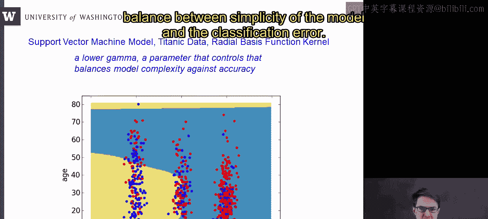

#  061：支持向量机示例 🚢

在本节课中，我们将通过泰坦尼克号数据集的实际例子，来学习支持向量机（SVM）的应用。我们将看到SVM如何学习决策边界，并讨论模型复杂度和过拟合之间的平衡。

---

回到我们的泰坦尼克号示例，我们可以看到支持向量机的一些应用。

下图展示了在此泰坦尼克号数据上学习到的线性支持向量机。我选择的属性是**Pclass**（乘客等级，即船上的头等舱、二等舱、三等舱）和**Gender**（性别）。图中红色代表未幸存，蓝色代表幸存。请注意，为了让红蓝点群更清晰可见，我对数据添加了一些噪声；否则，数据点会完全集中在几个特定位置。

这里，模型找到了一条直接区分男性和女性的直线，并判定这是最佳的线性分类器。这个结果符合直觉。

然而，当我们使用更复杂的核函数时，模型可以学习到更复杂的决策面。例如，模型可能将头等舱和二等舱的女性归为一组，判定她们幸存，同时将三等舱的女性区分开来。

上一节我们看到了线性SVM在简单分类上的应用，本节中我们来看看当选择不同属性时，SVM的表现。

如果我们选择泰坦尼克号数据集中的另外两个属性，例如**Age**（年龄）和**Pclass**（乘客等级），并使用径向基函数（RBF）作为核函数，支持向量机将学习到一个相当复杂的决策面。

同样，图中黄色区域代表预测为幸存，深蓝色区域代表预测为未幸存。模型似乎根据图中少数几个蓝色数据点，在特定区域（如某些年长的二等舱、三等舱乘客）划出了很小的“幸存”区域，甚至为一个非常年长的头等舱乘客也划出了一个孤立的区域。

当你看到如此复杂的决策面，尤其是在数据本身没有明显强烈模式的情况下，这应该让你联想到**过拟合**。模型可能过度捕捉了训练数据中的噪声，而非真正的规律。

因此，和往常一样，我们可以调整这些学习方法的其他参数来避免过拟合。

以下是调整模型复杂度与分类错误之间平衡的关键方法：

*   **正则化参数（如C参数）**：在SVM中，参数C控制着对误分类点的惩罚程度与决策边界复杂度之间的权衡。较小的C值倾向于选择更平滑、更简单的边界（即使这意味着在训练集上犯更多错误），这有助于防止过拟合。
*   **核函数参数（如RBF的γ）**：对于像RBF这样的核函数，参数γ定义了单个训练样本的影响范围。较大的γ值会导致决策边界更曲折，可能围绕每个数据点，容易导致过拟合；较小的γ值则会产生更平滑的边界。

在这个特定的库（Python的Scikit-learn）中，我们可以通过调整这些参数来获得一个更简单、可能具有更好泛化能力的决策边界。这意味着它在预测未知的测试数据时可能会表现更好。

---

本节课中我们一起学习了支持向量机在泰坦尼克号数据上的应用。我们看到了线性SVM与使用核函数的非线性SVM如何生成决策边界，并认识到复杂模型可能带来的过拟合风险。最后，我们了解到可以通过**正则化**等技术来平衡模型的简单性与分类错误，从而获得泛化能力更强的模型。