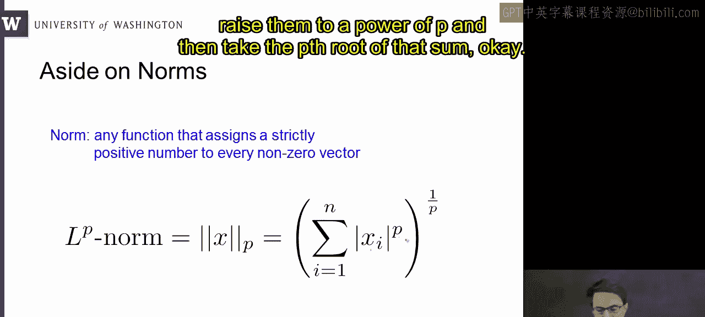

#  062：正则化直观理解 🧠

在本节课中，我们将学习机器学习中一个至关重要的概念——正则化。我们将探讨为什么在模型训练中，尤其是在处理高维数据时，需要引入正则化项，以及它如何帮助我们获得更简单、泛化能力更强的模型。

---

## 高维数据带来的挑战

上一节我们讨论了成本函数，现在我们来谈谈其中的正则化项及其必要性。理解正则化，首先要理解高维数据带来的问题。

想象一下图像分类任务。图像中的每个像素都可能是一个独立的属性，这意味着模型可能有数百万个属性需要处理。同样，在文本分析中，文档通常被表示为词项的向量，可能存在多达50万个不同的词项，每个词项是否出现在文档中都会对应一个权重。

在拥有如此多属性和权重的情况下，一个常见的问题是它们之间可能存在高度相关性。例如：
*   在文档中，某些词项倾向于同时出现或同时不出现。
*   在图像中，一个像素的颜色通常与其邻近像素的颜色高度相似。例如，绿色草地上的一个像素点，其周围的像素点也很可能是绿色的。

这种相关性会带来一个问题：在模型训练过程中，模型可能会通过给一个像素分配极高的权重，同时给其邻近的、高度相关的像素分配极低的权重来“作弊”。这样，它们的效果会相互抵消，虽然成本函数（误差）没有显著改善，但模型的权重却发生了剧烈且不稳定的变化。

本质上，模型变得过于复杂，并过度“记忆”了训练数据中的特定噪声，而没有学到真正通用的规律。这样的模型在训练集上可能表现良好，但在未见过的数据上（即泛化时）表现会很差。

---

## 正则化的作用：偏好简单模型

为了解决上述问题，我们需要一种机制来引导模型。其核心思想是：在其他条件相同的情况下，我们更倾向于选择更简单的模型。有时，即使这意味着模型会在某些数据点上犯错，我们也愿意接受，因为简单的模型通常比那些过度拟合特定数据集的复杂模型具有更好的泛化能力。

正则化项正是提供了这种平衡。它被添加到成本函数中，用于惩罚过大的权重值，从而鼓励模型保持权重较小、结构更简单。

---

## 理解范数：衡量“大小”的工具

在深入正则化公式之前，我们先快速了解一下“范数”的概念。范数是一个函数，它为输入（通常是一个向量）分配一个正数，并且只有当输入本身为零向量时，输出才为零。

最常见的两种范数是L1范数和L2范数：
*   **L2范数**（欧几里得范数）：计算向量各元素平方和的平方根。公式为：
    `||w||₂ = √(w₁² + w₂² + ... + wₙ²)`
*   **L1范数**（曼哈顿范数）：计算向量各元素绝对值的和。公式为：
    `||w||₁ = |w₁| + |w₂| + ... + |wₙ|`

更一般地，我们可以定义**LP范数**。其公式如下：
`||w||ₚ = (∑ᵢ |wᵢ|ᵖ)^(1/p)`
其中，`p`是一个大于等于1的实数。当`p=1`时，就是L1范数；当`p=2`时，就是L2范数。

在正则化中，我们通常使用权重向量`w`的范数（如L1或L2）作为惩罚项，乘以一个称为**正则化参数（λ）** 的系数，然后将其加到原始的成本函数上。这样，模型在试图最小化预测误差的同时，也必须尽量保持权重向量“小”（根据所选范数的定义）。

---

## 总结

本节课中，我们一起学习了正则化的核心思想。我们了解到：
1.  高维数据中属性间的相关性可能导致模型权重不稳定和过拟合。
2.  正则化通过在成本函数中增加一个惩罚项，来引导模型偏好更简单、权重更小的解决方案。
3.  范数（尤其是L1和L2范数）是衡量向量“大小”或“复杂度”的数学工具，被用作正则化惩罚项的基础。

通过引入正则化，我们能够在模型的复杂度和对训练数据的拟合度之间取得平衡，从而构建出泛化能力更强、更稳健的机器学习模型。