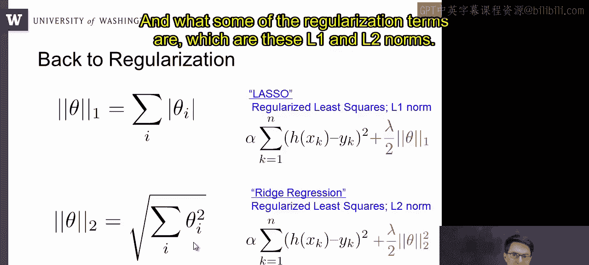

#  063：正则化与成本函数直观理解

在本节课中，我们将要学习机器学习中的两个核心概念：成本函数和正则化。我们将探讨如何量化模型的预测误差，以及如何通过正则化技术来防止模型过于复杂，从而避免过拟合。

---

## 成本函数：衡量预测误差

上一节我们介绍了模型预测的基本概念，本节中我们来看看如何量化预测的准确性。我们通过一个称为“成本函数”的单一数值来总结模型所犯的错误。

以下是几种常见的成本函数：

1.  **简单误差和**：`总误差 = Σ(预测值 - 真实值)`。这种方法通常不理想，因为正负误差可能会相互抵消，使模型看起来表现很好，但实际上并非如此。

2.  **平均绝对误差（L1范数）**：`MAE = (1/n) * Σ|预测值 - 真实值|`。这种方法认为，一个数据点上7个单位的误差，与七个数据点上各1个单位的误差是同等严重的。

3.  **均方误差（L2范数）**：`MSE = (1/n) * Σ(预测值 - 真实值)^2`。这种方法通过平方来放大较大的误差。例如，一个7单位的误差相当于49个1单位的误差（在不考虑开方的情况下）。我们有时会除以数据点数量`n`，甚至除以2，来计算每个数据点的平均平方误差，这有助于比较不同数据处理方法的效果。

简单误差和不是一个好的成本函数，因为它可能产生负数，也不符合“范数”的定义。而L1和L2范数能将误差映射为正数，因此在各种场景中都有广泛应用。

---

## 正则化：控制模型复杂度

了解了如何衡量误差后，我们回到正则化的主题。正则化的核心思想是在成本函数中增加一个“惩罚项”，以控制模型的复杂度，防止过拟合。

在机器学习文献中，使用不同的范数作为惩罚项对应着不同的技术：

*   **L1正则化（如Lasso回归）**：在成本函数中增加模型参数绝对值的和作为惩罚项，即 `惩罚项 = λ * Σ|θ_i|`。这意味着参数值（无论正负）过高都会增加总成本，从而激励优化过程保持参数值较小。
*   **L2正则化（如岭回归）**：在成本函数中增加模型参数平方和作为惩罚项，即 `惩罚项 = λ * Σ(θ_i)^2`。它同样会对过大的参数值施加惩罚。

有时你也会看到使用L2范数的平方（即直接求和，不开方）作为惩罚项。关于这些选择对不同类型问题的影响，已有大量研究。我们在此不深入细节，但希望你能够理解正则化的核心直觉：**通过惩罚复杂模型来避免过拟合**，就像我们在支持向量机中看到的复杂决策面一样。

---

本节课中我们一起学习了成本函数的作用，它用于量化模型误差；以及正则化的原理，它通过L1或L2范数惩罚项来限制模型复杂度，是防止模型过拟合的关键技术。