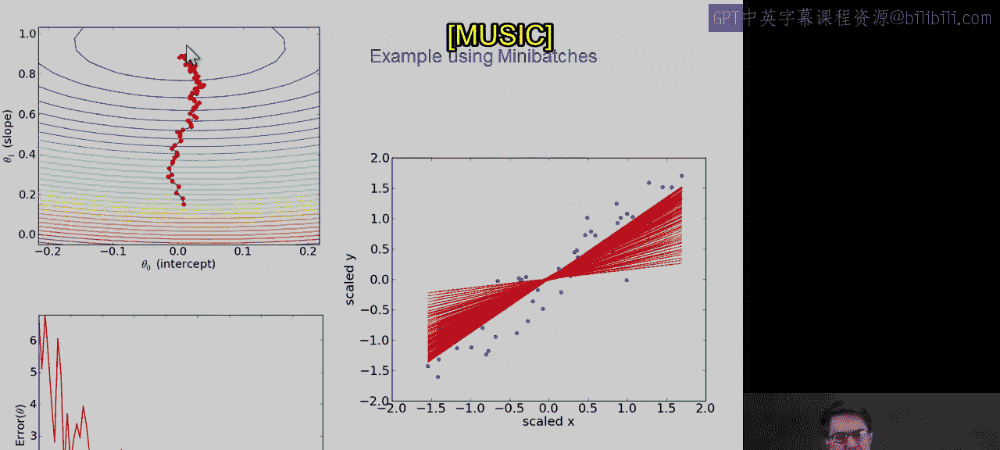

#  064：随机与批量梯度下降

在本节课中，我们将学习梯度下降算法的两种重要变体：随机梯度下降和批量梯度下降。我们将探讨它们如何工作、各自的优缺点，以及它们如何帮助处理大规模数据集。

---

## 梯度下降回顾

上一节我们介绍了梯度下降的基本概念。它是一种通过迭代调整参数来最小化损失函数的优化算法。其核心更新公式如下：

**参数更新公式：**
`θ_new = θ_old - α * ∇J(θ)`

其中：
*   `θ` 代表模型参数。
*   `α` 是学习率。
*   `∇J(θ)` 是损失函数 `J` 关于参数 `θ` 的梯度。

在标准（批量）梯度下降中，每次迭代都需要计算整个训练数据集的梯度。这对于大规模数据集来说计算成本非常高。

---

## 随机梯度下降

为了应对大规模数据，我们引入随机梯度下降。其核心思想是：不再使用整个数据集来估计梯度，而是每次迭代随机选取**一个**数据点来计算梯度。

以下是随机梯度下降的基本步骤：

1.  随机打乱训练数据集。
2.  对于数据集中的每个样本（或每次迭代）：
    *   使用当前参数计算该单个样本的损失梯度。
    *   根据这个梯度更新参数。

**单样本更新公式：**
`θ_new = θ_old - α * ∇J_i(θ)`
其中 `∇J_i(θ)` 是仅基于第 `i` 个数据点的梯度。

这种方法计算速度极快，但梯度估计基于单个数据点，因此**噪声很大**。参数更新的路径不会直接指向最小值，而是会“曲折”前进，收敛过程可能不稳定。

---

## 小批量梯度下降

随机梯度下降和批量梯度下降是两个极端。一个折中的方案是小批量梯度下降。

在小批量梯度下降中，每次迭代我们随机选取一个**小的数据子集**（即一个小批量），并用这个子集来计算梯度。

**小批量更新公式：**
`θ_new = θ_old - α * ∇J_B(θ)`
其中 `∇J_B(θ)` 是基于当前小批量 `B` 的梯度。

这种方法结合了两种方法的优点：
*   **计算效率**：比使用整个数据集快。
*   **稳定性**：比单样本的梯度估计更稳定、噪声更小。

选择合适的小批量大小是一个重要的超参数，需要在速度和稳定性之间取得平衡。

---

## 算法比较与可视化

让我们通过一个简单的例子来直观感受这三种方法的差异。

假设我们的目标是找到二维空间中的一个最低点（最优参数）。

*   **批量梯度下降**：路径通常平滑、直接地朝向最低点。
*   **随机梯度下降**：路径曲折，像“醉汉走路”一样在最低点附近徘徊，最终收敛。
*   **小批量梯度下降**：路径的噪声和曲折程度介于两者之间，具体取决于批量大小。

需要注意的是，学习率 `α` 的选择对所有方法都至关重要。过大的学习率可能导致算法在最低点附近震荡甚至发散。

---

## 并行化的挑战

我们之前讨论过，现代的可扩展性关键在于**并行化**。然而，标准的梯度下降及其变体本质上是**顺序的**。

问题在于每次迭代的参数更新都依赖于前一次迭代的结果：
`θ_(t+1) = f(θ_t, data)`

这种迭代间的依赖关系使得并行化变得困难。你不能简单地同时计算多个迭代，因为后面的计算需要前面的结果。如何有效地并行化梯度下降是当前研究的一个重要领域，通常涉及参数服务器、模型平均等更复杂的架构。

---

## 总结

本节课中我们一起学习了梯度下降算法的两种关键变体：
1.  **随机梯度下降**：每次使用单个数据点更新参数，计算快但噪声大。
2.  **小批量梯度下降**：每次使用一小批数据，在计算效率和稳定性之间取得了较好的平衡。

我们了解到，这些变体主要是为了**性能优化**，以应对无法一次性处理整个大数据集的情况。它们从编程角度看是简单的变体，但在数学和统计特性上有所不同。最后，我们指出了这些顺序算法在面向大规模并行计算环境时所面临的挑战。