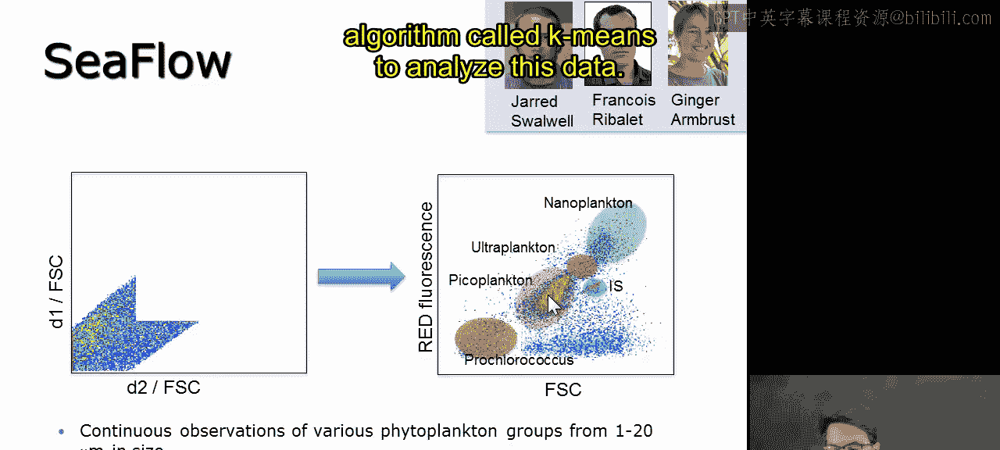

#  066：无监督学习简介 🧠

在本节课中，我们将要学习无监督学习的基本概念，特别是聚类分析。我们将了解它与之前讨论的监督学习有何不同，并通过一个海洋微生物监测的实际案例来理解其应用。

---

## 概述

到目前为止，我们已经涵盖了机器学习这一广阔领域中一些精选的主题。具体来说，我们讨论了**监督学习**。我们学习了作为某些假设表示的**规则和树**，探讨了通过**集成和提升**将一组弱学习器组合成强学习器的方法，并介绍了**梯度下降**这一优化技术及其应用，以及如何通过**随机梯度下降**来加速，并实现并行化。

现在，我们将转向**无监督学习**中的几个精选主题。这同样是一个非常广阔的领域，我们只介绍数据科学家应该熟悉的几个主题，这远非对整个领域的全面覆盖。

---

## 什么是无监督学习？

如果我们根据反馈来源将机器学习分为四类，那么**无监督学习**可能是其中最突出的一类。我们之前只讨论过监督学习，但你可以思考所有这四类。

*   在**监督学习**中，学习的反馈明确地来自数据。
*   在**强化学习**中，反馈由环境提供（例如控制理论中保持飞机飞行）。
*   在**博弈论**中，反馈来自系统中的其他参与者（游戏中的其他玩家）。

但在**无监督学习**中，**没有反馈**。因此，你只是在数据本身中寻找模式，并尝试加以利用。

---

## 无监督学习的核心

几乎所有的无监督学习工作都可以被视为**学习数据的概率模型**。

无监督学习的应用包括：
*   **异常检测**：例如，判断工厂运行是否正常。
*   **聚类**：这与我们讨论过的分类不同，因为没有类别标签。你可能会发现相似的物品组，然后当新物品出现时，你可以判断它与之前发现的哪个组最相似，从而将其归类到该组中。
*   **压缩与通信**：例如，与其发送序列“A, B, A, B, A, B, A, B”，不如发送“A B”并重复七次，这是该字符串更短的表示形式。

在所有情况下，我们都是在识别描述数据的模式，然后将其用于各种服务。

---

## 聚焦：聚类分析

接下来，我们将重点讨论**聚类分析**。这绝不是无监督学习的唯一形式，但你会经常遇到它。另一个常见形式是**降维**，但我们不会花太多时间讨论。

在聚类分析中，或许没有关于“簇”的精确定义，这也是为什么针对不同场景有各种不同算法的原因之一。但输出通常是相同的：**一组数据项集合**。

这些数据项可能是某个多维空间中的点，你的目标是**根据相似性对它们进行分组**。或者，数据项可能是图中的顶点，你的目标是找到比其它社区联系更紧密、协作更密切或交流更频繁的**社区**。在这里，你通过观察图的边结构来识别簇，但输出仍然是相同的：**一组项的集合**。

---

## 实际案例：海洋微生物监测

让我举一个与华盛顿大学海洋学家合作的例子。他们使用了一种名为“海流”的设备，借鉴了流式细胞术的技术，并将其用于环境监测。

在医学应用中，流式细胞术是一种诊断工具，其原理是获取患者的血液或血浆等颗粒物质样本，让颗粒单列通过毛细管，用光照射，通过颗粒的吸收和折射模式来判断它是哪种病原体。在这些应用中，你通常寻找的是少数几种已知的生物，并且环境是受控的实验室环境。

而这些研究人员从头开始开发了自己的设备，将其加固并倒置安装在远洋船只的底部，以实时获取连续的、标记的颗粒流，这些颗粒代表了公海的微生物种群。这是一个完全未知的领域。除了非常稀疏的直接采样数据，几乎没有真实的地面测量数据。

这项工作的一个挑战是：在实验室中，颗粒是单列通过的，但在这里，他们稍微扩大了管道，允许多个颗粒同时通过，因为在水下、船只运动的情况下，实现单列通行的工程难度太大。因此，必须在数据分析中弥补工程上的不足，因为现在的数据噪音更大。

当光线穿过颗粒流时，会被两侧的各种检测器收集。最初有两个检测器用于帮助识别哪些颗粒在流中心，哪些在边缘，以便过滤掉边缘的颗粒。然后还有其他检测器用于不同波长的光。

首先，你可以过滤数据，只关注位于流中心的颗粒。然后，你可以开始检查不同波长，以识别代表不同微生物种群的簇。例如，我们观察纳米浮游生物、微型浮游生物和微微型浮游生物的大小，这些不同种群的一些吸收和折射模式是已知的。但在数据流中，你仍然需要找出这些簇是什么。

因此，他们应用了一种聚类算法，这是一种非常流行的聚类算法——**K均值**的变体，来分析这些数据。接下来，我们将讨论K均值算法。

---

## 总结

本节课中，我们一起学习了无监督学习的基本概念，特别是聚类分析。我们了解了它与监督学习的区别，看到了它在没有明确反馈时如何从数据中发现模式，并通过一个海洋微生物监测的实际案例，理解了聚类在真实世界数据分析中的应用。下一节，我们将深入探讨K均值聚类算法的原理。