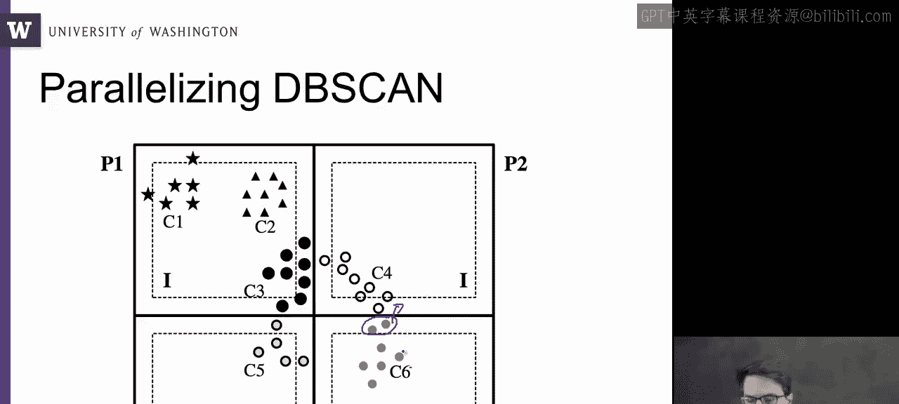

#  069：可变密度与并行算法

在本节课中，我们将探讨DBSCAN算法在处理可变密度数据时面临的挑战，以及如何通过并行化来提升其处理大规模数据的效率。我们还将通过可视化对比，总结DBSCAN与其他聚类算法的优势。

## 可变密度挑战

上一节我们介绍了DBSCAN的基本原理，本节中我们来看看它在处理密度不均匀的数据集时可能遇到的问题。

例如，下图与我们之前在统计学部分为说明异方差性而生成的图实际上是相同的，但我在此处和彼处删除了部分数据。现在，在我们看来，这里似乎应该有三个簇，对吗？一个在这里，一个在这里，还有一个在这里。

然而，考虑到DBSCAN对参数 **epsilon** 的敏感性，我们应如何定义 **epsilon** 呢？是定义一个较小的 **epsilon**（大约相当于此处的距离）以便轻松检测这个簇，还是定义一个稍大的 **epsilon** 以便捕获这些类型的簇？如果不加注意，这里我实际上调整了数据，使用较大的 **epsilon** 可能没问题。但如果不小心，此处的密度区域可能与这两个簇之间的距离相当，在这种情况下，**epsilon** 的微小变化可能导致整个数据集被归入一个簇。

因此，根据所在区域考虑使用**自适应的 epsilon** 值，可能是值得思考的方向。

## 并行化DBSCAN

与K-Means类似，我们也可以思考如何并行化DBSCAN。这里需要指出的一个关键技巧是，必须处理每个簇（或更准确地说，每个数据分区）周围的**边界区域**。

以下是并行化的基本思路：

1.  将数据空间划分为多个区域，例如分配给四个不同的处理器。
2.  在每个处理器负责的内部区域，可以照常运行DBSCAN。
3.  当处理接近该处理器负责区域的边界时，需要进行仔细的记录。

所有位于此边界区域内的点都需要发送给相邻的处理器进行比较，以判断是否需要将簇C4和C6重新标记为同一个簇，即判断这两个簇是否通过 **epsilon** 距离内的点相连。

各个处理器会独立地发现其区域内的簇，但在合并结果时，一些簇会被融合。这个过程实际上可以通过一系列MapReduce作业来表达。虽然不深入细节，但几年前这里的一位学生已经完成了一些工作来描述和分析此算法。

## 算法对比与总结

最后，我们通过scikit-learn Python库网站上一张精彩的图片来总结，它展示了各种聚类算法之间的差异。我们只讨论了其中的两种：K-Means和DBSCAN（MiniBatch K-Means是K-Means的在线版本，一次使用一个批次来更新中心点）。

你可以在此看到一些算法的优缺点。在这些公认具有挑战性的问题中，K-Means的表现实际上并不出色：
*   在第一个例子中，你可能认为内圆是一个簇，外圆是第二个簇，但K-Means根据初始条件的不同，并不总能得到正确结果。
*   在第二个例子中，两个簇在空间上有所重叠，如果初始条件不好（例如选在这两个簇之间），可能会将它们全部归入同一个簇。
*   在第三个例子中，只要初始点分别位于上方和下方，最终可能会收敛到这两个簇。

与此同时，DBSCAN的表现如下：
*   在第一个例子中，从此簇到彼簇的跳跃距离大于 **epsilon**，因此它会做出看似正确的判断：将内圆归为一个簇，外圆归为另一个簇。
*   在第二个和第三个例子中，簇间的距离足够大，DBSCAN能够正确识别。
*   在第四个有噪声的例子中，DBSCAN将所有点归入同一个簇，这在我们看来可能是正确的做法。

因此，这里最重要的启示是，至少在这四个挑战性问题中，**DBSCAN在每种情况下都做出了正确的判断**。所以，它是一个值得熟悉的好算法。

本节课中我们一起学习了DBSCAN在处理可变密度数据时的局限性、其并行化的核心思想，并通过与K-Means的对比，总结了DBSCAN在应对非球形、密度不均和含噪声数据时的鲁棒性优势。