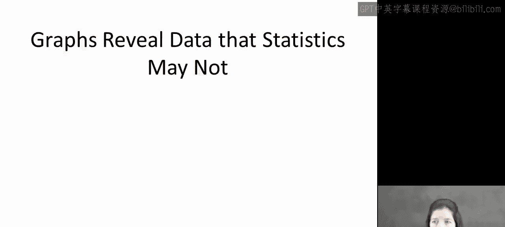
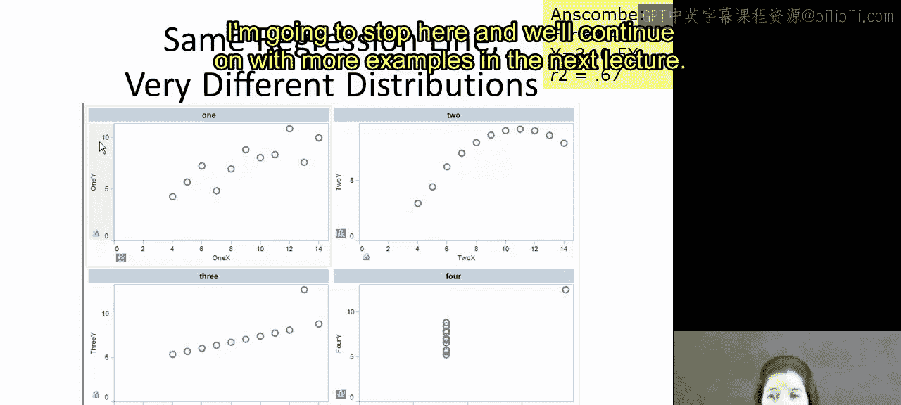

#  071：激励示例 📊

在本节课中，我们将通过几个具体的例子，探讨数据可视化在揭示数据深层含义、发现统计模型可能忽略的模式方面的重要作用。我们将从简单的表格数据开始，逐步展示可视化如何更高效地传递信息。

## 从表格到图形：效率的飞跃

历史上，可视化的首要用途可能是从数据中提取知识。假设我们有一个包含50行数据的表格，每一行代表美国的一个州。每行有三列数据：州名、该州大学毕业生百分比以及人均收入。

以下是关于此数据可能提出的问题：
*   哪个州的收入最高？
*   收入与教育水平之间是否存在关联？
*   数据中是否存在异常值或趋势？

显然，所有数据都已呈现在表格中。通过仔细查看，可以找出最高和最低的数字，并回答所有问题。但这是理解这些数据最高效的方式吗？

## 散点图的威力

以下是另一种呈现数据的方式——散点图。X轴代表人均收入，Y轴代表大学学位百分比。

通过观察散点图，哪个州收入最高的问题瞬间得到解答：康涅狄格州拥有最高的人均收入。同样明显的是，人均收入与大学学位百分比之间存在正相关趋势。此外，图中还显示了一些有趣的异常值，例如内华达州，它的人均收入相对较高，但大学毕业生比例却很低。

两种形式都呈现了所有信息，但视觉呈现方式在向人脑传递含义方面效率要高得多。

## 人脑：卓越的模式识别工具

此时可能产生一个疑问：所有这些信息不是可以通过统计程序分析数据更容易地获得吗？可以找到最大值、最小值，也可以计算回归线。

然而，事实证明，人脑是我们拥有的最佳模式匹配工具之一。迄今为止，在检测数据模式方面，人脑仍然优于我们最复杂的机器学习算法。

那么，一个直接的问题是：为什么不直接使用统计程序找出最小值、最大值和趋势线，而要费心进行可视化呢？

## 图表揭示统计可能忽略的信息

答案很简单：图表能揭示统计可能无法揭示的数据。

这里有一个著名的例子——安斯库姆四重奏。这里有四个小型数据集，通过观察可以看出它们彼此差异很大。但它们却拥有完全相同的线性模型，即相同的均值和相同的趋势线。

同样，这些数据也可以以表格形式呈现。但通过观察图表，我们能了解到关于这些数据集的更多信息。尽管它们拥有相同的均值和回归线，但这些数据集本身却截然不同。因此，统计可能无法告诉我们关于特定数据集的一切。

我希望这些例子能激发你对接下来一系列幻灯片内容的兴趣。本节课就到这里，我们将在下一讲中继续探讨更多示例。

## 总结

本节课我们一起学习了数据可视化的核心价值。我们通过对比表格与散点图，看到了可视化在快速揭示数据趋势、关联和异常值方面的高效性。同时，通过安斯库姆四重奏的例子，我们认识到可视化能够揭示单纯统计摘要（如均值、回归线）所无法体现的数据深层结构和模式，这凸显了人脑在模式识别中的独特优势，以及将可视化作为数据分析关键环节的重要性。