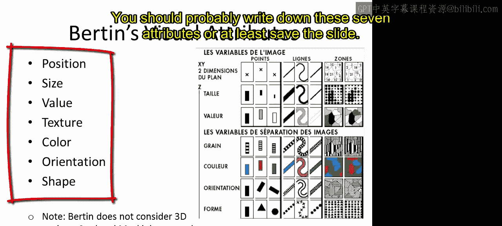
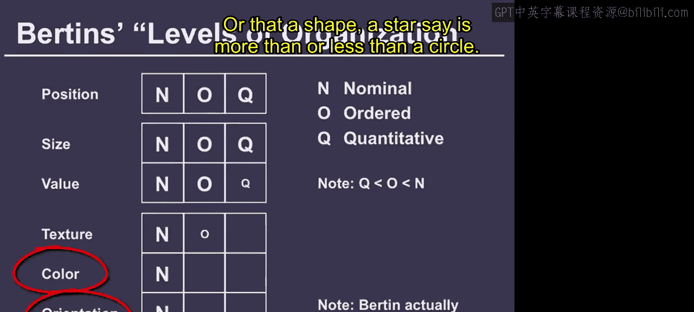
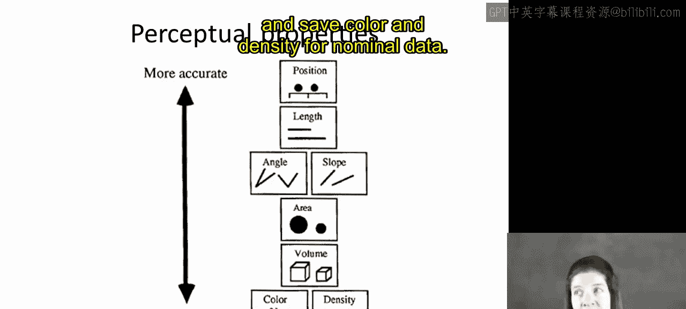
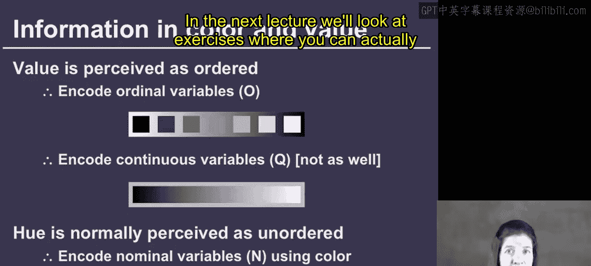

大规模数据科学（预测分析，交流数据科学结果）：第2课：将数据类型映射到视觉属性

在本节课中，我们将学习信息可视化流程的第二步：如何将不同的数据类型映射到合适的视觉属性上。我们将介绍视觉属性的分类，并探讨如何根据数据特性选择最有效的视觉编码方式。

上一节我们完成了信息可视化的第一步——理解数据类型。本节中我们来看看如何将这些数据类型映射到具体的视觉属性上。

在1967年，法国制图师Jacques Bertin首次形式化了视觉语言，并为信息可视化奠定了理论基础。他识别出了七个关键的视觉属性，这些属性在页面的右侧以0维、1维和2维的形式进行了图示。

以下是这七个关键视觉属性：
*   **位置**
*   **大小**
*   **明度**
*   **纹理**
*   **颜色**
*   **方向**
*   **形状**

这是一个重要的知识点，建议你记下这七个属性或保存此幻灯片。

---

现在我们已经了解了数据类型的分类和视觉属性的分类，接下来讨论如何将两者对应起来。Bertin提供了以下建议，他认为可以根据组织层级来考虑映射关系。

以下是Bertin提出的映射建议：
*   **位置**可用于表示**定类**、**定序**或**定量**数据。
*   **大小**同样可用于表示**定类**、**定序**或**定量**数据。
*   **明度**可用于表示**定类**或**定序**数据，或许也能用于**定量**数据，尽管效果不那么明确。
*   **纹理**可用于表示**定类**数据，或许也能用于**定序**数据（例如，更密集的纹理可能被视为比稀疏的纹理具有更高的顺序）。
*   **颜色**、**方向**和**形状**基本上只能用于表示**定类**数据。我们很难说一种颜色比另一种颜色“更大”，或者一个方向比另一个方向“更小”，也无法判断一个星形比圆形“更多”或“更少”。

---

后续数十年在心理学和心理物理学领域的研究，进一步确立了人类感知属性的层级关系。

人类对以下属性的差异检测准确性从高到低排列如下：
1.  **位置**
2.  **长度**
3.  **角度与斜率**
4.  **面积**
5.  **体积**
6.  **颜色与密度**（最不精确）

因此，当你为数据分配视觉属性时，请确保将**位置**用于最重要的**定量**数据，而将**颜色**和**密度**留给**定类**数据使用。

---

关于颜色最后需要注意一点。**明度**可以被感知为有序的，因此可以用来编码**定序**变量。换句话说，你看到从黑到白的色带，其明度在增加，你能看出这些颜色之间存在顺序。

你甚至可以用灰度映射来编码**连续**值，尽管效果不是最佳。其映射关系可以表示为：
`灰度值 = f(数据值)`

但是，**色相**通常被感知为无序的，因此你应始终只用颜色（色相）来编码**定类**变量。幻灯片底部的颜色之间没有顺序关系。

---

本节课中我们一起学习了信息可视化的核心问题——如何将数据类型映射到视觉属性。我们回顾了Bertin提出的七种关键视觉属性，探讨了它们与不同数据类型的适用关系，并了解了人类感知的精确度层级。记住，为最重要的定量数据优先选择位置编码，而为定类数据保留颜色编码。

在下一讲中，我们将通过练习来实际应用这些理论。