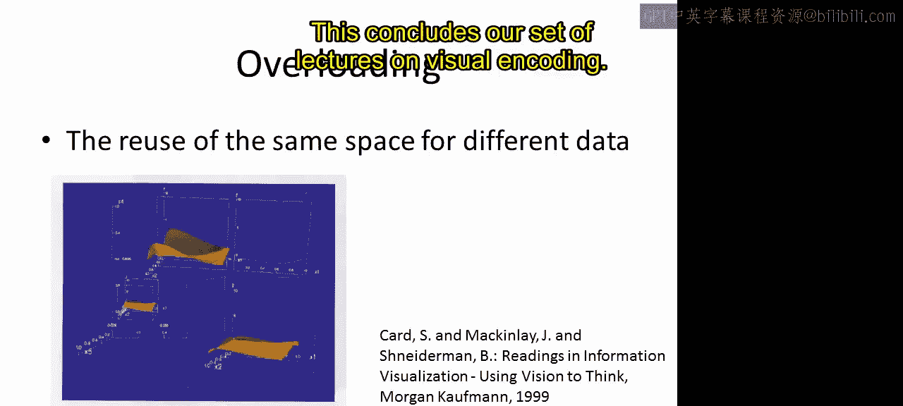

#  079：视觉编码的设计标准 🎨

在本节课中，我们将学习如何通过有效的视觉编码来呈现数据。首先，我们会通过两个快速练习来理解数据呈现的重要性，然后深入探讨五种关键技术，以增加通过空间位置所表示的信息量。

---

上一节我们介绍了有效视觉编码的重要性。现在，我们来看一个具体的例子。

请观察这两种定量数据的呈现方式。上方图表使用颜色来表示数据，而下方则是一个折线图。

为什么折线图比颜色图更好？你应该已经知道，折线图的解读速度更快。仔细观察后，你会发现折线图能展示更多的细节区别，定量信息也呈现得更清晰，并且解读时出错的概率更低。这很简单。

那么，这是否是一个有效的视觉呈现呢？答案是否定的。问题在于，这种视觉呈现方式不具有表现力，因为它暗示了国家之间一种错误的顺序关系。

---

我们已从人类感知的研究数据中得知，空间位置是表示定量数据最准确的方式。那么，我们如何利用这一事实呢？

在1999年，Car McKinley 和 Schneiderman 提出了五种技术，以增加通过空间位置编码的信息量。以下是这五种技术：

1.  **组合**
2.  **对齐**
3.  **折叠**
4.  **递归**
5.  **重载**

接下来，我们将逐一详细讲解这些技术。

---

**组合** 指的是坐标轴的正交放置。通过创建一个二维度量空间，你可以用多种不同的方式沿X轴和Y轴排列数据。

**对齐** 指的是在同一空间的不同位置重复使用同一个坐标轴。例如，你可以看到相同的时间轴在两个位置重复出现，但Y轴上呈现的是两组不同的信息图表。

**折叠** 是指在一个正交维度上延续某个坐标轴。

**递归** 是指对空间进行重复细分。

最后，**重载** 是指为不同的数据重复使用相同的空间。

---

本节课中，我们一起学习了视觉编码的核心概念。我们通过练习认识到清晰表达的重要性，并详细探讨了五种利用空间位置增强信息呈现的技术：组合、对齐、折叠、递归和重载。

下一组课程，我们将转向视觉感知的探讨。