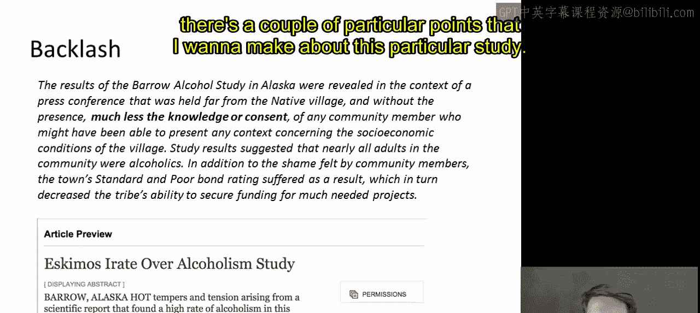

#  084：巴罗酒精研究 🧭

在本模块中，我们将探讨伦理与隐私问题。与专项课程中的许多主题一样，这个主题本身足以构成一门完整的课程。但正如我们处理其他主题的方式一样，我们将尝试概述该领域的重要概念。我们将通过现实世界的例子来引出讨论，并对一些特别重要的概念进行技术性深入探讨，以确保您对其使用和应用有直观的理解。我们希望这能激发您的兴趣，鼓励您去选修关于大数据和数据科学伦理与隐私的完整课程，这类课程正开始大量涌现。我们已经对数据库、大规模数据管理系统、机器学习、统计学和可视化进行了类似的处理，现在我们将尝试处理这个主题，挑选我们认为与课程主题相关且我个人感兴趣的内容。

我想从一个相当久远的研究开始，那是1979年在阿拉斯加巴罗进行的一项研究。

巴罗是美国最北端的城市。这是一个乡村社区，从放大的镜头中您可以看到该地区的湖泊。这是一个美洲原住民社区，几千年来一直以捕鲸为生。自第一次世界大战以来，该地在短时间内经历了重大的经济变化。当地原住民领袖和市政官员对社区内的酒精使用及其相关的暴力问题感到担忧，于是邀请了一组社会学研究人员来评估问题并共同制定解决方案。

以下是使用的方法：一个研究团队进入社区，收集了15岁以上人群的代表性样本。不过，我们稍后会提到，他们特别针对了原住民社区。他们采访了受访者对酒精使用的态度和价值观，包括心理历史，并让他们完成了一个先前设计的标准化酒精中毒筛查测试，还要求他们画一幅人物画，旨在确定文化身份。如果您以某种风格绘画，则表明您来自特定社区的视角；如果以另一种风格绘画，则来自另一个特定社区。这是当时被接受的一种方法。

研究结果的具体数字并不特别重要，您可以查阅相关资料，但总体影响是那里的酗酒问题相当严重，酒精的广泛使用和滥用带来了相关问题。

然而，我之所以要提及这项研究，更多是因为其发布方式以及研究进行的整体背景，以此来引出一些伦理考量。具体来说，这项研究的结果以两种形式同时单方面地公开宣布：一份报告被发布，同时举行了一场新闻发布会，面向巴罗社区。关键的是，研究中所反映的部落社区在新闻发布会上也没有代表出席。

这份报告被媒体转载，成为了《纽约时报》的头版新闻，标题为“酒精困扰爱斯基摩人”或“酒精中毒困扰爱斯基摩村庄”。您可以想象其影响。文章中的引述如“实际上正在通过大规模酗酒进行集体自杀，宾夕法尼亚大学的研究人员昨天表示，该村2000名因纽特男女的酗酒率为72%，暴力正成为伤害和死亡的主要原因”。

这项研究对民众的影响是立竿见影的。如果您是巴罗社区或伊努皮亚特部落的成员，您就会与这篇文章中呈现的品牌形象联系在一起，以一种非常公开的方式。

此外，巴罗酒精研究的结果是在远离原住民村庄的地方举行的新闻发布会上公布的，没有任何社区成员在场，更不用说他们的知情或同意，而这些成员本可以提供有关村庄社会经济状况的任何背景信息。

研究结果表明，社区中几乎所有成年人都是酗酒者。除了蒙受耻辱之外，该镇的信用评级也因此受损，进而削弱了部落为急需项目获取资金的能力。这对社区造成了直接的经济损害，即无法获得贷款来进行公共工程项目。

此后出现了一些文章，反映了他们对此事的愤怒以及所遭受的伤害。此外，还有一个微妙的副作用，这也是该研究在医学和社会学伦理界如此知名、常被引为例证的原因之一：研究本身在原住民中声誉不佳，不仅在这个地区，而且在很大程度上是因为这项研究及其他类似研究。因此，研究被描述为“可能是土著世界词汇中最肮脏的词语之一”。

理解这里出了什么问题非常重要。关于这项具体研究，我想提出几个要点。