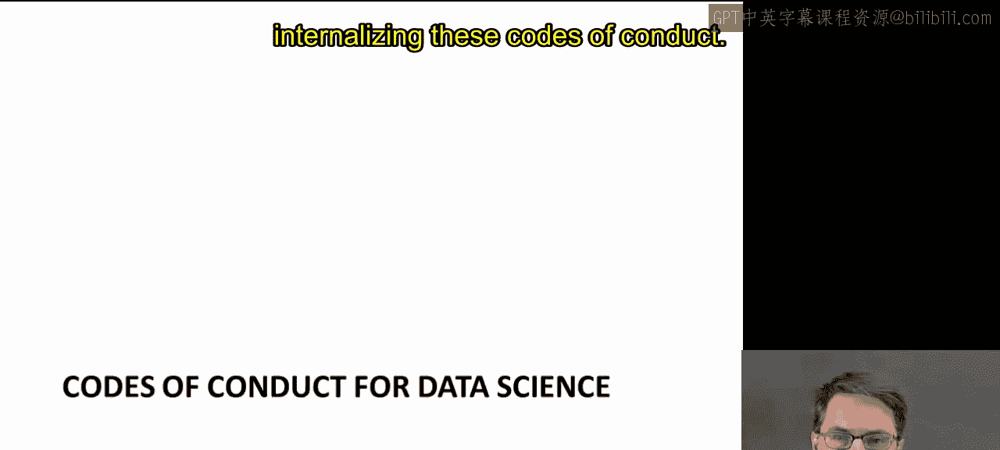

#  085：巴罗研究案例与伦理考量

在本节课中，我们将通过一个具体的研究案例——巴罗研究，来探讨数据科学实践中的伦理问题。我们将分析该研究在方法论和伦理上的缺陷，并讨论如何避免类似的错误，以及为什么伦理考量是数据科学家工具箱中不可或缺的一部分。

---

## 研究中的方法论问题

上一节我们提到了数据科学中伦理的重要性，本节中我们来看看一个具体的反面案例。巴罗研究在方法论上存在明显问题。

一个技术咨询小组（这类研究项目中通常要求设立）曾多次表示担忧，即研究只调查了本地居民，而没有将镇上的外来人员纳入研究范围。

此外，研究试图在“醉酒频率”与“基于关联的被拘留概率”之间建立联系。例如，如果某人通常会被送进监狱，研究者就可以推断其醉酒程度。这种关联至少对一些人来说是没有意义的，并因此受到了严厉的批评。

回到第一点，即只研究了本地居民。这种方法论表明，研究者在设计研究时可能已有一个预设的结论，并围绕证实该**假设**来设计研究。因此，这里可能存在**确认偏误**的渗入。

## 超越方法论的伦理伤害

以上是方法论问题。但这里我想讨论的更微妙的一点是，参与者自始至终都无法控制自己的数据，也无法控制数据被呈现的**上下文**。

正如我提到的，你可以证明具体且重大的伤害，包括社会污名化，甚至是明确且现实的财务困难。

## 如何避免此类问题？

那么，如何避免这种情况呢？如今，当我们思考大数据和隐私时，常听到的是确保不泄露任何个人可识别信息，我们稍后会讨论实现这一点的技术。

但在巴罗研究的案例中，并没有泄露个人可识别信息，对吗？然而，那些根本没有参与研究的人也受到了伤害，仅仅因为他们与被研究的群体有关联——无论是作为该群体的成员、来自那个小镇，还是来自那个部落。

因此，试图将这些隐私问题简化为一个待解决的技术问题，并证明某件事是安全或不安全、私密或不私密、泄露或未泄露，我想说服你，这种思路是**不充分**的。

这正是为什么伦理研究是任何数据科学家工具箱中的重要组成部分。因为必须考虑哪些研究应该做，哪些不应该做。在某个时间点，你需要决定参与哪些项目，你需要具备那种伦理上的“第六感”，在决定项目时能“嗅到”伦理问题。在项目进行过程中，你也必须思考你的行动可能引发何种危险信号，以及谁可能因此受到伤害——即使独立于那些形式上的保证。

仅仅因为你能做某事，并不意味着你应该做。这目前还不是数据科学讨论中的常见部分，但正变得越来越重要，这也是我们在本课程中至少包含一些最低限度讨论的原因。

## 核心要点与过渡

以下是本案例的核心要点：

*   **群体性伤害**：即使没有人真正违反规则，整个群体的人也受到了伤害。
*   **伦理指南的重要性**：这正是为什么伦理指南变得越来越重要。

在下一节中，我们将探讨两个相关主题：一是我们正在讨论的伦理考量中的社会成分，体现为各种组织制定的行为准则；二是技术成分，我们将讨论关于隐私可以做出哪些形式上的保证。

---

本节课中，我们一起学习了巴罗研究案例，它揭示了数据科学项目中可能存在的**确认偏误**和对参与者**上下文**控制的缺失，导致了广泛的群体性伤害。这强调了技术解决方案（如匿名化）的局限性，以及培养伦理意识和遵循行为准则的至关重要性。