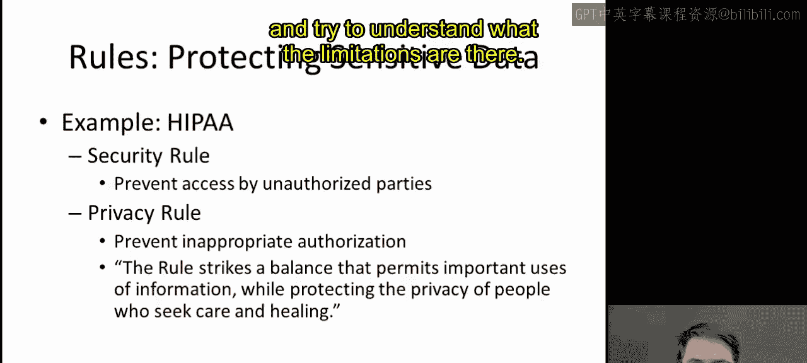

#  089：HIPAA 🏛️

在本节课中，我们将探讨如何将伦理原则具体化为成文规则，并以著名的HIPAA（健康保险携带和责任法案）为例，分析其核心规则、实际应用中的挑战，以及它与更广泛的伦理准则之间的关系。

上一节我们介绍了作为伦理原则具体化的行为准则。本节中，我们来看看另一种将伦理考虑制度化的方式：具体的成文规则。

## 成文规则概述

行为准则主要通过概括性的行为原则来体现伦理考量。尽管其中也包含一些具体规则，但总体而言，它们处于较高的抽象层面。与此同时，也存在一些更为具体的成文规则。

以下是两个知名的成文规则示例：

*   **HIPAA**：该法案立法规定了应如何处理敏感的患者医疗数据。
*   **FERPA**：这是一套关于学生数据（如成绩、个人信息等）的规则。例如，根据FERPA，我不被允许将你的成绩通过电子邮件发送给外部各方，或以其他方式公开它们。

## HIPAA 规则详解 🩺

HIPAA因其与众多领域工作者相关，值得在此层面进行了解。它主要包含两条核心规则。

**安全规则**旨在防止未经授权的各方访问数据。其核心目标是防范外部入侵。

**隐私规则**旨在防止我在此所称的“不当授权”。这意味着，虽然你授予了某人访问权限，但本不应如此。这与安全规则防范无人授权访问的情况不同。

在本课程中，我们不会过多讨论安全，但将重点探讨隐私问题。

## HIPAA 的局限性与挑战 ⚖️

我之所以在此提及HIPAA，并对其持保留态度，是因为它存在一些局限性。HIPAA并未规定任何形式的形式化保证，因此在某些方面留下了模糊性，在其他方面则可能难以实现。

这导致可能出现以下问题：

*   **易于满足法律条文但违背规则精神**：可能存在表面上遵守法律，但实际上违反了规则初衷的情况。
*   **实施困难**：试图构建一个符合HIPAA的系统非常困难，因为很难精确定义“合规”究竟意味着什么。
*   **存在规则漏洞**：我认为，这些漏洞通过行为准则可以得到更好的覆盖。

## 规则、准则与形式化保证的平衡 ⚖️➡️🔬

因此，我的观点是，两个极端层面尤为重要：

1.  **我们能够做出的形式化保证**（这将是下一节的重点）。
2.  **指导我们行为的通用行为准则**。

试图在中间地带通过法律来运作，往往效果不佳，并可能产生以下不良后果：

*   **扭曲的激励**。
*   **规则存在漏洞**。
*   **规则被不必要地应用**。

例如，在HIPAA框架下，存在患者难以获取自身数据以提供给研究人员的情况。即使患者的明确目标是希望自己的数据能帮助尽可能多的研究者，从而可能改善其（例如绝症的）治疗结果，但HIPAA的相关规则反而使这一过程变得更加困难。这显然不是HIPAA规则的初衷，但却是可能发生的现实。

## 课程总结与过渡 🔄

本节课中，我们一起学习了成文规则（以HIPAA为例）如何尝试将伦理原则具体化，并分析了其在实践中的挑战与局限性。我们看到，仅靠具体的法律条文可能不足以全面保障数据隐私与伦理。

因此，接下来我们将探讨如何形式化地定义隐私问题，并尝试理解其内在的局限性。这将帮助我们建立更坚实、可验证的隐私保护基础。