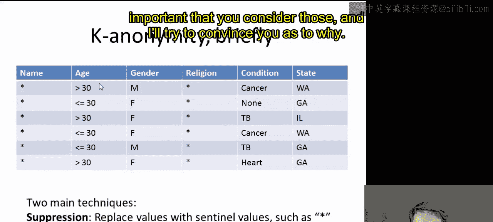

#  090：初步尝试 🔒

在本节课中，我们将探讨数据科学中的隐私保护技术。我们将从社会伦理规范转向技术层面的隐私保证，并重点介绍几种主要的技术方法及其局限性。

上一节我们讨论了以行为准则形式体现的社会伦理与隐私问题。现在，我们来看看技术层面能为隐私保护提供何种保证。

## 技术性隐私保护方法概览

以下是几种主要的隐私保护技术分类：

*   **访问控制**：仅允许特定人员或在特定情况下访问数据。
*   **查询限制**：不直接提供数据，而是通过API提供访问，并谨慎控制用户可以提出的问题类型。
*   **数据扰动**：向数据中添加噪声，以混淆真实信号，防止某些特定问题被准确回答。
*   **安全多方计算**：这是密码学的一个子领域。例如，同态加密允许你在加密数据上执行计算并获得结果，而无需解密数据本身。
*   **匿名化**：尝试擦除数据中的特定信息，以防止某些问题被回答。

我们将重点讨论**访问控制**与**匿名化**这两个方面，并解释为何它们最值得关注。

## 实践中的隐私保护尝试

为了使概念更具体，请思考在实践中如何保护隐私。我们可以控制信息本身的访问、通过API控制信息流，或者在发布数据时尝试控制信息的使用目的。

以下是几种常见的实践方法：

*   **移除标识符**：直接删除如姓名、身份证号等直接标识信息。
*   **实现k-匿名性**：确保数据集中，任何查询都无法将一条记录与至少 **k-1** 条其他记录区分开来。这为个体在至少包含 **k** 个成员的集群中提供了匿名性。公式表示为：对于任意记录，其所在的等价类大小 ≥ **k**。
*   **发布代表性样本**：仅发布整体数据的一个子集，供人们研究。

这些方法试图在**个体隐私**与**数据集整体效用**之间取得平衡。然而，我的观点是：**这些方法都无法绝对保证隐私**。接下来我们将探讨原因。

## 深入理解k-匿名性

首先，为确保你理解k-匿名性，我们简要介绍其核心思想。虽然它引发了大量研究，但最终被证明是一个相当脆弱的概念。

k-匿名性旨在确保无法定位到特定记录，而是将记录保持在至少包含 **k** 个相似或不可区分记录的集群中。主要有两种实现工具：

*   **抑制**：用特定符号（如星号 `*`）替换标识信息，即将其从数据集中删除。
*   **泛化**：将具体值替换为一个范围或类别。

假设我们有一个包含以下字段的数据集：`姓名`、`年龄`、`性别`、`宗教`、`医疗状况`、`所在州`。

为了保护隐私，我们可能会：
1.  抑制 `姓名` 和 `宗教` 字段（用 `*` 代替）。
2.  将 `年龄` 泛化为范围（例如 `>30` 或 `≤30`），使其不再能作为唯一标识符。

通过应用这些技术，我们可能得到一个看似匿名的数据集。但请注意，即使经过处理，`所在州` 和 `疾病` 的组合仍可能唯一识别出个人。这引出了k-匿名性的根本弱点：它通常无法抵御**背景知识攻击**或**多数据集关联攻击**。

本节课中，我们一起学习了技术性隐私保护的几种主要思路，特别是访问控制和匿名化方法，并重点剖析了k-匿名性的基本概念及其内在局限性。我们了解到，简单的标识符移除或数据泛化并不足以构成强大的隐私保证。在后续课程中，我们将探讨更强大的隐私定义和技术。