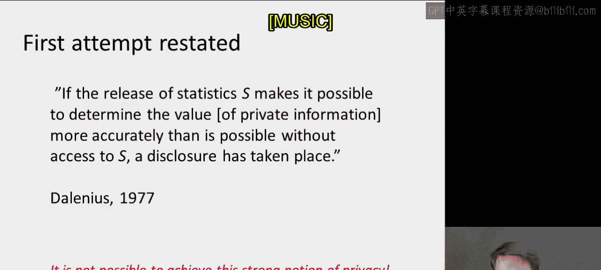

#  092：形式化隐私问题 🔒

## 概述
在本节课中，我们将探讨数据科学中的隐私问题。我们将通过一个真实案例，理解为何简单的数据匿名化方法容易失效，并尝试形式化地定义隐私保护的目标与挑战。

---

## 一个案例：马萨诸塞州州长的医疗记录被识别

上一节我们讨论了数据隐私的一般性问题。本节中，我们来看一个具体案例，它揭示了传统匿名化方法的脆弱性。

拉塔尼亚·斯威尼（Latania Sweeney）进行了一项研究。她首先提出了k-匿名性条件，并对此进行了初步尝试。她试图证明，当时马萨诸塞州团体保险委员会发布的一份关于州雇员的匿名医疗数据（记录了每个人的每次医院就诊信息）是无效的。她想表明，这种匿名化完全无效，要破解它并不困难。

为了证明这一点，她利用了关于马萨诸塞州州长的公开信息。这位州长居住在麻省剑桥市，一个居民不多、只有七个邮政编码的城市。斯威尼花费20美元，从剑桥市购买了完整的选民登记册。这个数据库包含了每位选民的姓名、地址、邮政编码、出生日期和性别等信息。

在剑桥市，只有六个人与州长共享出生日期（这也是公开信息）。在这六人中，只有三人是男性。而在这三名男性中，只有他一人居住在他的邮政编码区域内。

在这个案例中，数据维度实际上相对较低，并不需要查看太多不同的字段。但通过利用公开数据源并结合这些不同的数据集，斯威尼很快就能确定这个人的身份。她将包含其完整医疗历史和就诊记录的信息发送给了他，以证明这一点。

在后续的一些工作中，她进一步表明，邮政编码、出生日期和性别这三项信息，就足以唯一识别大约87%的美国人。因此，识别个人身份并不总是需要高维数据。

---

## 隐私泄露的常见特征与现有方法的局限

正如我们所说，与隐私泄露相关的两个反复出现的特征是：**高维数据**和**独特个体**，以及**结合多个数据集来重新识别这些个体**。

以下是现有隐私保护方法面临的主要挑战：
*   大多数我们提到的方法，甚至只是简要提及的，都没有解决这两个问题。它们不能很好地处理高维数据（尽管可以找到一些处理这个问题的论文）。
*   更重要的是，这些方法对于如何应对结合多个公开数据集的情况，没有太多有效的建议。

原因在于这很难控制。如果你试图设计一个系统或形式化方法来证明隐私保证，你通常需要考虑你的数据、数据的接收者，以及试图进行不当行为的攻击者。但这更像一个封闭系统。如果你必须考虑所有可能的数据、所有你未设计或未控制的其他系统，这个问题就变得有些难以处理。

然而，现实情况是，攻击者确实可以访问这些公开信息。因此，任何不考虑这些因素的方法都不是特别有用。这一点在一段时间后逐渐被理解。

---

## 精确地思考隐私问题

接下来，让我们更精确地思考这个问题。这张幻灯片改编自普渡大学克里斯汀·塔斯克（Christine Task）的讲义，我认为它很好地设定了讨论框架。

我们有一个感兴趣的人群，位于左侧。然后有各种数据源。这些数据源可能是发放的调查问卷，也可能不是。它们可能是为各种目的收集的数据，例如你登录过的不同网站（你向每个网站提供了不同的信息），或者一个是你的医生，另一个是谷歌。这些是不同的数据源，它们拥有你身份的不同方面。

然后，存在一个聚合数据集，它可能有权访问所有这些不同的数据源。我们希望对这个聚合数据进行一些私有化分析，产生一些结果，并与公众分享这些结果。

我们希望保证，或者说我们希望推断，公众随后能从这些结果中推导出关于原始数据源的什么信息，以及他们能推导出关于你的什么信息，他们能学到什么样的信息。这就是我们所处的背景。

我们将使用以下符号：
*   用 **P** 表示整个感兴趣的人群。
*   **I** 是 **P** 的一个子集，代表参与这些数据源的人。有些人从未登录过网站，从未参与过调查，从未做过任何事情，他们属于 **P** 但不一定属于 **I**。
*   **Dᵢ** 是一个特定的数据集或数据源，其中 **i** 属于 **I**。
*   集合 **Dᴵ** 是所有 **i** 属于 **I** 的 **Dᵢ** 的集合。这仅仅是所有数据集的汇总。
*   然后我们说，查询函数 **Q** 作用于 **Dᴵ**，写作 **Q(Dᴵ) = R**，产生某个结果 **R**。

---

## 如何定义隐私问题？

有了上述符号，我们如何定义隐私问题呢？

**第一次尝试**：可以这样想，如果某个可疑公司拥有我的数据，但他们能向我保证，对于任何其他人可能提出的查询，我提供给该公司的数据都不会影响那些查询的结果。换句话说，如果提供我的数据永远不能改变结果，那么对我没有伤害，我也不介意分享数据。

你可以这样形式化这个条件：对于查询 **Q**，在没有我的数据时得到的结果，与包含我的数据时得到的结果完全相等。
`Q(Dᴵ \ {i}) = Q(Dᴵ)`

那么，这个条件可能实现吗？答案是否定的。因为如果我的数据没有影响，那么通过归纳法，任何人的数据都不会有影响，结果将是毫无用处的。如果这个条件成立，那就意味着你可以不断地将人们从数据中移除，并应用相同的等价表达式，直到数据集中没有任何人、没有任何数据为止。显然，你感兴趣的查询必须在空数据集上返回与在任何任意数据集上相同的结果。你无法定义任何能实现这一点的有趣查询。你只能进行常量值查询。实际上，你无法计数、无法聚合、无法做任何有用的事情。因此，这是无法实现的。

**另一种表述**：如果统计结果 **S** 的发布，使得确定私有信息的值比在没有访问 **S** 的情况下更准确，那么就发生了信息披露。这是1977年提出的一个用于保护私有数据的定义。但在我们描述的背景下，不难证明这也是不可能实现的。

---

## 总结
本节课中，我们一起学习了数据隐私的核心挑战。我们通过马萨诸塞州州长的案例，看到了结合低维公开数据即可破解匿名化的现实。我们形式化地描述了数据源、聚合与分析的过程，并探讨了两种早期定义隐私保护目标的尝试（“数据不影响结果”和“不增加推断准确性”），发现它们在提供有用分析结果的前提下都是无法实现的。这为后续寻找更实用的隐私保护模型（如下节课可能介绍的差分隐私）奠定了基础。