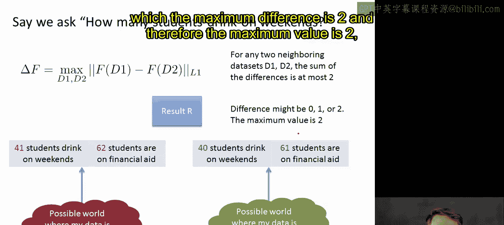

#  094：全局敏感度 📊

在本节课中，我们将要学习一个核心概念——**全局敏感度**。这个概念对于在保护个体隐私的同时，如何安全地发布数据以支持统计分析至关重要。我们将通过简单的例子来理解其定义、计算方式及其重要性。

---

## 概念引入：从单一计数问题开始

假设我们想通过一项调查了解“有多少学生在周末饮酒”。这项调查收集了学生的各种信息，我们希望保护每位学生的隐私，但同时允许研究人员回答这个问题。我们需要找到一种既能发布数据支持此类查询，又能保护隐私的方法。

对于考虑是否参与调查的单个学生而言，存在两种可能的情况：我参与调查，或我不参与调查。

*   如果我参与调查，并且我是一名在周末饮酒的学生，那么总计数将是 **41**。
*   如果我不参与调查，总计数将是 **40**。

因此，在这两种可能情况（即两个数据集）下，这个查询结果的最大差异是 **1**。这里所说的“最大”，是指考虑任何两个**相邻数据集**时的情况。

---

## 定义相邻数据集与敏感度

上一节我们通过一个例子引入了差异的概念，本节中我们来看看其正式定义。

**相邻数据集**指的是两个仅在**一条记录**上存在差异的数据集。这条记录可以是我（或任何其他人）是否被包含在数据集中。

给定一个返回单个数字的查询函数 **f**，其**全局敏感度**定义为：在所有可能的相邻数据集对 **(D1, D2)** 上，查询结果**绝对差值**的最大值。

我们用公式表示如下：

**Δf = max_{D1, D2} | f(D1) - f(D2) |**

其中，D1 和 D2 是相邻数据集。

对于“周末饮酒学生人数”这个计数查询，无论我们考虑哪一对相邻数据集，结果的最大差异始终是 **1**。因此，该查询的全局敏感度 **Δf = 1**。

---

## 扩展：处理多个查询（向量输出）

单一的计数查询并不总是够用。我们通常希望回答一系列问题。此时，查询函数 **F** 返回的不再是一个数字，而是一个**结果向量**（例如，同时查询饮酒人数和获得助学金人数）。

在这种情况下，我们需要衡量两个向量之间的差异。我们使用 **L1 范数**（即曼哈顿距离）来计算：先计算两个结果向量中每个对应元素的绝对差值，然后将所有这些差值相加。

因此，对于返回向量的函数 **F**，其全局敏感度的定义扩展为：

**ΔF = max_{D1, D2} || F(D1) - F(D2) ||₁**

这里，**|| · ||₁** 表示向量的 L1 范数。它衡量的是在所有可能的相邻数据集对上，输出向量总变化量的最大值。

---

## 实例分析：计算组合查询的敏感度

让我们通过一个具体例子来理解向量输出的敏感度计算。假设我们的查询 **F** 同时返回两个结果：
1.  周末饮酒的学生人数。
2.  获得助学金的学生人数。

现在，考虑一个学生（一条记录）是否包含在数据集中所造成的影响。这个学生可能属于以下四类情况之一：

以下是学生可能归属的类别及其对计数结果的影响：

1.  **不饮酒，且未获助学金**：该学生的存在与否对两个计数结果均无影响。差异为 **0**。
2.  **饮酒，但未获助学金**：该学生的存在会影响“饮酒人数”计数，差异为 **1**。
3.  **不饮酒，但获得助学金**：该学生的存在会影响“助学金人数”计数，差异为 **1**。
4.  **饮酒，且获得助学金**：该学生的存在会同时影响两个计数，差异为 **1 + 1 = 2**。

为了找到全局敏感度 **ΔF**，我们需要考虑**所有可能**的相邻数据集对。由于可能存在属于第4类的学生，因此两个计数结果的最大可能总变化是 **2**。

所以，对于这个返回两个计数的查询函数 **F**，其全局敏感度 **ΔF = 2**。

---

## 总结

本节课中我们一起学习了**全局敏感度**这一核心概念。

*   我们首先从保护隐私的数据发布场景出发，引入了“相邻数据集”的概念，即仅相差一条记录的两个数据集。
*   接着，我们定义了返回单个数值的查询函数的全局敏感度公式：**Δf = max | f(D1) - f(D2) |**。
*   然后，我们将概念扩展到返回向量结果的查询，其全局敏感度定义为输出向量L1范数差值的最大值：**ΔF = max || F(D1) - F(D2) ||₁**。
*   最后，我们通过一个计算“饮酒人数”和“助学金人数”的实例，演示了如何分析并计算一个组合查询的全局敏感度。

理解全局敏感度是应用差分隐私等隐私保护技术的基础，它量化了单个个体数据对查询结果所能产生的最大影响，为后续添加恰当的噪声以保护隐私提供了关键参数。