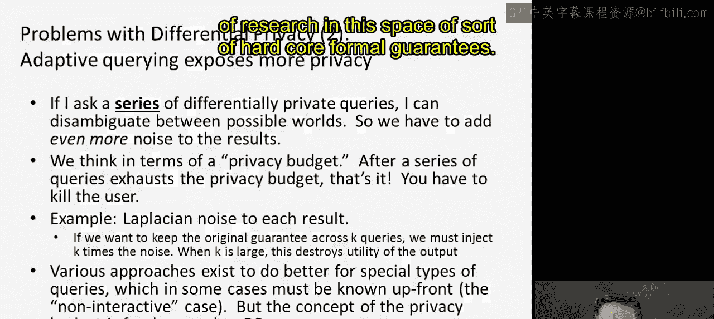

#  097：差分隐私的弱点

## 概述

在本节课中，我们将探讨差分隐私这一技术。我们之前介绍了差分隐私的动机和基本概念，它旨在提供形式化的技术保证，以应对隐私问题。然而，任何技术方案都有其局限性。本节我们将重点分析差分隐私的两个主要弱点：对查询类型的限制，以及在面对自适应查询时遇到的挑战。

## 差分隐私的回顾与动机

我们引入差分隐私有几个原因。我们希望探索在这个领域能做出何种形式化的技术保证，这与基于专业组织行为准则等更具行为指导性的方法形成对比。形式化技术保证是解决隐私问题光谱的另一端。此外，我们指出，许多尝试形式化并解决隐私问题的方法往往忽略了一个几乎所有攻击都具备的关键特征：攻击通常结合了来自多个不同来源的数据集，以获取更多信息。例如，攻击者不会仅使用Netflix数据来侵犯用户隐私，而是会结合外部信息；同样，AOL搜索查询数据也常与电话簿等外部数据结合使用。因此，任何形式化方法都需要考虑这一点，而差分隐私做到了。它的定义中没有试图建模攻击者拥有何种数据集的参数，也不依赖于此。这是它的优点。

## 差分隐私的弱点

尽管差分隐私有上述优点，但它也存在一些问题。这里我们重点讨论两个主要弱点。

### 弱点一：对查询类型的限制

差分隐私主要设计用于处理**低敏感度查询**。我们讨论过的计数查询就属于低敏感度查询。无论参与调查的特定个体情况如何，他们对查询结果的最大影响只能是增加或减少一个单位。然而，对于涉及数值求和的查询，情况则不同。

考虑关于收入的查询，例如计算特定性别群体在某细分市场中的总收入。包含或排除单一个体可能会**极大地**改变结果，因为收入的分布并非高斯分布，而更接近指数分布。这里存在“二八法则”，高收入者的收入远高于低收入者。对于求最大值这类查询，问题更明显，因为最大值不依赖于数据集的大小。即使有数百万用户，最大值仍可能因单一个体的收入而发生显著变化。

因此，对于某些查询族，要推导出能回答这些查询的差分隐私机制需要大量工作，而且如何有效实现并不明确。在某些情况下，研究表明，为了满足差分隐私，需要添加大量噪声，以至于难以保证结果的可用性。

### 弱点二：自适应查询的挑战

上一节我们讨论了回答单个查询并假设其满足差分隐私的情况。但如果我们允许用户连续提问呢？用户可能先问一个问题，根据答案再问另一个，如此反复。这可能会让你联想到我们讨论统计推断方法时的情景：你有一个未知分布，通过在特定数据集上重复实验（或重采样模拟重复实验），可以推断出底层分布的形式并回答问题。

统计推断本质上正是在尝试破解差分隐私的防御。差分隐私通过添加噪声来混淆信息，而统计推断则试图通过重复实验来推断信息。因此，可以想象，如果允许我提出多个查询，而系统对每个结果都添加噪声，我或许能够通过这些查询区分出信号和噪声。

这个问题在差分隐私提出之初就被充分认识到了。唯一的解决方案是向结果中添加**更多**的噪声。可以证明，一系列 **K** 个独立的、采用我们描述的拉普拉斯机制进行隐私化的差分隐私查询，其整体隐私保证会减弱，隐私泄露量最多可达到原始隐私参数的 **K** 倍。

这意味着隐私泄露随查询次数**线性增长**。如果你通过一次查询实现了某个隐私级别，那么进行 **K** 次查询后，你允许的隐私泄露量就增加了 **K** 倍。虽然人们已经推导出了更严格的界限，但至少是这个数量级。从某种意义上说，这提供了一个简单的应对技巧：如果我们事先知道没有人会提出超过10个查询，我们可以直接将隐私参数 **σ** 除以10，然后按常规方式添加噪声。

基于这种推理，更合理的做法是将其视为一个**隐私预算**。当一系列查询耗尽了该预算后，该用户就不再被允许提出更多查询。然而，如果开始考虑用户之间的共谋，或者用户通过创建虚假账户等方式隐藏身份，使得我们无法有效追踪用户，那么按用户管理隐私预算就会变得非常困难，甚至可能需要对整个世界设置一个总预算，这在实际中几乎无法操作。

对于这里的例子，如果你想在 **K** 次查询中保持原始的隐私保证，你必须在每次查询的结果中注入 **K** 倍的噪声。当 **K** 很大时，例如需要支持成千上万次查询，你实际上已经破坏了输出的可用性，因为每个查询都添加了如此多的噪声，以至于无法从中得出任何有意义的结论。

为了解决这个问题，针对特定查询族（如布尔谓词）的研究区分了**交互式**和**非交互式**场景。非交互式场景下，给定一组固定的查询（例如100个），我们可以一次性处理；而交互式场景下，攻击者可以基于先前查询的结果和已有知识，自适应地提出下一个查询。但在所有这些情况下，**隐私预算**的概念都是差分隐私中非常基础和核心的，这也严重限制了它在实践中的可用性。

## 总结

本节课我们一起学习了差分隐私的两个主要弱点。首先，它主要适用于低敏感度查询，对于求和、求最大值等高敏感度查询，实现有效且可用的差分隐私机制具有挑战性。其次，在面对自适应查询时，需要通过隐私预算来管理，这可能导致需要添加大量噪声，从而损害数据实用性，或者对系统的用户管理和查询策略提出很高要求。尽管如此，我仍然讲解这个概念，是为了揭示在隐私领域，即使是形式化的技术保证也存在其局限性。目前，差分隐私仍然是追求严格形式化隐私保证的研究中最有前景的方向之一。

