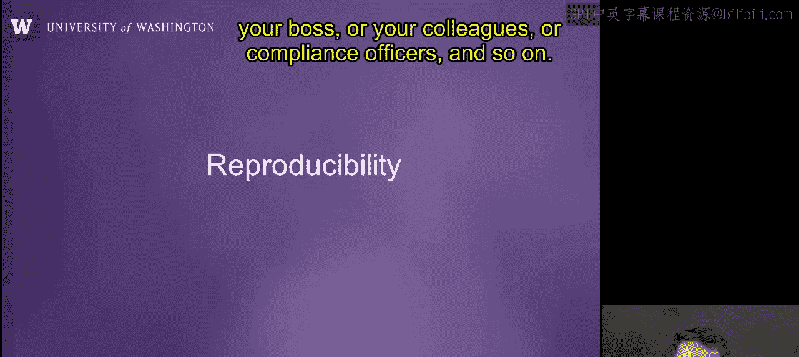
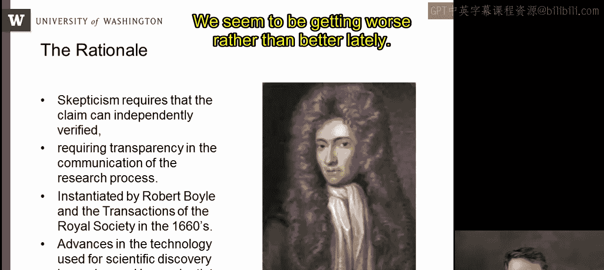
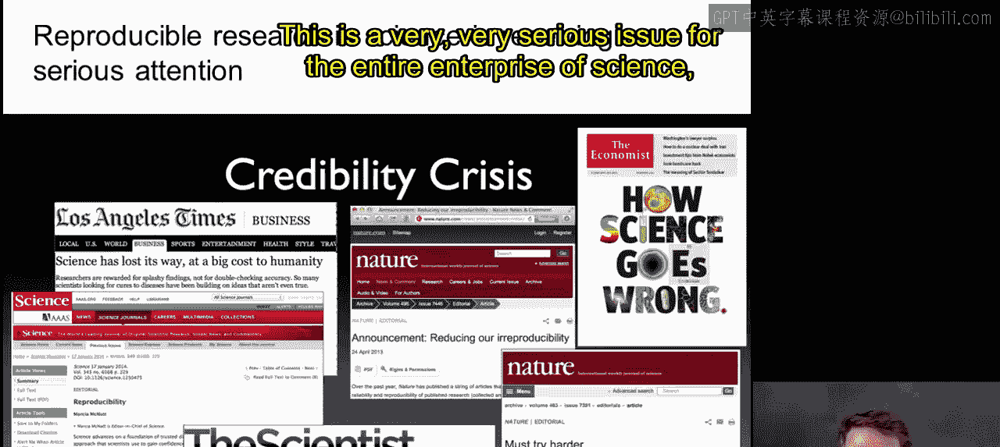
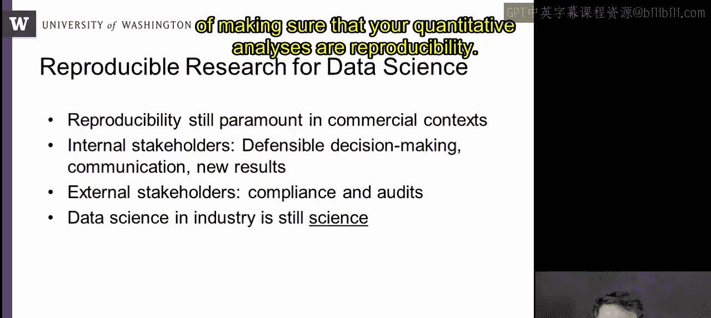

#  098：可重复性与数据科学 🧪

在本节课中，我们将探讨数据科学中的一个核心但常被忽视的议题：可重复性。我们将了解为什么可重复性是科学研究的基石，以及它在商业和数据科学实践中的重要性。

---

上一节我们提到了数据科学的本质是科学研究。本节中，我们来看看可重复性在科学中的核心地位。

科学的认识论基础是怀疑主义。怀疑主义要求任何科学主张都必须能够被独立验证。如果没有这一点，科学就无从谈起。因此，你不能仅仅在“密室”中运行你的R脚本，然后向他人展示结果，并期望他们相信你或据此做出决策。你必须能够展示并沟通得出结果所需的完整步骤。研究过程必须具备这种透明性。

这一理念始于17世纪60年代罗伯特·波义耳在皇家学会的工作。然而，随着技术进步，特别是研究变得更加计算化和数据密集型，可重复性的含义发生了变化，实现它的难度反而增加了。作为一个计算机科学家，这实际上令人尴尬：从现实世界中提取知识本应比从编码为0和1的数字形式中提取更困难，但事实似乎并非如此。我们的可重复性状况似乎在变差，而非变好。

---

上一节我们讨论了可重复性的普遍挑战。本节中，我们来看看这个问题在科学界有多严重。

可重复性正受到严肃关注。大量研究表明，科学文献中的信息确实存在不可重复的问题，许多结果似乎站不住脚。这个问题遍及科学的各个方面和所有领域，对整个科学事业构成了非常严重的威胁。

---

那么，对于数据科学，尤其是商业环境下的数据科学，这意味着什么呢？本节我们将探讨其重要性。

可重复性在商业环境中同样至关重要，即使这一点尚未被完全认识到。内部利益相关者（如你的老板、同事或合规官）最终都会要求某种程度的可重复性，无论他们现在是否明确提出。以下是几个关键原因：

以下是可重复性在商业环境中的核心价值：

*   **为决策提供辩护依据**：如果决策要基于定量分析或科学结果，你必须能够回溯到事实本身，理解它们是什么。尤其是当决策出错时，人们需要确认过程是否正确。
*   **促进内部沟通与传承**：当你离职或将项目移交给他人时，必须以某种可重复的方式记录步骤，以便他人能够在此基础上继续工作。这对于团队培训和知识传承也至关重要。
*   **确保实验有效性**：商业决策将越来越多地基于一系列实验的结果，而这些实验的有效性标准与基础研究中的实验完全相同。
*   **应对外部压力**：外部利益相关者，如合规官和审计人员，会施加其他压力。遵守关于数据保留期限和记录保存的法律规定是其一，但确保定量分析本身可重复、可审计，也是一种普遍要求。

---

总而言之，数据科学，即使在工业界，其本质依然是科学。可重复性不是可选项，而是确保分析可信、决策可靠、知识可传承的基石。在本节课中，我们一起学习了可重复性的哲学基础、它在当前科学中面临的挑战，以及在商业数据科学实践中不可或缺的具体原因。