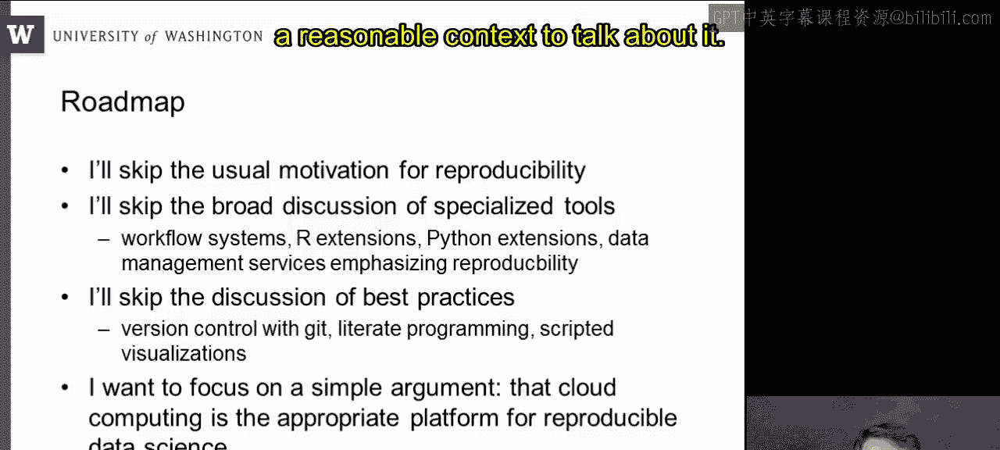

#  099：可重复性黄金标准 🏆

在本节课中，我们将探讨数据科学中的一个核心挑战：研究的可重复性。我们将了解当前可重复性危机的现状，并深入讨论实现可重复性的“黄金标准”是什么，以及为什么它难以实现。

---

## 可重复性危机

近年来，多个领域的研究都面临着严峻的可重复性问题。以下是一些高知名度的案例：

*   2011年，拜耳公司的研究人员报告称，在67项重要的药物研究中，他们只能重复出17项的结果。
*   2012年，安进公司进行了一项类似的可重复性实验，发现53项癌症研究中，仅有6项的结果能够被重复。
*   2015年8月，弗吉尼亚州的“可重复性项目”报告称，他们只能重复出100项心理学研究中的39项。这一事件引起了媒体的广泛关注。
*   2015年9月，美国联邦储备委员会发现，在67项经济学研究中，只能重复出29项的结果。

计算金融领域出现的“回测过拟合”概念，已成为一个主要问题。这本质上就是我们上一门课程中讨论过的“过拟合”问题。“回测”指的是查看历史数据。在计算金融中，如果你有一个特定的信号模式，找到一个能完美捕捉该模式的模型是轻而易举的。更糟糕的是，一些本质上不道德的金融顾问的做法是：尝试上千个模型，报告表现最好的那一个，并以此进行宣传，然后当它无法很好地预测未来结果时，又假装惊讶。这个领域从根本上缺乏科学规范和诚信，这可能令人惊讶，也可能不，但这确实是一个与可重复性相关的问题。一种科学的、实证的思维方式被视为解决方案的一部分。

2014年3月，西弗吉尼亚大学的研究报告称，他们无法复现大众汽车公司声称的排放数据。正如我们现在所看到的，这已经演变成一场国际丑闻。事实证明，大众汽车在作弊。

---

## 可重复性的黄金标准

上一节我们看到了可重复性问题的普遍性，本节中我们来看看理想的解决方案是什么。

我认为，可重复性的黄金标准是：**其他人能够使用你在实验时的精确环境**。这包括相同的软件、相同的软件环境、相同的硬件，甚至可以说，房间里相同的灯光——一切都完全相同。

此外，与之相辅相成的是，你的实验流程本身就是为了确保可重复性而设计的，这样你事后就无需担心，结果会自然而然地重现。理想情况下，你可以在事后按下一个开关，保存你的整个工作空间——你的办公室、里面的一切——打包并发送给其他人，使其能够复现所有结果。

有一种观点认为，这是一个糟糕的“黄金标准”定义，我们稍后会再讨论这一点。你可以思考一下这可能是什么原因。有些人会争辩说，这是一个糟糕的理想目标，或者这个想法中缺少了某些部分。

---

## 当前的工具与局限

即使你满足于上述黄金标准，我们也无法完全实现它，但我们可以通过虚拟机等技术接近它。在本模块的课程中，我将逐步阐述这个论点。

接下来，我将跳过通常关于可重复性的长篇动机论述（尽管我已经做了一些），并跳过对专门工具的广泛讨论。这些工具包括声称能更好支持可重复性的科学工作流系统、用于R环境和Python环境的插件和扩展（它们可以监视你的操作并保存状态）、允许为事物附加元数据的系统，以及各种旨在让未来在R/Python中的日常工作更具可重复性的系统。还有强调可重复性的数据管理服务，当你保存数据集版本时。

但同样，我对其中任何一个特定工具都不够兴奋，不足以将其作为推荐或进行深入探讨。此外，对这些工具的深入讨论往往更吸引那些对构建这些工具感兴趣的人，而不仅仅是使用它们的人。

我也将跳过关于最佳实践的讨论，这包括版本控制（如今通常使用Git，因为它很好地统一了人们的注意力，并通过GitHub真正解决了问题）、文学化编程（确保你的可视化和图表都是脚本化的，以便重新运行和修改）、软件工程原则、测试驱动开发等。

---

## 云计算的解决方案

我想聚焦于一个最终很简单的论点：**云计算（无论是公共云还是某种形式的私有云）才是实现可重复数据科学的合适平台**。通过这个论点，我们将引出可重复性的一些特征，同时也会带出云计算本身的特性，因为这是一个讨论它的合理背景。

所以，我们来谈谈它。

---

## 总结

本节课中，我们一起学习了数据科学中可重复性问题的严重性，从制药到经济学等多个领域都面临挑战。我们探讨了可重复性的“黄金标准”——即完全复现原始实验环境，并认识到其理想化的难度。最后，我们指出了跳过复杂工具和最佳实践的细节讨论，将重点引向一个核心观点：**云计算平台为实现可重复的数据科学提供了最可行和本质的解决方案**。在接下来的内容中，我们将围绕这个论点展开。