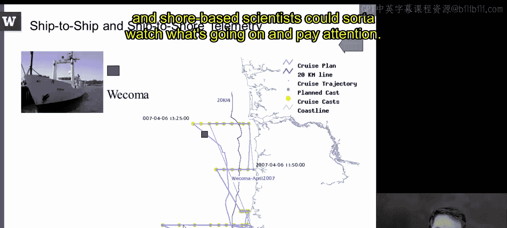

#  100：虚拟化轶事——海洋设备

在本节课中，我们将通过一个关于“海洋设备”的实际项目轶事，来探讨虚拟化思想在解决现实世界复杂问题中的应用。这个例子虽然不直接涉及虚拟化技术本身，但其核心思想——通过封装和标准化来简化部署、管理和维护——与虚拟化的理念一脉相承。

上一节我们介绍了虚拟化的基本概念，本节中我们来看看一个具体的应用实例。

## 项目背景与挑战

在2007年，我参与了一个名为“海洋设备”的项目。这个项目的初衷，是为了解决向野外工作站，特别是远洋船舶，分发软件时所面临的诸多难题。

将软件直接提供给船舶工程师，让他们在船上的计算机上进行安装，这种做法存在许多问题。原因包括安全考虑、船上人员的技术专长有限、远程调试访问困难，以及其他各种潜在问题。

我们涉及的软件本身并不特别复杂。它包含一个数据库系统、一个从传感器读取数据的遥测系统（用于将数据传回岸上），以及一些Web界面。这些界面供船上的研究人员和操作人员使用，以便查看数据、调试问题，甚至进行一些实时的现场科学研究。

## 解决方案：海洋设备

这个“海洋设备”承担了多项职责。它本质上接管了船载计算的任务，包括进行数据分析、数据采集、安全备份数据、将数据发送回岸上、生成可视化图表，并作为一个应用服务器，供其他需要连接它的笔记本电脑使用。

通过使用这个专用设备，我们可以保证软件运行在一个特定的、可控的环境中。这样就能确保，软件在一艘船上运行良好，在另一艘计算平台较弱的船上也不会突然出现用户体验崩溃或其他问题。我们消除了所有不可控的因素。

这个设备的成本在当时非常低廉，大约500美元。虽然现在的价格已经完全不同，但在当时，这确实是一个不算昂贵的“盒子”。

以下是这种设备需要部署的典型环境描述：

*   这是一个紧凑的实验室工作台，位于一艘相当小的研究船（R/V Barnes）内部。
*   我们将设备安置在甲板下方，接入船舶的网络和电源，基本就完成了部署。
*   网络配置通常也会提前安排好。

## 设备的功能与价值

这个设备能够完成一些非常有意义的工作。

它实现了船与船之间、以及船与岸之间的遥测。下图展示了美国西海岸三艘不同船只的航行轨迹。

当时（现在也仍然是）的一个想法是，实现多艘船只之间的协调自适应采样。这意味着，不是让三艘船独立地去往三个不同的地方，有时你可以让它们共同观测同一种现象。然而，同时租用三艘船并协调时间通常很困难，资金也难以筹集。因此，实际做法往往是多个项目共享一艘船的时间。如果要共享船时，就需要更高级别的协调，而“海洋设备”这套基础设施正好有助于实现这种协调。

船与船之间的遥测也有助于将数据中继回岸上。虽然随着卫星通信日益普及，这个问题正在逐渐消失，但在某些情况下，仍需要使用远程无线电。由于地球曲率的影响，无线电信号无法直接传回岸上。虽然可以尝试通过电离层反射信号来稍微“作弊”，但通信范围仍然有限。然而，在自适应采样场景下，如果能实现从一艘船到另一艘船再到另一艘船的连接，就能为实时遥测数据构建一个更长的中继链路，使得岸上的科学家能够观察现场情况并给予关注。

## 核心思想总结

本节课中我们一起学习了“海洋设备”这个案例。虽然它没有使用虚拟化技术，但其设计哲学与虚拟化高度一致：**将复杂的软件栈及其依赖环境封装（`encapsulate`）到一个标准化、可移植的硬件单元中**。这样做的好处是：

1.  **简化部署**：只需连接电源和网络，无需在目标机器上进行复杂的安装和配置。
2.  **环境一致性**：确保软件在任何部署地点都能在预期的环境中运行，避免因系统差异导致的问题。
3.  **降低维护成本**：集中管理设备比远程调试分散安装的软件要容易得多。
4.  **提升可靠性**：通过专用设备保障核心服务的稳定运行。

这个轶事生动地说明了，虚拟化的核心价值在于通过抽象和隔离来管理复杂性，而实现这一目标的具体形式可以是软件层面的（如虚拟机、容器），也可以是硬件层面的（如本例中的专用设备）。