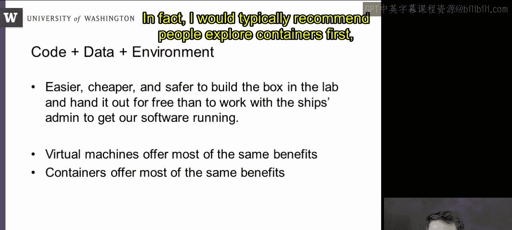

#  101：代码、数据与环境 🚢

在本节课中，我们将探讨一个关于数据科学项目部署的实际案例，并分析如何通过控制环境来解决可重复性与跨平台协作的难题。我们将重点理解虚拟环境（如虚拟机和容器）在简化部署、确保结果一致性和促进协作方面的核心价值。

---

上一节我们讨论了数据科学项目在真实世界部署的复杂性。本节中，我们来看看一个具体的海洋监测项目案例，它清晰地展示了环境控制的重要性。

在哥伦比亚河口，我们部署了一个监测网络。具体设置如下：
*   河口内有一艘船。
*   公海上有两艘船。
*   这些船只超出了20公里的无线电通信范围，但我们仍能实时获取数据。

这个系统的搭建并不十分困难，因为我们在船上配备了计算平台来实时处理工作。我们实时进行事件检测，例如在哥伦比亚河口观测到的“红水”现象。

图中显示了一片红色的水域。我们过去称之为“赤潮”，但需要注意，这里的生物（*Myrionecta rubra*）相对无害，不会致人死亡，但它依然是一种有趣的小生物，会将水染红。在数据中，我们可以观察到浊度（即水的浑浊程度）的峰值，这可能是检测到“红水”的信号。

这里有两桶水样本，一桶取自红色斑块区域，另一桶取自清澈水域。尽管光线条件可能掩盖了部分效果，但这些实时事件意味着：当你发现某些情况正在发生时，你会希望立即收集数据并采取行动。将设备部署在船上，有助于自动触发这一过程。

---

那么，我为什么要提及这个案例呢？因为它揭示了一个关键点：在实验室里构建好设备盒子并免费分发出去，比在野外与船只管理员协作、尝试让我们的软件运行、修复问题以及处理各种异构性要**更容易、更便宜、更安全**。

这与可重复性问题有共通之处。你让一切在自己的环境中运行，然后将整个环境分享给世界，这比试图与那些想复现你结果的人合作、带领他们完成所有必要步骤、并帮助他们解决因平台异构性而产生的新问题要高效得多。

平台异构性导致的新问题，其责任归属并不明确。对于接收方而言，如果你想复现他人的结果，却不得不解决各种未在论文中描述、与科学本身无关的疑难问题，这会令人沮丧。东西就是无法直接运行。

然而，对于研究成果的生产者来说，要求他们投入额外工作来保证其成果能在任何可能的平台、任何操作系统版本、任何技能水平的人的任何环境中运行，也**不太现实**。

因此，这里存在一种张力。但虚拟机提供了大部分相同的好处。实际上，我们当时构建了一个物理盒子，是因为存在互联网连接等限制。这些问题在大多数情况下并不十分相关，但基本理念是相通的：一个受控的虚拟机为你提供了一个受控的环境。

我接下来要讲的大部分内容也适用于**容器**，它在几乎所有方面都是一种更优的实现这些好处的方式。容器去除了冗余（例如，多个虚拟机之间通常有很多共同点），同时仍能提供定制化环境的可移植性，并且还具有可组合性等其他优秀特性。

因此，我关于虚拟机的论述大多也适用于容器。事实上，如今我通常会建议人们首先探索容器技术。

---

本节课中，我们一起学习了通过一个海洋监测案例，理解了环境控制在数据科学项目中的重要性。我们认识到，与其在异构平台上艰难地调试和部署，不如直接分享一个**受控的、可复现的环境**（如虚拟机或容器）。这不仅能简化协作、降低成本，还能从根本上保障研究结果的可重复性。容器作为更现代和高效的解决方案，尤其值得初学者优先探索。