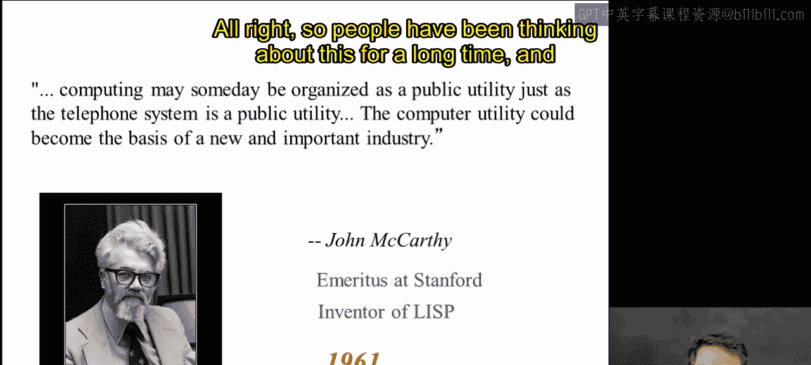

大规模数据科学：第2课：云计算简介

在本节课中，我们将学习云计算的基本概念，了解其与虚拟化的关系，并探讨其如何改变我们处理计算资源的方式。

上一节我们介绍了虚拟化及其在可重复性中的作用，本节中我们来看看云计算。

---

我们花了几分钟讨论虚拟化及其在可重复性中的作用。现在，我想花几分钟谈谈云计算。我认为，虚拟化和云计算正日益紧密地结合在一起，尽管它们并非必然相互依存。如今，点对点地传递虚拟机并在没有共享执行环境的情况下运行它们，这种做法越来越不合时宜。对于容器而言，情况也类似，尽管由于体积和规模等原因，传递容器不像传递虚拟机那样麻烦。

我们来稍微谈谈云计算。这是一台位于旧工厂地下室的发电机。仔细观察，你会发现它很可能不再被用作发电机。周围有穿着西装打着领带的人在唱歌，墙上挂着艺术品等等。它更像是一个话题装饰品。这里的观点是：在某个时期，自己发电更便宜、更安全或更方便。但在过去的某个时刻，这变成了一个古怪的想法，这台发电机也成了过去时代的遗迹。这个论点认为，服务器机房也将走向同样的方向。那种出于成本、便利性、安全或业务连续性考虑而需要物理维护机器的想法，正在逐渐过时。这个过程正在加速。对于那些在IT领域有深厚投资的大公司来说，仍有很长的路要走，但这是我们前进的方向。

这个想法并不新鲜。有一句引语是：“计算有朝一日可能会像电话系统作为公共事业一样，被组织成一种公共事业。计算机公用事业将成为一个新的重要产业的基础。”你或许想猜猜这话是什么时候说的。说这话的人是斯坦福大学的荣誉退休教授，也是Lisp语言的发明者。所以，这是约翰·麦卡锡在1961年说的。可见，我们思考这个问题已经很久了。如今，随着云计算的发展，它正在成为现实。

---

本节课中我们一起学习了云计算的概念，理解了它如何从一种长期设想演变为当今数据处理的主流模式，并看到了它与虚拟化技术共同推动着计算资源使用方式的根本性变革。