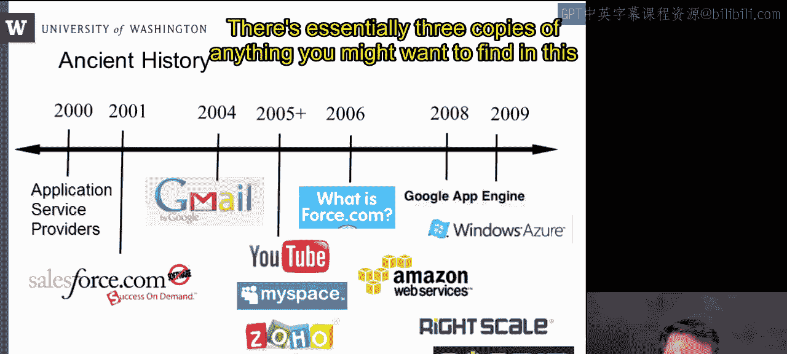
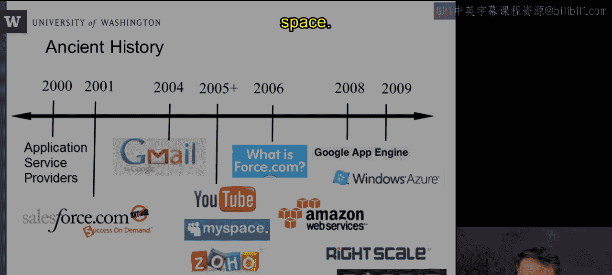

#  103：云计算历史 📜

在本节课中，我们将回顾云计算发展的关键历史节点，了解它如何从早期的概念演变为今天支撑现代应用的基础设施。我们将看到服务模式的演变，以及几家科技巨头是如何塑造这一领域的。

---

上一节我们介绍了数据科学的基本概念，本节中我们来看看支撑其发展的关键技术——云计算的起源。

## 早期概念：应用服务提供商

在2000年左右，出现了“应用服务提供商”的概念。当时，这成为了杂志封面上的热门术语，也是大型咨询公司的重要业务。其核心思想是，企业通过互联网向其他企业提供软件应用服务，而非要求客户在本地安装和管理软件。

Salesforce是这一模式的先驱。他们不向客户销售软件安装包，而是通过浏览器提供客户关系管理服务，并自行管理所有后端基础设施。

这种模式带来了巨大优势：
*   **对开发者而言**：他们无需处理客户端的安装或配置问题，可以集中精力开发和维护服务，并统一推送更新。
*   **对客户而言**：他们减少了本地IT支持和维护的成本与复杂性。

## 观念的转变：浏览器也能运行“真正的”应用

当时，人们普遍怀疑浏览器能否运行功能完整的“真正”应用，认为它只适合简单的网页应用。而Gmail的出现改变了这一观念。

Gmail是一个功能齐全的电子邮件客户端，完全在浏览器中运行。它证明了复杂的桌面级应用完全可以托管并在云端通过浏览器交付。自此之后，“应用运行在云端”不再具有争议性。

如今，计算越来越多地发生在云端，本地设备（如手机、平板电脑）上只保留非常轻量化的客户端。

## 服务模式的演进：从SaaS到PaaS

随着YouTube、Myspace等应用的流行，以及Zoho、Google Docs等在线办公套件的出现，软件即服务模式被广泛接受。

随后，一个关键发展是Force.com的出现（由Salesforce.com推出）。他们意识到，可以不只是提供具体的CRM应用，而是将构建此类应用的基础设施和能力开放出来。

Force.com允许开发者在他们的平台上构建和发布自己的Web应用。这被认为是**平台即服务** 模式的早期开端。其核心公式可以概括为：
`平台即服务 = 基础设施 + 开发工具/框架 + 运行时环境`

## 基础设施的民主化：IaaS的兴起

不久之后，亚马逊推出了亚马逊网络服务。他们将服务层级进一步下沉，提供了更底层的**基础设施即服务**。

AWS提供对原始计算资源（如虚拟机、存储、网络）的直接访问。用户可以在这些基础资源上安装任何软件，构建任何架构。一个有趣的问题是：为何是亚马逊（一家电商公司）而非微软、IBM等传统IT巨头率先开创了这一模式？

当时的解释是：
1.  亚马逊本质上是一家技术公司，拥有处理海量交易的技术架构。
2.  亚马逊擅长**薄利多销**的商业模式。他们最初卖书，后来利用同一套基础设施卖各种商品。既然能支撑自己的商城，何不将这套基础设施出租给其他人？
3.  在AWS广为人知之前，亚马逊曾允许第三方商家在亚马逊的机器上搭建自己的在线商店，这可视作AWS的前身。
4.  传统IT巨头倾向于追逐高利润的大客户，而亚马逊习惯于在微小利润上通过巨大规模取胜。

## 格局的形成与竞争

谷歌也随后推出了Google App Engine（此段历史截至2009年）。自此，云计算市场的主要格局开始形成。

如今，亚马逊、谷歌和微软在这个领域全面竞争。它们提供的服务已经高度重叠和覆盖，几乎任何你需要的云服务都能在这三家主流提供商中找到对应的产品。市场竞争推动了技术的快速发展和成本的持续下降。

---

本节课中我们一起学习了云计算从应用服务提供商概念，到SaaS、PaaS，最终到IaaS的演进历史。我们看到了Gmail如何证明浏览器应用的可行性，Salesforce如何向PaaS拓展，以及亚马逊凭借其技术架构和商业模式开创了IaaS的先河。理解这段历史有助于我们把握当前云服务生态的由来与核心逻辑。