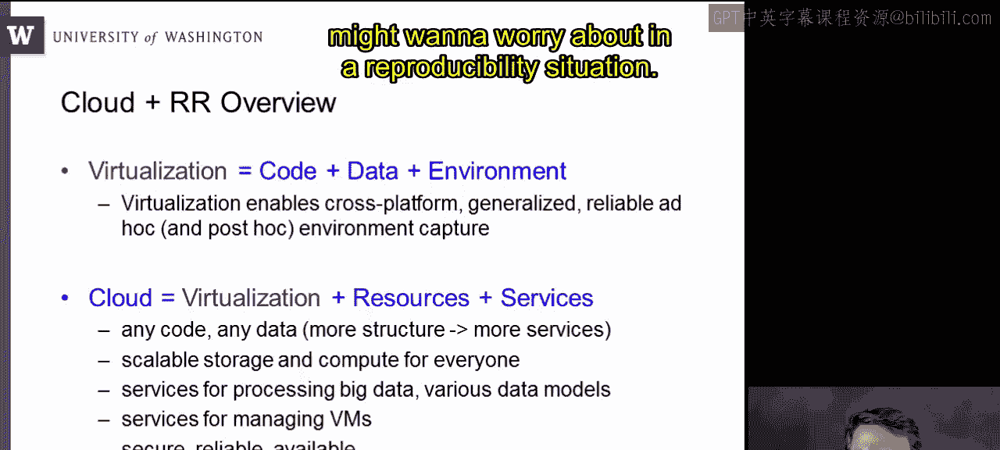

#  104：代码、数据、环境与平台

在本节课中，我们将探讨可重复性研究的核心要素：代码、数据、环境以及支撑它们的平台。我们将了解云计算和虚拟化技术如何将这些要素整合在一起，从而为数据科学实验提供可靠、可复现的基础。

## 核心要素：代码、数据与环境

上一节我们讨论了数据科学的基本流程，本节中我们来看看构成可重复性研究的三个关键支柱。

虚拟化技术所封装的核心是**代码、数据和环境**。人们经常讨论分享代码的工具与最佳实践，也讨论分享数据的方法，有时还会强调需要平台来同时支持两者。然而，很少人深入探讨分享**环境**的必要性。

这一点正变得越来越重要，因为仅凭你编写的新代码和你亲手处理的数据，通常不足以完整复现你所做的任何实验。你的代码依赖于数量庞大的库，这些库构成了环境的主要部分。

## 虚拟化的作用

虚拟化技术使得这种跨平台的、通用的、可靠的环境捕获成为可能。这里特别要指出的是**事后捕获**的重要性。

在进行实验时，你通常无法预知哪个实验最终需要被打包和分享。如果要求你对每一项活动都投入同等的关注、规范和警惕，以确保其能被任何人无限次地复现，这会浪费巨大的精力。我认为要求每个人都这样做并不现实。

因此，你需要一种能够回溯的能力，能够指出“啊，这一系列步骤才是我真正想要捕获并分享的”。正如之前提到的，虚拟化和容器技术提供了这种能力。你可以拍摄一个**快照**，然后从容地说：“这就是我想要打包的环境。”

## 云计算的延伸：资源与服务

然而，虚拟化或容器论证只是第一步。云计算更进一步，它不仅关乎虚拟化、代码、数据和环境，还关乎**资源**和**服务**。

这也是可重复性的重要组成部分。假设你完成了一个出色的实验，但它需要特定的GPU服务器、一个机器集群、中间的数据库服务器以及一个你使用的Web应用程序。要求他人在自己的世界里重建这样一个环境是不现实的，同样，要求他们想出另一种使用不同架构的方法来复现你的实验也不合理。

## 云计算的优势

以下是云计算为可重复性研究提供的关键支持：

*   **无限的规模**：任何代码和数据都得到云的支持，你无需担心存储和计算的规模限制。
*   **丰富的服务**：构建在可扩展存储和计算之上的服务日益有用、复杂，并针对特定任务进行了专门优化。例如，对于结构化关系数据或非结构化数据，你都有多种选择。
*   **高效的管理**：用于管理大量虚拟机（VM）和容器（如今容器本质上正是为应对管理大量不同VM的挑战而发明的解决方案之一）的服务。
*   **可靠的保障**：安全性、可靠性和持续可用性。这些是你自己的计算基础设施或他人的基础设施难以保证的属性。

因此，云计算真正地将可重复性情境中你可能需要担心的所有变量都打包解决了。

## 总结

本节课中，我们一起学习了可重复性数据科学研究的完整图景。我们认识到，完整的复现不仅需要**代码**和**数据**，还必须包括其运行的**环境**。**虚拟化与容器技术**使我们能够方便地捕获和分享这个环境。而**云计算平台**则进一步提供了可扩展的资源、多样化的服务以及可靠的基础设施保障，将代码、数据、环境和运行资源整合为一个完整的、可复现的解决方案包。