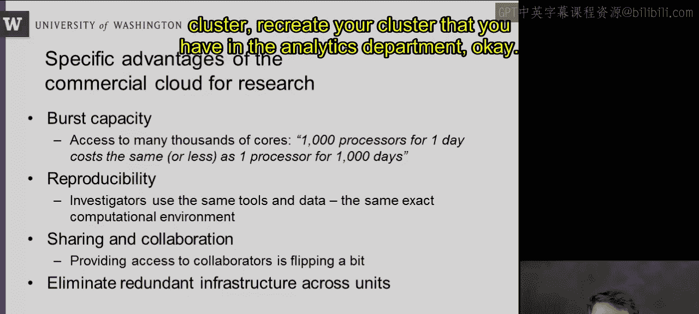

#  105：云计算用于可重复研究

在本节课中，我们将要学习云计算的核心概念，特别是它如何支持可重复的研究工作。我们将了解云服务的不同类型、它们的优势，以及为什么云计算对数据科学和科学研究至关重要。

## 云计算的三种服务模式

上一节我们介绍了云计算的基本概念，本节中我们来看看其核心的三种服务模式。

以下是三种主要的云服务模式：

*   **基础设施即服务**：提供虚拟化的计算资源，如服务器、存储和网络。经典的例子是亚马逊的EC2（计算引擎）和S3（存储服务）。
*   **平台即服务**：提供一个平台，让开发者可以构建、运行和管理应用程序，而无需处理底层基础设施。例如，微软的Azure最初就是以此模式起步的。
*   **软件即服务**：通过互联网提供完整的应用程序。例如，微软的Office 365。

随着服务模式从基础设施向软件演进，服务变得更加具体、面向特定领域和任务，同时也能引入更多的自动化功能。过去十年间，行业的发展正是不断充实这一设计空间的过程。

## 云计算的巨大成功

了解了服务模式后，我们来看看云计算在实际应用中的巨大成功。

云计算的增长是爆炸性的。例如，亚马逊全球网站的带宽消耗呈现稳定增长，而亚马逊网络服务的带宽消耗则呈爆炸式增长。同样，S3中存储的对象数量也经历了指数级增长。这些数据都清晰地展示了云计算的普及和成功。

## 云计算对研究的优势

云计算的成功不仅体现在商业领域，对于科学研究，尤其是数据科学，它带来了独特的优势。

以下是云计算为研究工作带来的几个关键优势：

*   **突发性计算能力**：历史上首次，使用1000个处理器运行一天的成本，与使用1个处理器运行1000天的成本相同甚至更低。这使得研究人员可以在实验结束后关闭所有资源，极大地提高了资源利用的灵活性。
*   **支持可重复性**：研究者可以访问完全相同的工具、数据和计算环境，从而让他人能够精确复现实验过程。
*   **便于共享与协作**：将工作环境开放给外部访问，通常只需在软件中进行简单设置，无需物理移动数据或代码。
*   **消除跨部门冗余基础设施**：无论是在不同大学之间，还是在公司内部的不同部门（如市场部和分析部），集中化的云平台都可以避免重复建设计算集群，将资源共享提升到软件操作的层面。

对于稳态的数据处理任务，云计算的成本优势可能不明显。但对于实验性工作、数据科学和科学研究而言，这种突发性计算能力的模式非常适用。

## 公共云与私有云

最后，我们来谈谈云计算的部署模式。

实现上述优势，可以通过我们讨论的公共云，或者通过某种形式的私有云。在这些情况下，集中化程度越高越好，因为它能将资源共享从物理硬件层面提升到软件操作层面。

本节课中我们一起学习了云计算的三种服务模式（IaaS， PaaS， SaaS），见证了其巨大的商业成功，并重点探讨了它为科学研究带来的核心优势，特别是突发计算能力、可重复性以及便捷的协作共享，这些特性使其成为现代数据科学不可或缺的工具。