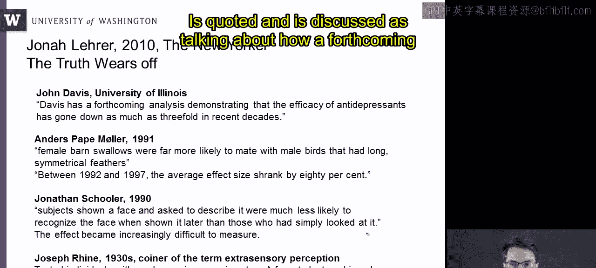
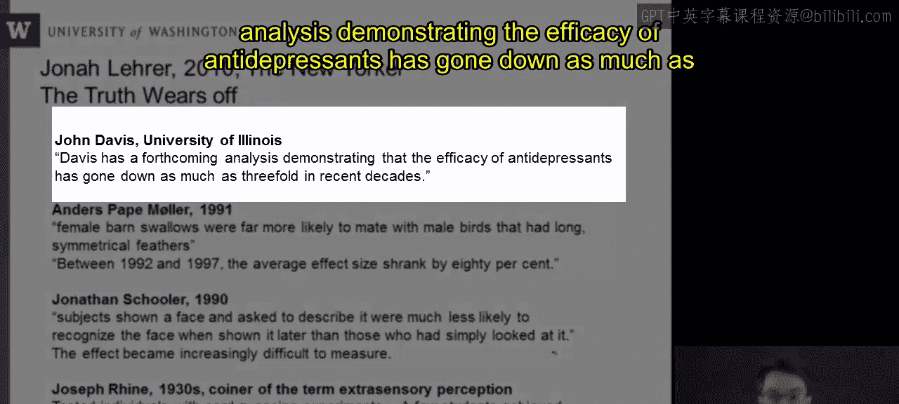
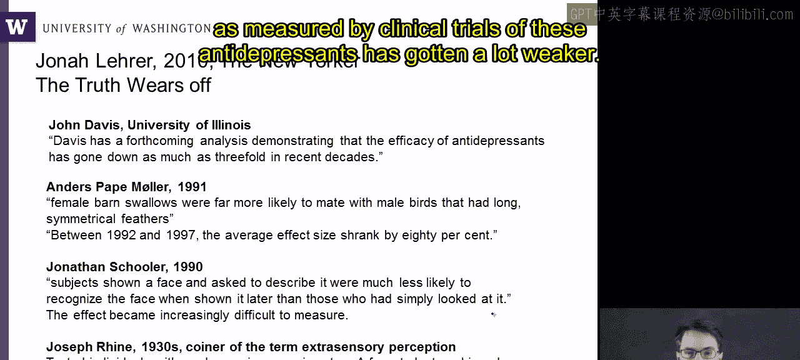
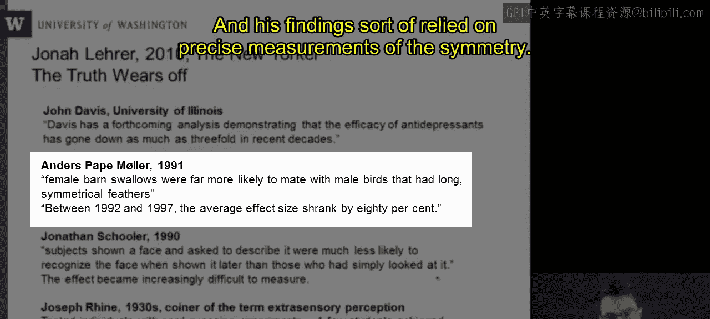
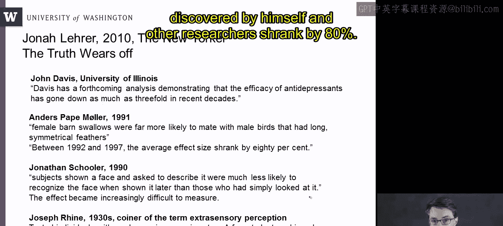
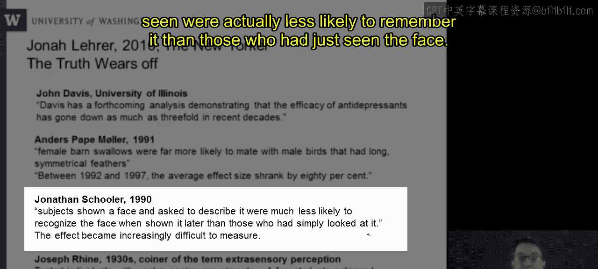
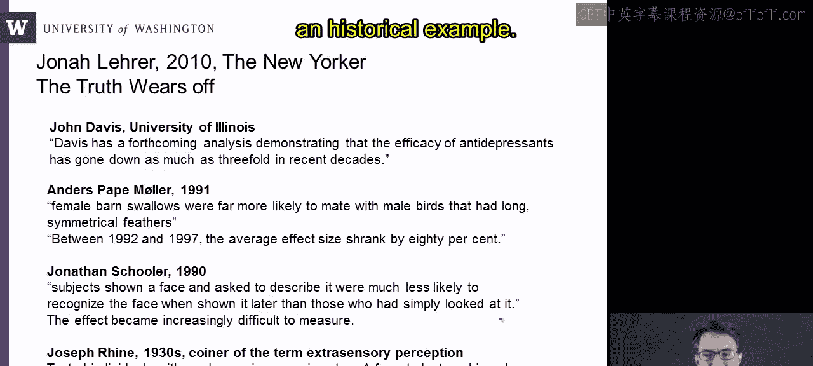
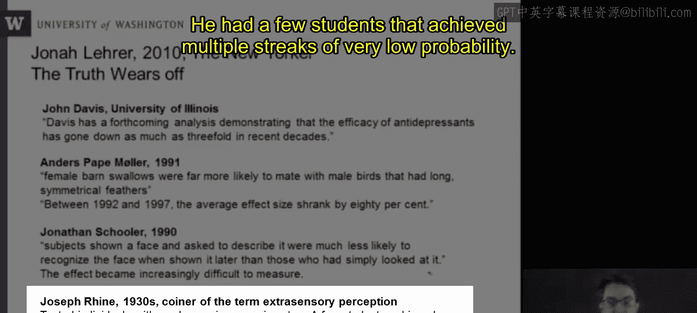
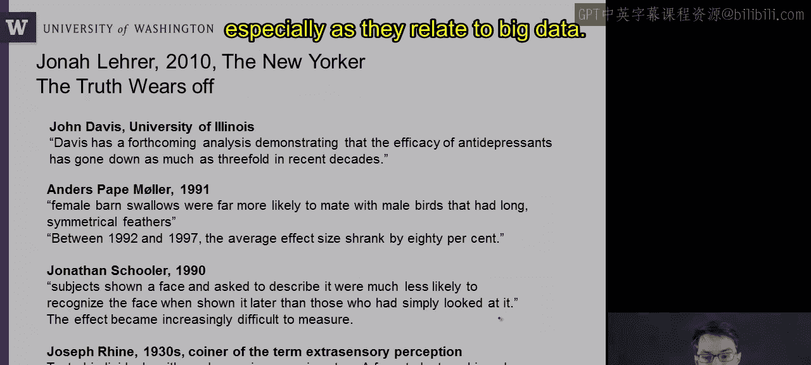

# 杜克大学《大规模数据科学（预测分析，交流数据科学结果，第2、3课⧸共3课有视频）｜Data Science at Scale》中英字幕 p01 0_激发胃口：坏科学.zh_en -BV1xf421Q7bH_p1-

。

All right， so starting a new week， starting a new section of the course。

 Where are we we've talked about what I maybe in this slide now calling informatics So the management manipulation。

 integration of data， and we had some emphasis on scale and we had some emphasis on specific tools so now we're moving into what I'll call analytics。

 And so we're going to talk about statistical estimation and prediction。

 And one of the points I want to make is that this builds on the informatics in that the things you're going to learn you can。

Implement using the tools before， and we already saw a piece of this where we did sort of matrix multiplication in various tools and so on。

The other point if you remember we made early on was that 80% of what people think of as analytics really boils down to the ability to do sums and averages。

And so we'll see a little bit that in here where maybe you know。

 understanding the problem and understanding the solution is。You know。

 hard or easy depending on maybe your background， but as far as implementing it， it's not too bad。

And then we'll move on to the visualization in a couple of weeks。All right。

 so to get started on this。I want to call your attention to this article in 2010 from the New Yorker with the caveat that this is far from a。

Research article， and in fact， a lot of what the article has to say I'm not。Sure。

 I'd recommend taking to heart。 But the point the， you know topic that they bring up is that。

 you know， the title is here is the truth wears off。

 And what they're exploring is this notion that statistical results in the sciences seem to have gotten weaker over time。

 And so John Davis is。You know， research at the University of Illinois who does work on antidepressants。

He is quoted and is discussed as talking about how a fourth Amendment analysis of demonstrating the efficacy of antidepressants has gone down as much as threefold in recent decades。

 So this is that the effectiveness as measured by clinical trials of these antidepressants。

Has gotten a lot weaker。The article also talked about Ands Mula。Who studied barn swallows and。

Discovered that the females were more likely to mate with males that had long symmetrical feathers and these。

I finding sort of relied on。

Precise measurements of the symmetry。And so this was a pretty significant discovery。

 but over the course of the next five or six years。Effect size， as discovered by。

Himself and other researchers shrank by 80%。

Okay， a lot of the article talks about Jonathan Schooller in 1990 who made a discovery of an effect that he called verbal overshadowing。

Which was。Counterintuitive。Because it showed that people who are asked to describe a face。

know using English that they've seen were actually less likely to remember it than those who had just seen the face。

 and so the you know talking about the face somehow overshadowed the effect of just seeing it alone。

Okay and once again， this effect seemed to get weaker over time and became increasingly difficult to measure。

 but including by Jonathan Schooler himself， and in fact he's quoted as saying this frustrated him right he was having trouble replicating it。

Okay。And then they also bring up。Someone who's。A little less respected， well。

 a fair amount less respected the scientific community as an historical example。

 and is the person who actually coined the term the decline effect。

 which is brought up over and over again in the article。

In the 1930s。Joseph Fine tested individuals with these card guessing experiments in an attempt to measure。

The effect of extrasory perception or ESP， and he's the one who actually coined that term。

So he had a few students that achieved。

Multiple streaks of very low probability， you know， many。

 many cards in a row that they guessed right and so on。But there was a decline effect， in the same。

Ha。Candidates， the same participants。Couldn't match the earlier performance。Okay， and so。

The article touches on what is essentially the correct explanation of this effect。

 and it also sort of brings up the possibility of a bunch of。Quas Im， you know， mystical。

Incorrect explanations of this， at least in my opinion。So I want to tell you about I want I want to。

 you know， in the next couple of segments， the next few segments。

 I want to sort of explore this as a test case for。Statistics and statistical estimation。

And I want to use this as a vehicle to introduce the fundamental concepts of statistics and also some of the somewhat more advanced concepts of statistics。

 especially as they relate to big data。

