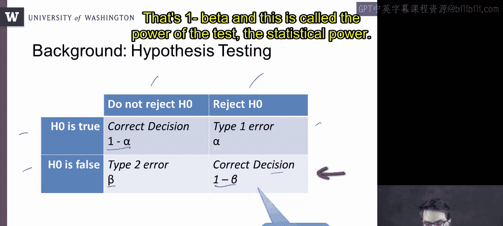

# 杜克大学《大规模数据科学（预测分析，交流数据科学结果，第2、3课⧸共3课有视频）｜Data Science at Scale》中英字幕 p02 1_假设检验.zh_en -BV1xf421Q7bH_p2-

。

To get started。Let's talk about the background here。

 and then we'll come back to this specific article and explore the reasons for why the truth wears off。

Okay。So this is going to be this is not going to be a replacement for a introductory college statistics course。

 this is going to be a quick overview of the terminology and the concepts you should be familiar with okay。

So we're talking about statistical inference here。 and so these are methods for drawing conclusions about a general population from sample data。

And there's two key methods that you can use here， hypothesis tests。And confidence intervals。

 and we're going to bring your confidence intervals again a little later on。

 but I'm not going to talk about them directly right now， right。So what is hypothesis testing， well。

 you're going to be comparing an experimental group to a control group。And。

There's always going to be a null hypothesis and the null hypothesis is there's just no difference between these two groups right the one who received the treatment in question are no different than the ones who did not。

You， the new website generates no more traffic than the old website than the control website than the default and so on。

So that's the null hypothesis。 The alternative hypothesis is that there is an effect。

 There's a statistically significant difference between the two。

And so here difference is defined in terms of some test statistic and you can。

Most of the examples you'll find in an introductory course or really any course are going to be about comparing the means so the average effect in the control group was different than the average effect in the experimental group。

Okay。Now。A lot of what statistics is about is actually designing the experiment to collect the data。

And in a data science regime， in a big data regime， we're actually less。啊。

Frequently in a position to design the experiment in the first place。

 a lot of times we're dealing with data that we did not necessarily collect。Okay。

 so that's maybe one difference between classical statistics and。は。

The way I want to present this material for purposes of data science。 Okay， that being said。

 it's important to understand that careful experimental design is really。

The most important thing there is in all this work， right。Analysis techniques are second。

Fitddle to the。Proper collection of data。 Okay， so this includes things like randomized trials。

 blinded and double blinded so。You know what is blinded means that the participants themselves don't know which group they're in and that's。

Pretty much not negotiable， right， You can't tell people that they're getting a placebo drug versus。

TheThe actual drug or where they' they'll。You know， they'll report their。

Symptoms differently as an of fact。Randomized is also。

Would be non negotiable except the fact that it's difficult to achieve in practice in some cases。

So' a randomized would mean。We draw a sample。Through some method。

 and then we assign them to the groups。Ha。To the control group and the experimental group with no。

Process whatsoever， right， It's just purely random。 Okay， so this framework。

Expressed in just these sort of few bullets at a high level is unbelievably powerful， right。

 It's completely universal to data analysis。 So It it's really important to sort of internalize these points。

 And we'll go into some more detail on some of the。Other aspects that aren't included in this slide。

 so some examples you can dream up you know that the measuring the effect of a new ad placement on your website compared to the control group of the existing placement。

Measuring the effect of a treatment against。MySugar pill or the best existing treatment。

And everything else you might imagine。So to summarize hypothesis testing。

 you can organize this terminology into this grid here where there's two possibilities。

For this true state of the world， one is that the null hypothesis is true。

 There is no difference between the control group and the experimental group。

 and the other is that the null hypothesis is false， that there is an effect that you're measuring。

And so then there's also two possibilities for the outcome of your。A statistical test， in one case。

 you do not reject the null hypothesis， right， You find no evidence that there's any difference between the groups。

And the other is that you reject the null hypothesis。

 You do find evidence that there's difference between the groups。 Okay。

 so if the null hypothesis is true， there is no difference， but you detect a difference。

 That's a type 1 error and the rate at which that happens， you can well refer to as alpha。

 and that might come up。At times as we have this discussion。Right。

And if you make the correct decision， then the probability that is 1 minus alpha。

When the null hypothesis is true。When the nupo is false and you fail to reject it。

There is an effect and you fail to measure it。 That's a type 2 error。And that's beta。

And when you do reject the nu hypothesis， when it's false。

 you detect an effect when there is an effect to detect， that's one minus beta。

 And this is called the power of the test。

The statistical power。