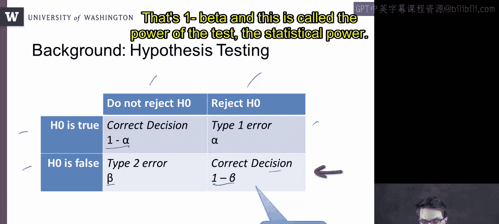

# 大规模数据科学：第2课：假设检验 📊

在本节课中，我们将要学习假设检验的基本概念。这是统计推断的核心方法之一，用于通过样本数据对总体做出结论。我们将从背景知识开始，逐步深入到具体概念和术语。

---

## 背景介绍

首先，我们来谈谈背景知识。之后，我们会回到一篇具体文章，探讨“真相为何逐渐消失”的原因。

请注意，本节内容并非大学入门统计课程的替代品，而是一个快速概述，旨在帮助你熟悉相关术语和概念。

## 统计推断与假设检验

我们讨论的是统计推断。这是从样本数据中得出关于总体结论的方法。这里有两种关键方法：**假设检验**和**置信区间**。我们稍后会再次提及置信区间，但现在不直接讨论。

那么，什么是假设检验？你将比较一个实验组和一个对照组。总会存在一个**零假设**，其含义是这两组之间没有差异。例如，接受某种治疗的人群与未接受治疗的人群没有不同；新网站产生的流量与旧网站或默认网站没有差异。这就是零假设。

**备择假设**则是指存在效应，即两组之间存在统计学上的显著差异。这里的“差异”通常通过某个**检验统计量**来定义。在入门课程或大多数课程中，例子通常是关于比较均值的，即对照组的平均效应与实验组的平均效应是否不同。

## 实验设计的重要性

统计学在很大程度上是关于设计实验以收集数据。然而，在数据科学或大数据领域，我们通常较少有机会亲自设计实验。很多时候，我们处理的数据并非由我们主动收集。这是经典统计学与数据科学方法的一个可能区别。

尽管如此，理解仔细的实验设计是所有这些工作中最重要的一环。分析技术是次要的，正确的数据收集才是首要的。这包括诸如**随机化试验**、**单盲**和**双盲**等方法。

*   **盲法**意味着参与者不知道自己属于哪一组，这几乎是不可协商的。你不能告诉人们他们服用的是安慰剂还是真正的药物，否则他们会以不同方式报告症状。
*   **随机化**也应该是不可协商的，尽管在实践中有时难以实现。随机化意味着我们通过某种方法抽取样本，然后**完全随机地**将他们分配到对照组和实验组，没有任何其他过程。

这个框架，即使只是以几个要点的高度概括，也具有难以置信的强大力量。它完全适用于数据分析。因此，理解并内化这些要点非常重要。我们将在后续讨论中更详细地探讨本幻灯片未包含的其他方面。

以下是一些你可以设想的例子：
*   测量网站上新广告位与现有广告位（对照组）相比的效果。
*   测量某种新疗法与安慰剂或现有最佳疗法相比的效果。
*   以及其他任何你能想到的场景。

## 假设检验总结

你可以将假设检验的术语整理成如下表格：

| 真实情况 \ 检验结果 | 不拒绝零假设 | 拒绝零假设 |
| :--- | :--- | :--- |
| **零假设为真** (无差异) | 正确决策 (概率 = `1 - α`) | **第一类错误** (概率 = `α`) |
| **零假设为假** (有差异) | **第二类错误** (概率 = `β`) | 正确决策 (概率 = `1 - β`，即**检验功效**) |

表格中有两种关于世界真实状态的可能性：
1.  零假设为真：对照组与实验组之间没有差异。
2.  零假设为假：存在你正在测量的效应。

同时，你的统计检验结果也有两种可能性：
1.  你不拒绝零假设：未发现两组之间存在差异的证据。
2.  你拒绝零假设：发现了两组之间存在差异的证据。

*   如果零假设为真（无差异），但你检测到了差异，这就是**第一类错误**。其发生概率称为 **`α`**。
*   在这种情况下做出正确决策（不拒绝零假设）的概率是 **`1 - α`**。
*   如果零假设为假（有差异），但你未能拒绝它（即未能检测到效应），这就是**第二类错误**。其发生概率称为 **`β`**。
*   当零假设为假时，你正确地拒绝了它（检测到了存在的效应），这个概率是 **`1 - β`**，被称为**检验的功效**。

*（图示：统计功效）*

---

本节课中，我们一起学习了假设检验的基本框架，包括零假设与备择假设的定义、实验设计的重要性，以及第一类错误 (`α`)、第二类错误 (`β`) 和检验功效 (`1 - β`) 等核心概念。理解这些是进行任何数据分析的基础。