# 杜克大学《大规模数据科学（预测分析，交流数据科学结果，第2、3课⧸共3课有视频）｜Data Science at Scale》中英字幕 p06 5_显著性的置换检验.zh_en -BV1xf421Q7bH_p6-

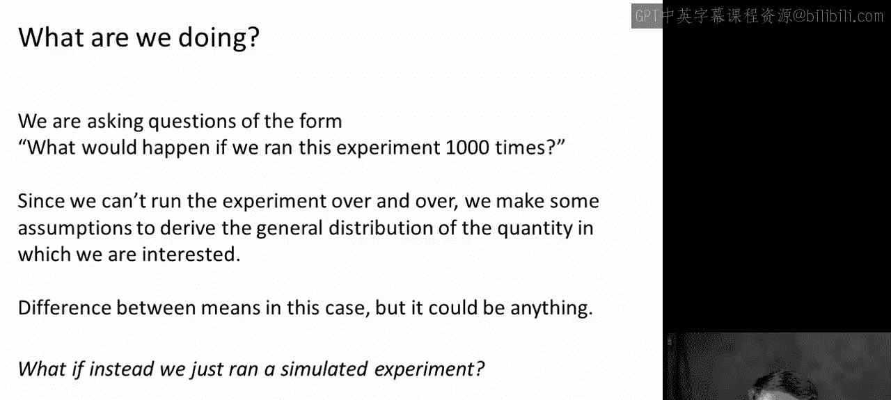

So。What are we really doing here， what we're doing is we're asking questions of the form。

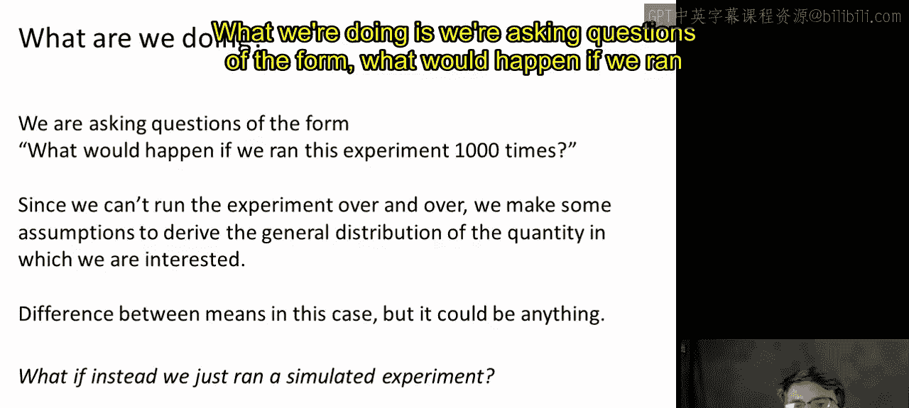

What would happen if we ran this experiment， you know，1000 times 10。

000 times we can't actually run the experiment over and over。 We can't do that， you know。

 we especially not with patients， but really with any kind of you know。

 data acquisition is an expensive process。So we。Reason about the result theoretically。

 we make some assumptions about the general distribution。

 use that to derive the distribution of the sampling distribution of the statistic we're interested in。

 and then reason about that。Based on typical values in the textbook and the tables。

So in this case it was a difference between means， but it really could be any derived statistic。

So what if instead of either doing the experiment again， which is not possible？Or。

Analyzing it theoretically by having to make assumptions about the underlying distribution。

 what if instead we just ran a simulated experiment？

If we can't draw new data from the original population。Maybe that's okay。

 We already have a representative sample of that population， the data we've already collected。

 What if we just redraw samples from that。A sample。In order to simulate these additional experiments。

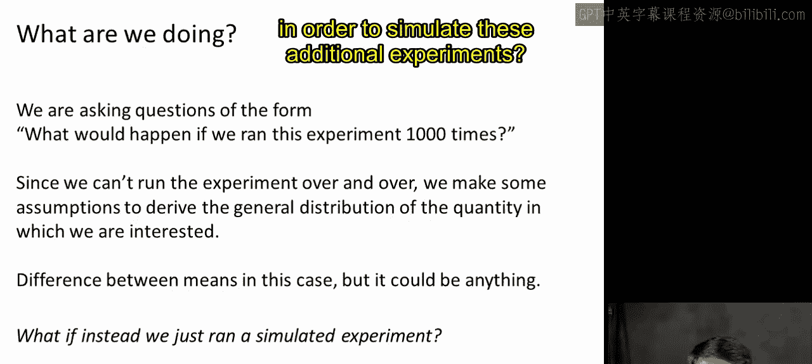

So let me give you an example， We started off with。Two populations are excuse。

 two cohorts of patients here。

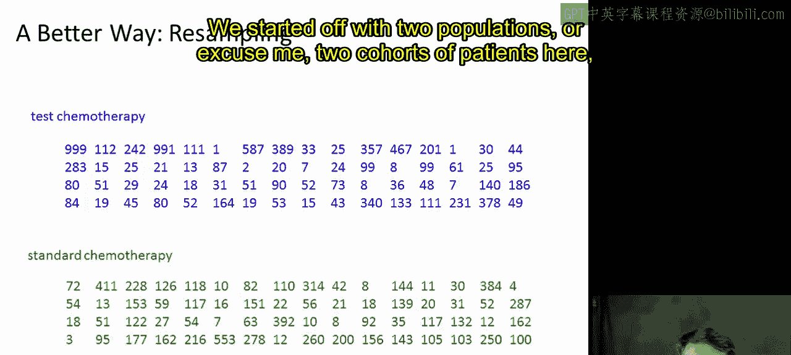

Those who receive the test treatment and those who receive the standard treatment。

If the difference between these two cohorts is significant。Then when we scramble the labels。

 if we mix up the data so that we don't know which ones are green and which ones are blue。

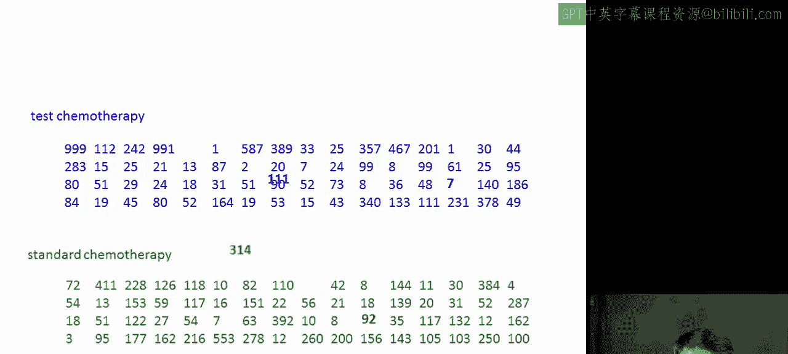

And we keep repeating this until they're all sort of mixed up。

 then we should see a significantly different result than we did on our actual data。

Right our data should be rare while repeated scramblings of the data should。

Paint out a different kind of distribution， and so we can just do that experiment by writing some code。

So if I've scrambled them here manually and I recompute the means and then I recompute the difference in the means。

 and now I get a number 10。3 days of the difference between them。

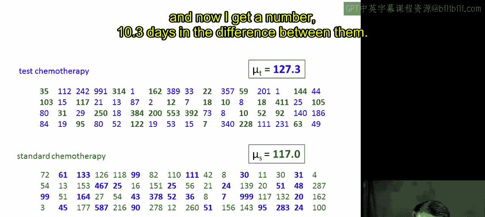

And I can keep doing this， I can compute the difference in the means。After10 trials。And I get。

 you know， two values that fall in this range and a bunch of。

A bunch of other instances that have fallen。

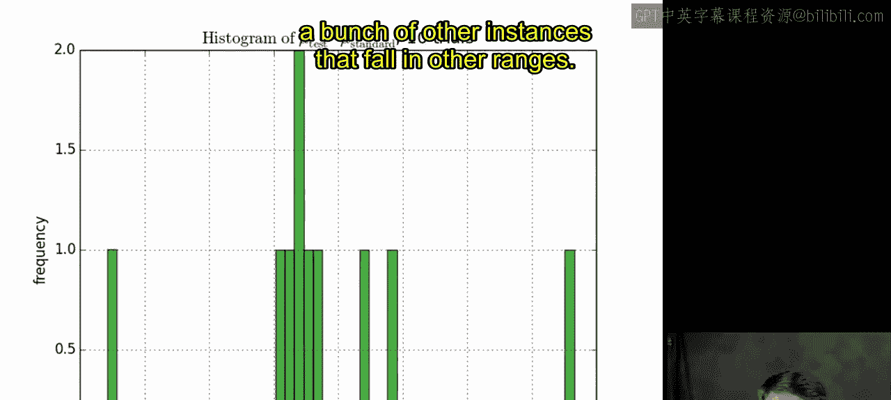

Other ranges。And then I can do it with 100 trials， and it paints out a different kind of distribution。

 You can see the shape starting to emerge， and then I can do it with 1 thousand00 trials。

 And now you sort of see the bell curve here。

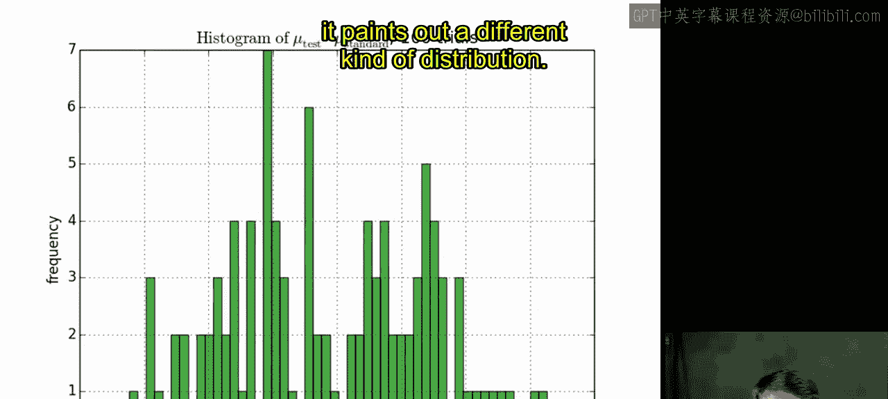

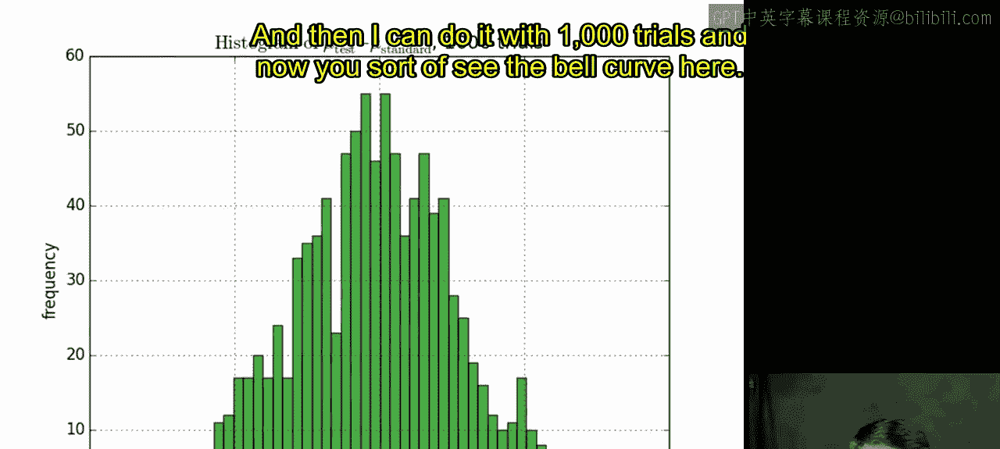

And then I can do it 10，000 trials。 and now you see a nice clean bell curve。

 and it looks like it's kind of centered around zero， which is suspicious and。

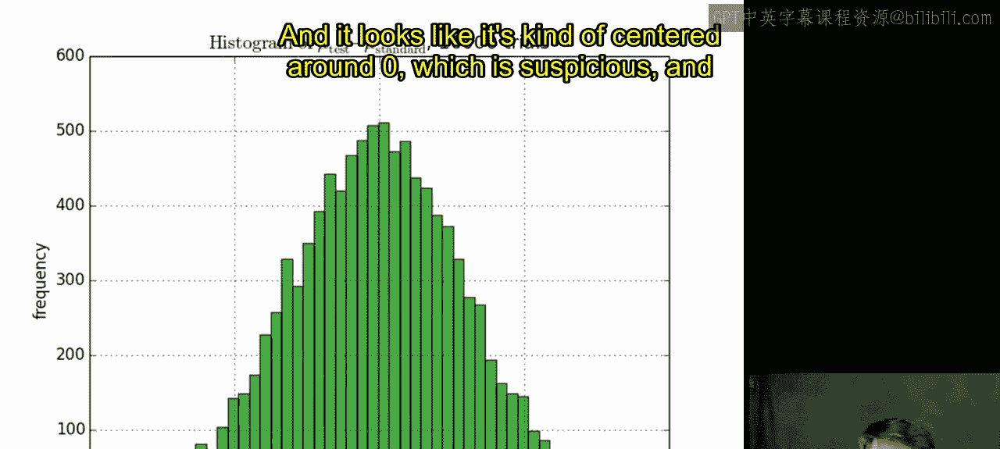

呃。Agrees with the result we found using the classical method。

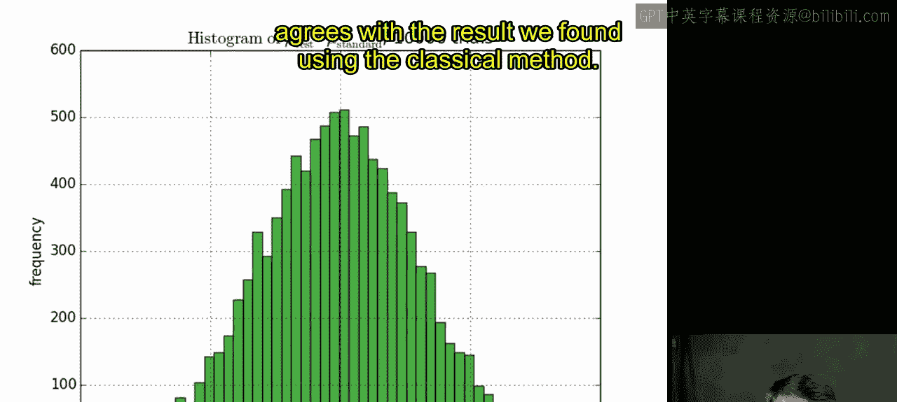

So our value of 12。4 days was right over here。And if you。嗯。Count up。

The number of times that the difference in means。Exceeded our value is 33% of them。

So 33% of the tiles produce similar greater results。

 that's nowhere near enough for us to conclude that this 12。

4 couldn't have happened by chance it's right there in the width of the distribution。

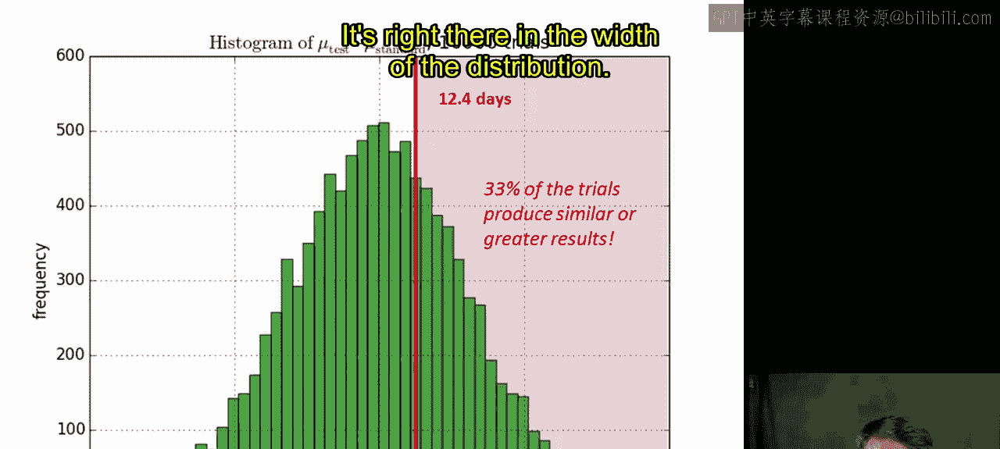

Okay， so we did this shuffle test where we scrambled the labels。

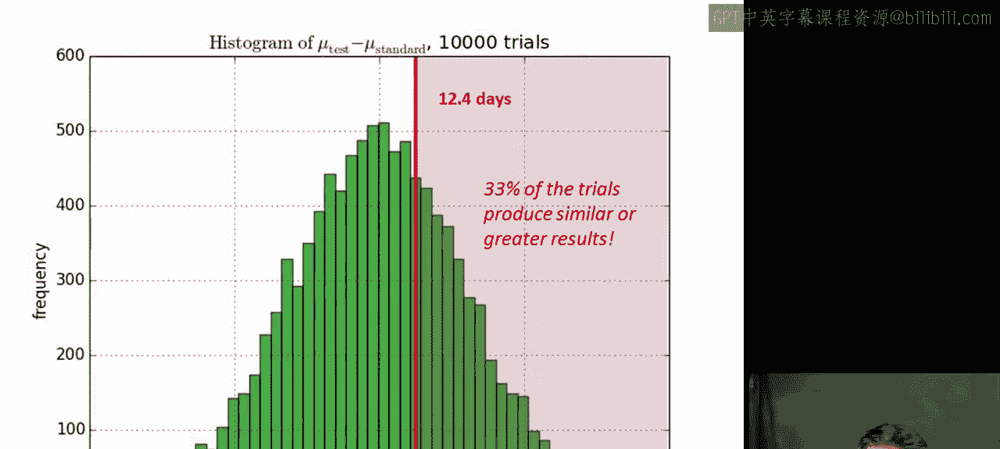

Recomputed the mean for the two cohorts of patients。

Took the difference between those means and then plot on a histogram， repeating this experiment。

10000。

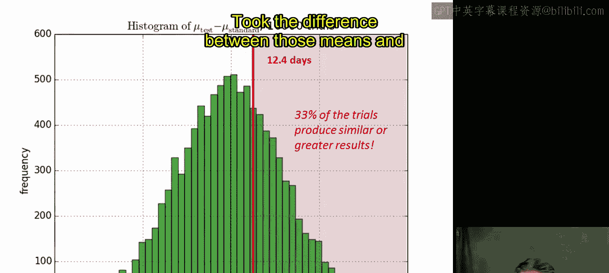

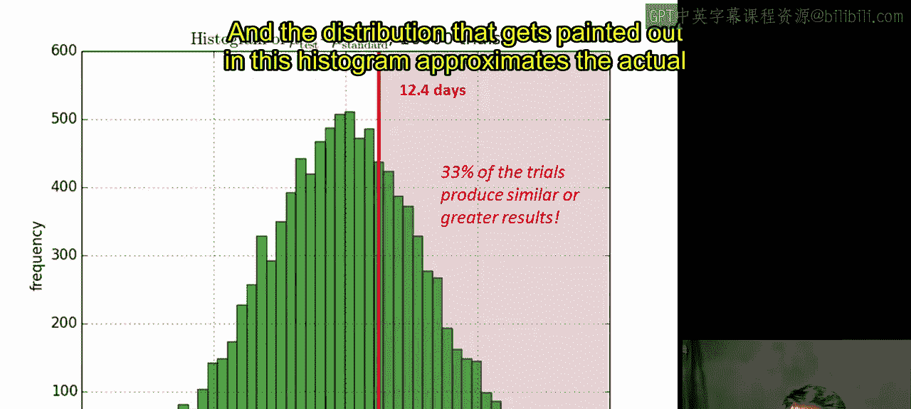

Times and the distribution that it gets painted out in this hisstogram approximates the actual sampling distribution that we tried to derive earlier using classical methods。

 except there we had to make some assumptions about the underlying distribution and you know。

Go slowly and deliberately and carefully to make sure we're interpreting all those terms correctly here we really didn't have to do very much work at all we actually and it makes sense because what we're actually doing is simulating the experiments that all that classical work is designed to accommodate the absence of right you can't actually do those experiments in practice so that you have to kind of work very hard to reason about what would happen in general。

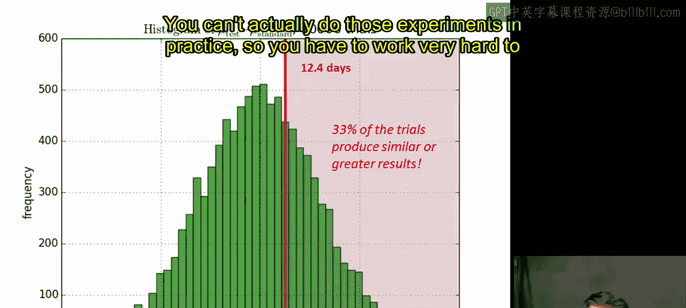

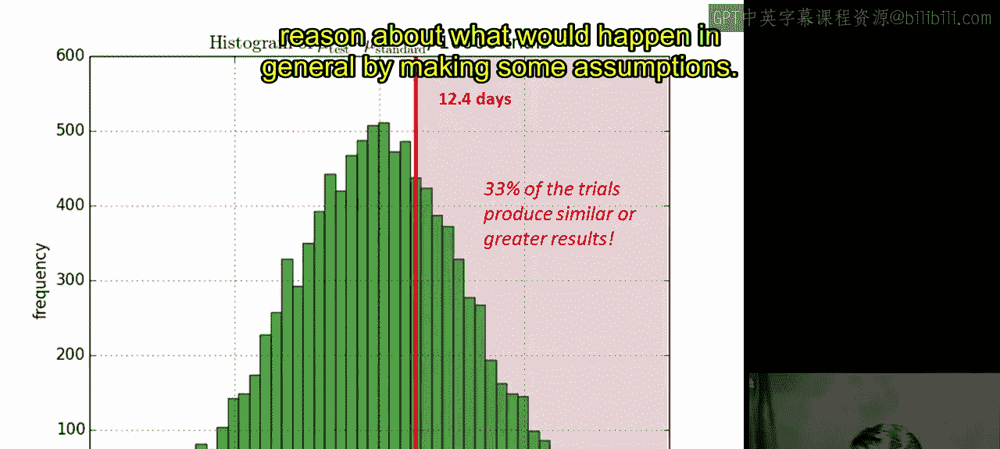

By making some assumptions here we just do the experiments directly。

 And so we directly get to the end result where the classical methods have been have been trying to get so we can state the significance。

Quite clearly， so this is the P value the one minus1 minus the 30% is indeed the P value that you may have heard about。

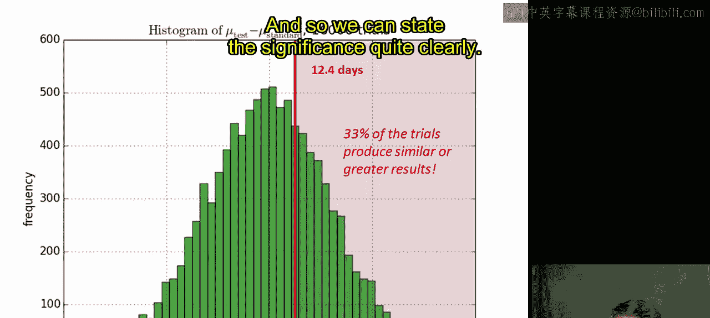

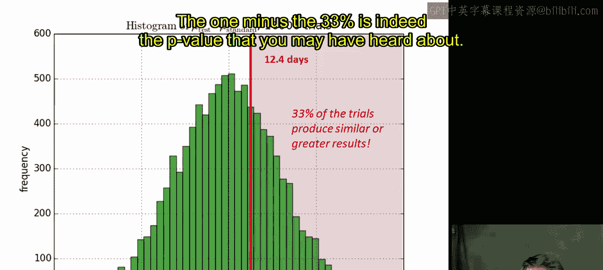