# 大规模数据科学：第2课：显著性的置换检验 🧪

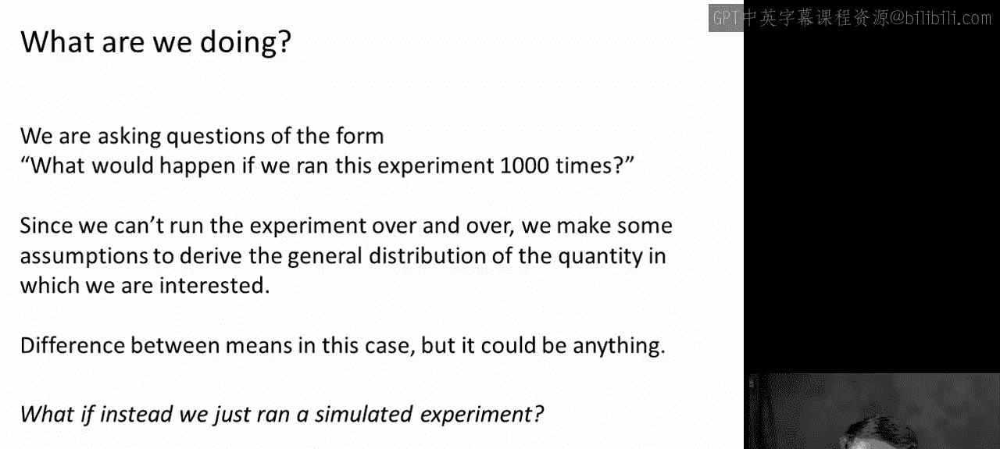

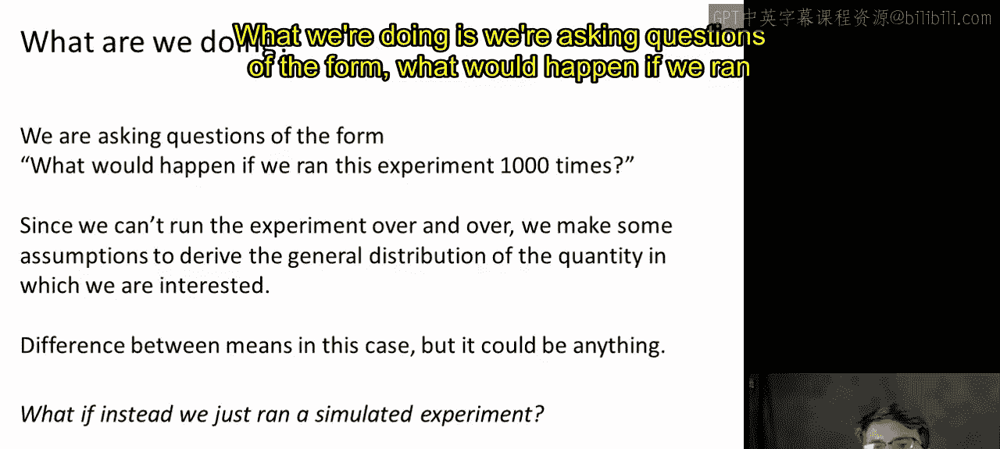

在本节课中，我们将学习一种称为“置换检验”的统计方法，用于评估实验结果的显著性。我们将通过一个模拟实验的例子，直观地理解如何在不依赖复杂理论假设的情况下，判断观察到的差异是否可能由随机因素导致。

## 概述

在传统统计推断中，我们通常通过理论推导来估计统计量的抽样分布，这需要假设数据服从某种分布。然而，置换检验提供了一种替代方案：通过直接模拟大量随机实验，来构建统计量的经验分布，从而评估观察结果的显著性。

上一节我们介绍了传统统计推断的局限性，本节中我们来看看如何通过模拟实验来绕过这些限制。

## 置换检验的核心思想

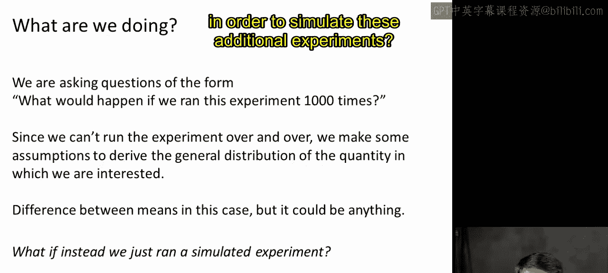

我们真正在做的是提出这样的问题：如果我们把这个实验重复运行1000次、10000次，结果会怎样？实际上我们无法反复进行真实实验，尤其是涉及患者或其他成本高昂的数据收集过程。

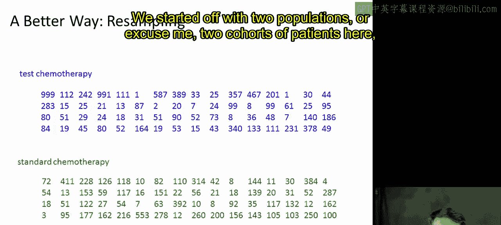

因此，传统方法是通过理论来推理结果：我们对总体分布做出一些假设，用此推导出我们感兴趣的统计量的抽样分布，然后基于教科书和表格中的典型值进行推理。在这个案例中，统计量是均值差，但它可以是任何衍生统计量。

那么，如果不能重新做实验（这通常不可能），或者不想通过假设底层分布来进行理论分析，我们该怎么办？我们可以转而运行一个模拟实验。

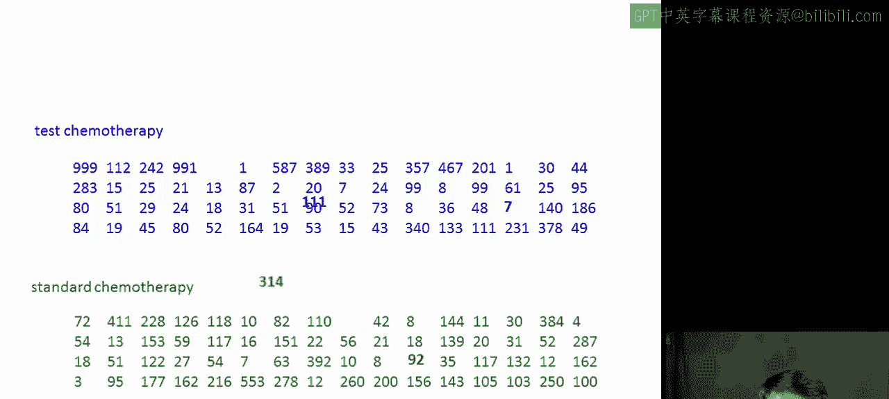

如果我们无法从原始总体中抽取新数据，这或许没关系。我们已经拥有该总体的一个代表性样本，即我们已经收集到的数据。我们可以直接从**这个样本**中重新抽取数据，以模拟这些额外的实验。

## 一个具体例子

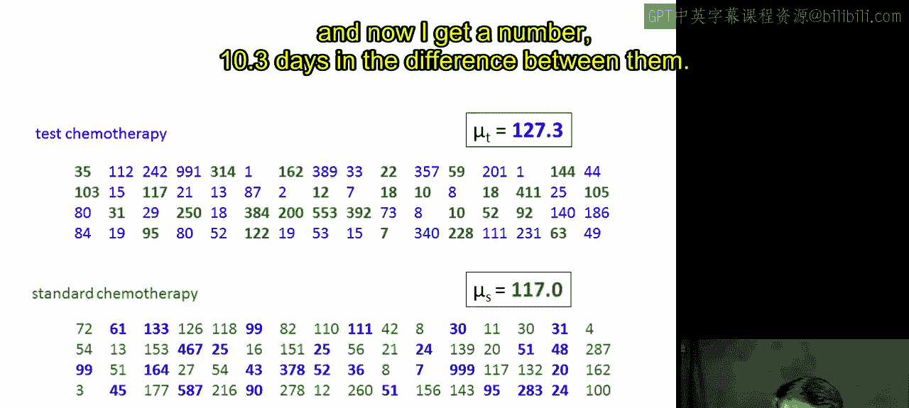

让我们来看一个例子。我们最初有两组患者：接受新疗法的患者和接受标准疗法的患者。

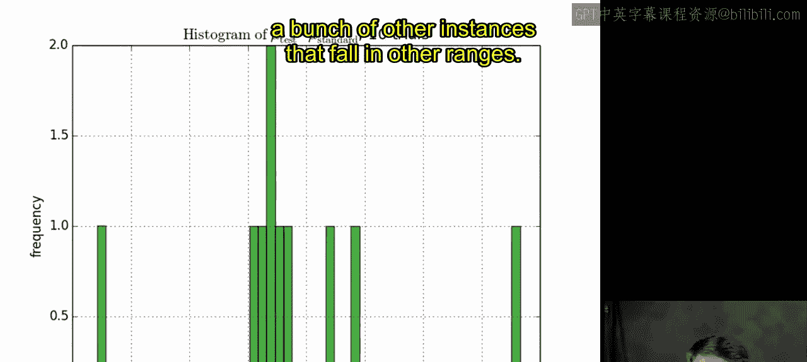

如果这两组之间的差异是显著的，那么当我们打乱标签（即混合数据，使我们不知道哪些数据点属于哪一组）并不断重复这个过程，直到数据完全混合后，我们应该会得到一个与真实数据显著不同的结果。

我们的真实数据结果应该是罕见的，而数据的重复打乱应该会描绘出一种不同的分布。我们可以通过编写一些代码来直接进行这个实验。

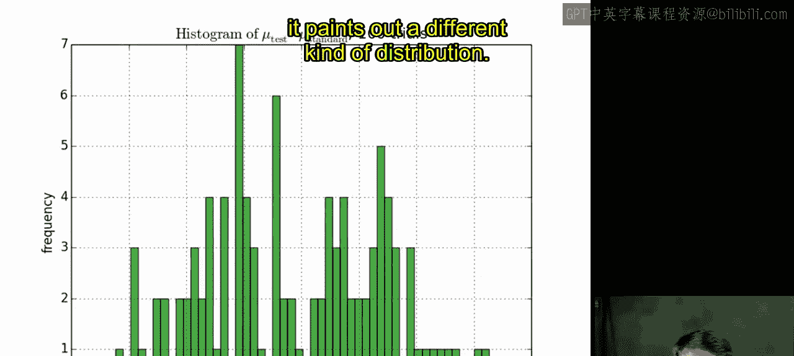

以下是模拟实验的步骤：
1.  将两组数据合并。
2.  随机打乱所有数据的“组别”标签。
3.  根据新的随机标签，将数据重新分成两组。
4.  计算新分组的均值差。
5.  重复此过程成千上万次，记录每次的均值差。

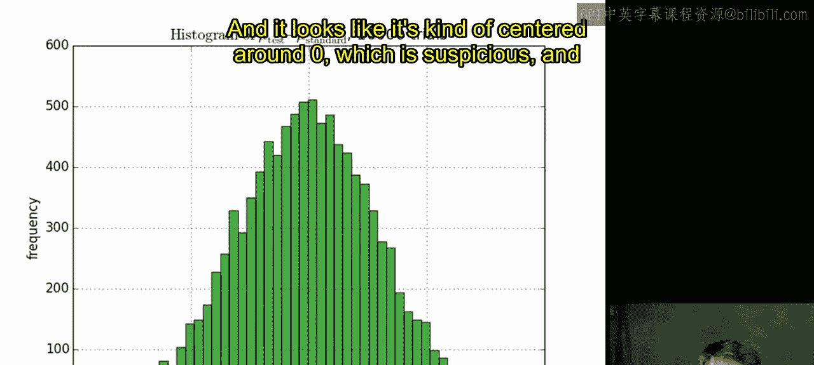

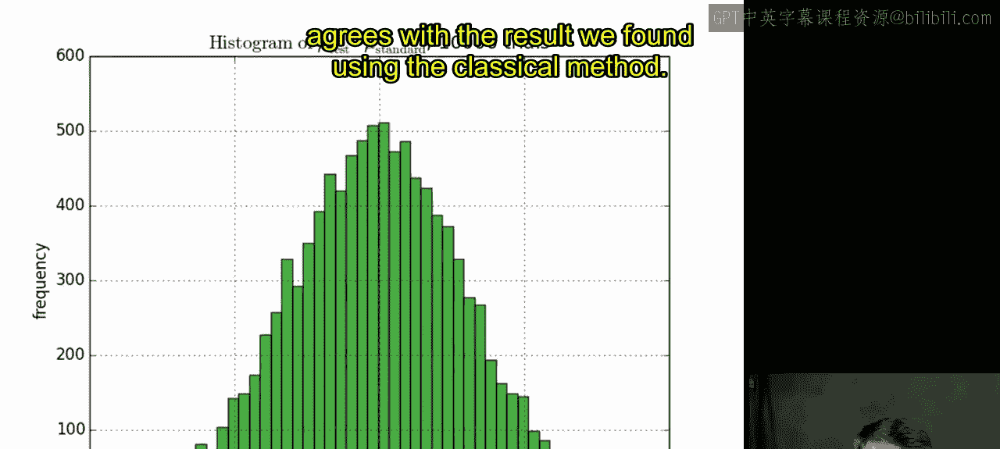

通过手动打乱标签并重新计算均值差，我们可能得到一个数值，例如10.3天。

我们可以持续进行这个操作。在10次试验后，我们得到一些落在不同范围内的值。在100次试验后，分布的形状开始显现。在1000次试验后，我们可以看到类似钟形曲线的分布。在10000次试验后，我们得到一个清晰、漂亮的钟形曲线，并且它似乎以零为中心。

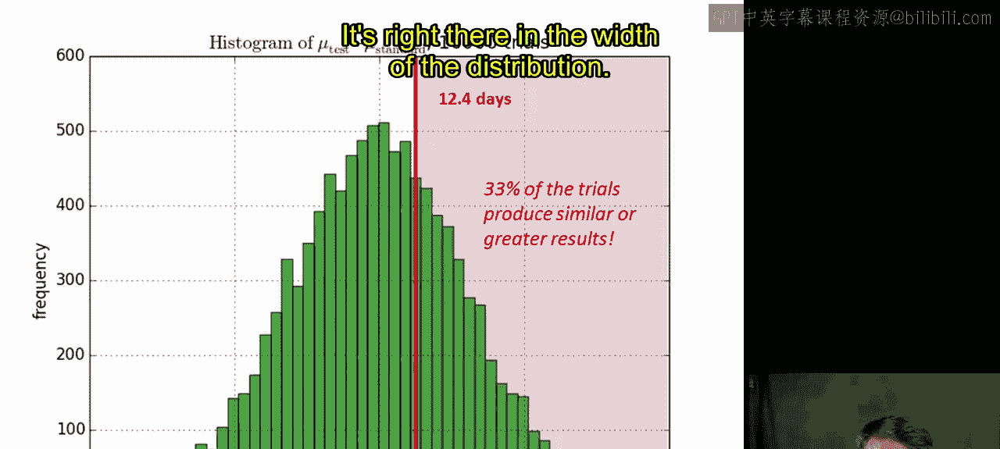

这个结果与我们使用经典方法得到的结果一致。我们观察到的12.4天的差异值就落在这个分布之中。如果我们计算均值差超过我们观察值（12.4天）的次数，发现大约有33%的模拟结果产生了相似或更大的差异。

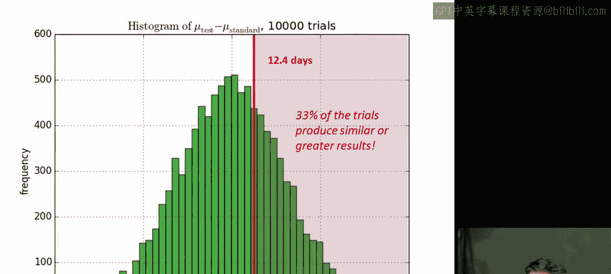

这意味着，有33%的随机打乱产生了与我们观察结果一样极端或更极端的结果。这远不足以让我们得出结论，认为这12.4天的差异不可能是偶然发生的——它正好落在这个分布的宽度之内。

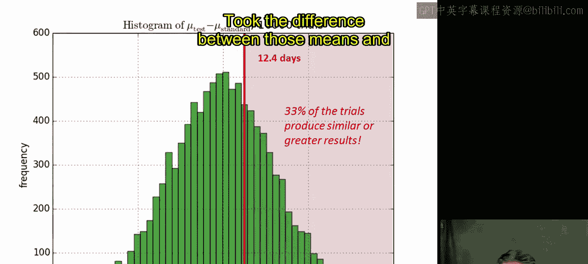

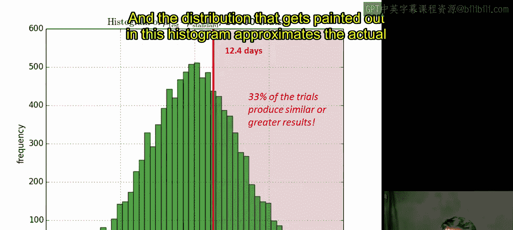

## 方法总结与P值

我们进行了这个“打乱检验”：我们打乱了数据标签，重新计算了两组患者的均值，取它们的差值，并将结果绘制在直方图上，重复这个实验10000次。

这个直方图描绘出的分布，近似于我们之前试图用经典方法推导的实际抽样分布。区别在于，经典方法需要对底层分布做出假设，并且需要仔细、严谨地解释所有术语。而在这里，我们几乎不需要做太多工作。这很合理，因为我们实际上是在模拟那些经典理论试图弥补无法实际进行的实验。

通过直接进行模拟实验，我们直接得到了最终结果，而经典方法正是试图达到这个结果。因此，我们可以非常清晰地陈述显著性。

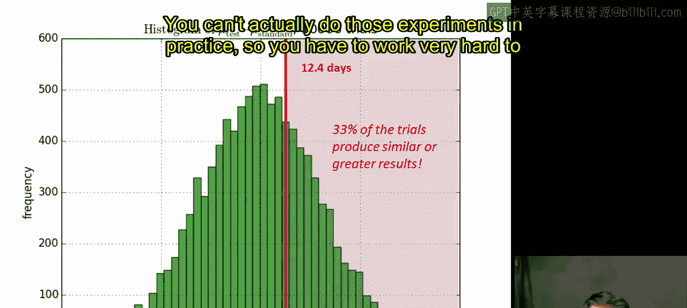

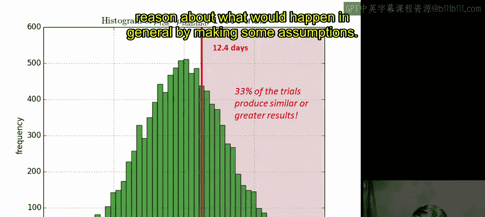

这个P值，即1减去那个30%（更准确地说，是观察到极端结果的概率），正是你可能听说过的P值。它量化了在零假设（即两组无真实差异）成立的情况下，观察到当前结果或更极端结果的概率。

## 本节课总结

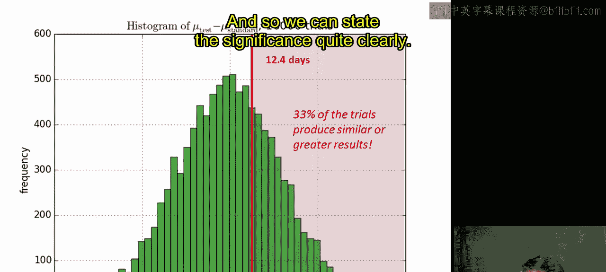

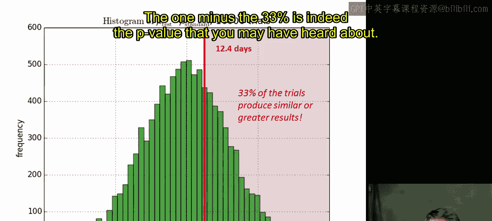

本节课中，我们一起学习了置换检验的基本原理和应用。我们了解到，通过随机打乱数据标签并重复计算统计量（如均值差），可以构建该统计量的经验分布。通过将实际观察值与此经验分布进行比较，我们可以计算P值，从而评估观察到的效应是否具有统计显著性。这种方法直观、计算驱动，且对数据分布的假设要求较少，为评估显著性提供了一个强大而灵活的工具。