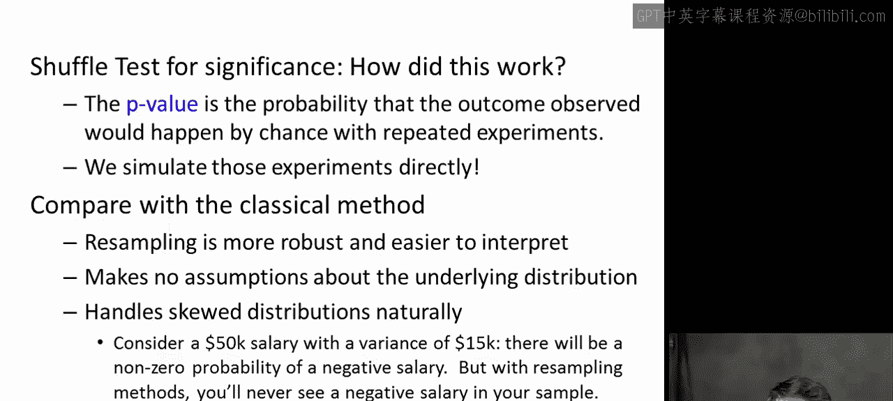
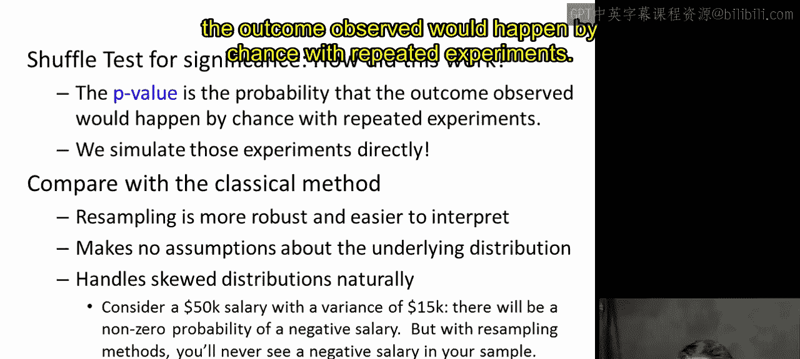
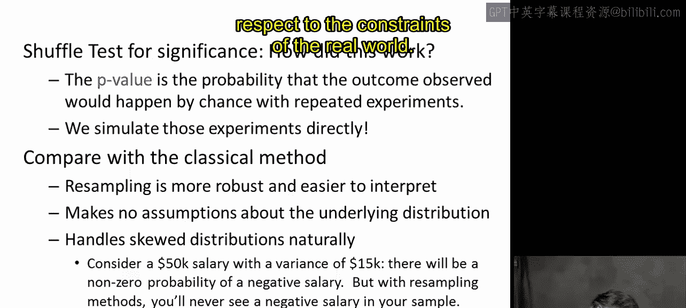
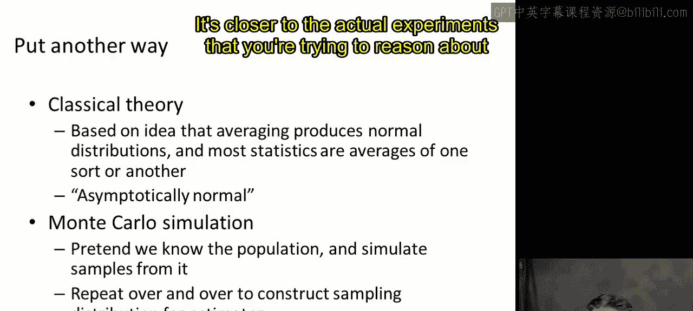
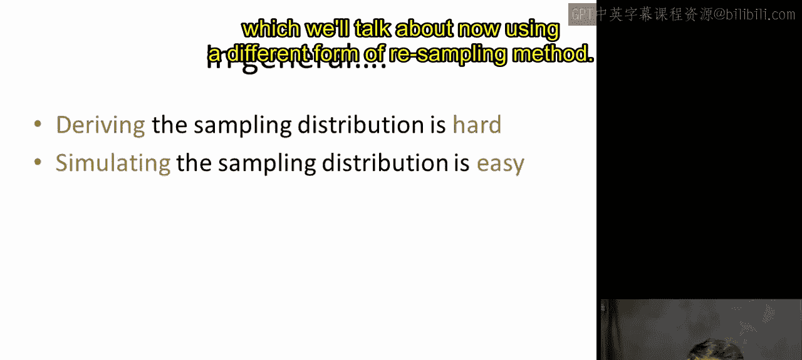

# 杜克大学《大规模数据科学（预测分析，交流数据科学结果，第2、3课⧸共3课有视频）｜Data Science at Scale》中英字幕 p07 6_比较经典和重抽样方法.zh_en -BV1xf421Q7bH_p7-

So with this shuffel test， how does this actually work， the P value。

 which we didn't talk about directly， is the probability of the outcome observed would happen by chance with repeated experiments。

 And we simulated those experiments directly。 And compared with the classical methods， this is。

 you know， more robust and arguably much easier to interpret because you just see the distribution right in front of you that you generated。

By running the experiments， you know， this matches exactly the interpretation that your your're。

Supposed to use when reason about the things like the P value and these confidence intervals。

 which we'll talk about in a second， and it makes no assumptions about the underlying distribution。

 which is crucial， right， You don't have to care。You don't have to sort of imagine what the underlying population。

 the characteristics of the underlying population are the parameters that define the distribution of the underlying population。

 you just resample the method and you'll see that distribution painted out or the sampling distribution painted out。

So for example， it handles sked distributions naturally。

 consider a you know salary salary measurements where the $50，000 a year salary is the mean。

 but the variance is 15 k。 Well， if you model this as a normal distribution。

 you have a non-zero chance of getting a negative salary which can't actually happen but。

When you just work from the。Sample that you've already collected， you won't have any。

Negative salaries， for sure。Okay， so you don't have to sort of stand on your head to kind of constrain the or change the distribution。

Of the underlying population， you' changing normal distribution so that it's kind of bounded at 0 or do anything like that。

 You just work with the data you have and you'll naturally sort of be robust with respect to。

あ。The constraintsst of the real world。Okay， so put another way。

 classical theory is based on the idea that averaging tends to produce normal distributions， right。

 this is the central limit theorem。And that most statistics are essentially some kind of an average of one kind or another。

 So asymptotically， they are normal distributions or Gaussian。 And so we can。

Start from a Gaussian and then reason about the sampling distribution of all these different kinds of statistics one way or another and pretty much all this has been worked out for any kind of situation or case or statistics you want to statistics you want to compute。

 they'll be the sampling distribution has probably been derived and you can look it up in a textbook。

But as an alternative， you can do this kind of Monte Carlo simulation where we pretend we know the population and simulate samples from it and repeat over and over and over just to construct the sampling distribution for the estimator you're interested in more or less directly so I may be belaboring this but I really want to sort of bring home the idea that not only is this arguably clear and understand。

 it actually is closer to the goal， it's closer to the actual experiments that you're trying to reason about theoretically。

So in general， deriving the sampling distribution is difficult。

 but simulating the sampling distribution is easy。So so far we've shown this shuffle test。

 but now I want to show。It shuffled as useful for significance testing so you can tell whether the value is significant or not。

 but it doesn't really give you the effect size， it doesn't give you how important that value is。

 what kind of range of values that estimator can take。And for that。

 you need the confidence interval arosche we'll talk about now using a different form of reampling method。

