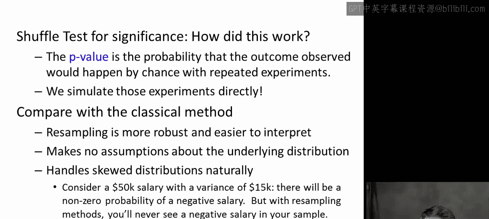
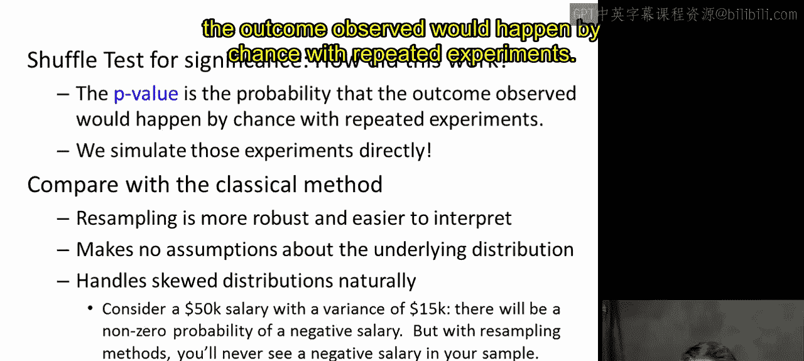
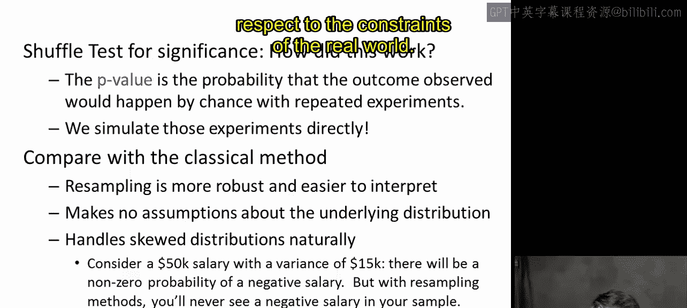
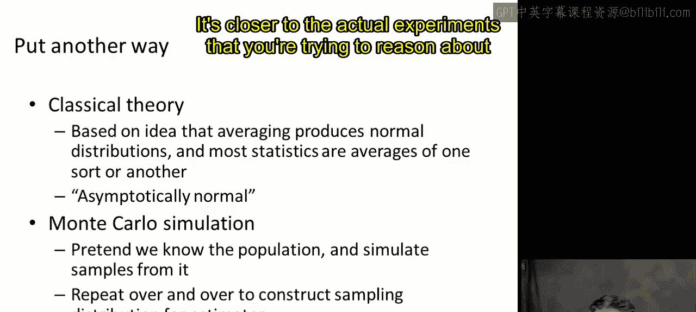
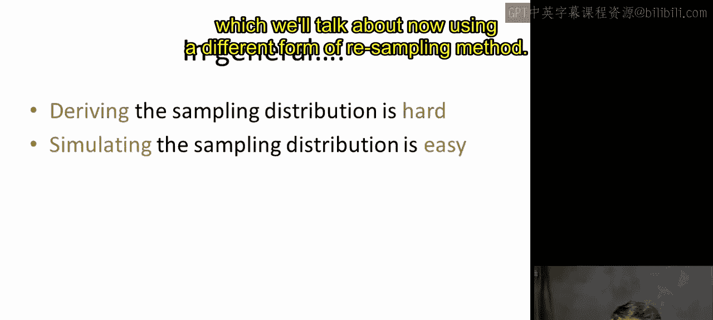

# 大规模数据科学：第6章：比较经典方法与重抽样方法 🧪

在本节课中，我们将学习如何通过重抽样方法（如置换检验）来评估统计显著性，并将其与依赖理论假设的经典方法进行比较。我们将探讨P值的概念、重抽样方法的优势，以及如何通过模拟实验来直观地理解统计推断。

---

## 置换检验的工作原理





上一节我们介绍了重抽样的基本思想，本节中我们来看看置换检验的具体工作机制。P值，我们之前没有直接讨论，它表示在重复实验中，**观测到的结果偶然发生的概率**。我们通过直接模拟这些实验来计算P值。

与经典方法相比，重抽样方法**更稳健**，并且可以说**更容易解释**，因为你直接看到了自己生成的分布。


通过运行这些模拟实验，其结果完全符合你在推理P值和置信区间（我们稍后会讨论）时应该使用的解释逻辑。

---

## 重抽样方法的优势

重抽样方法的一个关键优势在于，它**不对底层数据分布做任何假设**。这一点至关重要。你无需关心或想象底层总体的特征，也无需定义其分布的参数。你只需对现有样本进行重抽样，就能看到抽样分布被清晰地描绘出来。

以下是重抽样方法处理偏态分布的一个例子：

考虑年薪数据，假设平均年薪为 **$50,000**，方差为 **$15,000**。如果将其建模为正态分布，你将得到一个非零的负薪水的概率，而这在现实中不可能发生。

```python
# 经典方法可能产生不现实的负值
import numpy as np
mean_salary = 50000
std_salary = 15000
# 从正态分布中抽样，可能产生负值
possible_salary = np.random.normal(mean_salary, std_salary, 1000)
negative_count = np.sum(possible_salary < 0)
print(f"从正态分布抽样中，负薪水的数量: {negative_count}")
```

然而，当你仅从已收集的样本中进行重抽样时，你**肯定不会得到任何负的薪水数据**。因此，你无需费尽心思去约束或改变底层总体的分布（例如，将正态分布的下界设为0），你只需处理手头的数据，就能自然地适应现实世界的约束。




---

## 经典理论与重抽样模拟

换一种说法，经典统计理论基于一个核心思想：**平均化倾向于产生正态分布**，这就是中心极限定理。大多数统计量本质上都是某种形式的平均值。因此，渐近地看，它们服从正态分布或高斯分布。

基于此，我们可以从高斯分布出发，推理出各种统计量的抽样分布。几乎所有情况下的抽样分布都已被推导出来，并可以在教科书中查到。

但作为一种替代方案，你可以进行**蒙特卡洛模拟**。在这种模拟中，我们假设已知总体，并从中反复模拟抽取样本，从而直接为你感兴趣的估计量构建出抽样分布。

我可能有些赘述，但我真的想强调：这种方法不仅清晰易懂，而且**更接近目标**，更接近你试图从理论上推理的实际实验过程。



总而言之，**推导抽样分布是困难的，但模拟抽样分布是容易的**。

---

## 从显著性检验到效应大小


到目前为止，我们展示了置换检验可用于**显著性检验**，即判断一个值是否显著。但它并不能给出**效应大小**，即无法告诉你这个值有多重要，或者估计量可能取值的范围。

为了评估效应大小和估计量的不确定性范围，你需要**置信区间**。这需要使用另一种形式的**重抽样方法**，我们将在接下来的课程中讨论。



---

## 总结


本节课中，我们一起学习了如何利用重抽样方法（特别是置换检验）进行统计推断。我们了解到，与依赖严格理论假设的经典方法相比，重抽样方法通过直接模拟实验来构建抽样分布，具有**无需假设分布、结果直观、对偏态数据更稳健**等优势。虽然置换检验擅长检验显著性，但要评估效应大小，我们还需要借助能构建置信区间的其他重抽样技术。