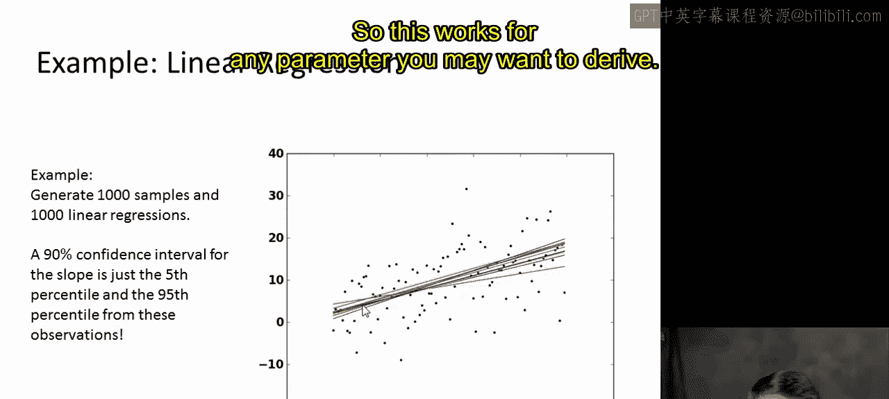

# 杜克大学《大规模数据科学（预测分析，交流数据科学结果，第2、3课⧸共3课有视频）｜Data Science at Scale》中英字幕 p08 7_自助法.zh_en -BV1xf421Q7bH_p8-

Okay， so we may have decided that a result is significant or in our case。

 we decided it wasn't significant， but we don't really know how large the effect typically will be。

 What sort of values will our statistic take on these repeated experiments。

 We do the experiment many many times， what sort of range of values it'll typically take So the classical method for computing this confidence interval。

Is to take the critical value we found from that we looked up in that table。

For the T statistic and multiply by the standard error of the T statistic to compute these marginal。

 So the difference in means minus this marginal and the difference in mean plus this marginal give us this。

 this range。 and you know， it can be the。嗯。At different significance levels。

 willll give you different size or confidence intervals， right。

 So we picked a significant level of 0 point。5%， 0。05， which means it's 2 and a5 percent to 97。5%。

So for the reampling method， though。Utterly straightforward。

 Just literally run this experiment over and over and over again。

Using these bootstrap samples that I'll talk about in a second and just compute the fifth and 95th percentiles of all the different results you get right if you do 10。

000 repetitions of the experiment，What's the5 percent and then compute the now you have 10。

000 difference of means。Take the  fifthth percentile and the 95th percentile。 That's the range。

 So it just directly computes it。 The only trick is whether we can trust this bootstrap sampling process or not。

And so that's been worked out。 And it's a rigorous way of doing it with a couple of caveats that we'll talk about in a second。

 So given a data set of size in， draw it in samples。 So if you have 100。In 37 patients。

 you're going to create another sample of size 137。But you're going to sample with replacement。

 so you may get duplicates in the result。Okay。We brief this lots of times， you know，100， 10，000。

 many， many times， which is easy with you know。Computers now。So these are you now have 1，000 or 10。

000 loop sample data sets that you know were all drawn from the same original population。

And so you can compute these 1000 sample statistics and you can interpret these as repeated experiment。

 which is exactly what the classical methods call for you're exactly capturing。U。The， the。

Goal of the theory developed in the classical methods。 Okay。

 the key assumption here is that all the samples need to be independent。

 but you don't have to assume very much else。So we don't really know the distribution from which the data was drawn。

 have but the data we've already collected estimates its own distribution。

 so drawing random samples from that distribution gives you an estimate。Okay。

And if you think about so why is it with replacements， versus without replacement？

One is if you join a sample size of a sample of size in from population of size in and you do it without replacement。

 you're going to get the same thing every time， but even if you were allowed to do different sizes which does come up and sometimes you're going to want to assume independent remember we said assuming independence comes up over and over and over again。

 if you don't do with replacement then now the samples will be dependent there'll be a lower probability namely zero of ever drawing that you draw value 95 in the future you'll never have a chance to drawing that again if you don't do it with replacement so then now they're no longer independent。

Okay。So just to flash an example of this on the screen， imagine we have the data set 123456。

 we compute the mean of that as 3。5， then we draw a bootstrap sample。

 the first value in our bootstrap sample is4， then we draw3。

 then we draw four again because it's with replacement and so on and we get a mean of 3。

33 and then we can repeat that sampling and mean computation procedure over and over and over again until we have a set of observations of the mean and we can do this with difference of means or any other kind of statistic you may want to derive with a couple of exceptions that we'll mention in a second。

So with our own data， we can do this as well， but it's important that we take a bootstrap sample of the test cohort and then a bootstrap sample of the standard。

嗯。Cohort。Okay， and if we do that。We can paint out a histogram that might look like this。

 where you can see that the。Zero value， so the mean where the mean is zero is squarely within the confidence interval。

 these two red lines are the2 and a half percentile and the 97。

5 percentile to give a significance level of 0。05。And our mean。

 if you remember our derived sample mean or our。Mean from our original sample was 12。

4 so somewhere in here， but there's you know confirming what we found earlier。

 there's no reason to assume to reject the null hypothesis here zero is squarely within the confidence interval it would very。

え。Not not unlikely at all that it would happen by chance that we would see that value Okay。

 so you can do this with other statistics as well， not just confidence intervals。

You can say do it when you're doing linear regression。

 you take a bunch of points and you compute the linear regression and。诶。

Draw bootstrap samples from those set of points。Right。

 drawing with replacement to drive 1000 samples or 1000 samples。

 recompute the linear regression each time， and you'll get a bunch of little lines that all have the same similar。

 similar slope， but not exactly the same slope。 And now by reasoning about that range of slopes that you got from all those samples。

 you can construct a confidence interval over the slope of the true line。

 so this works for sort of any parameter you may want to derive。

Again， with a couple of exceptions。