# 杜克大学《大规模数据科学（预测分析，交流数据科学结果，第2、3课⧸共3课有视频）｜Data Science at Scale》中英字幕 p10 9_异常值和秩变换.zh_en -BV1xf421Q7bH_p10-

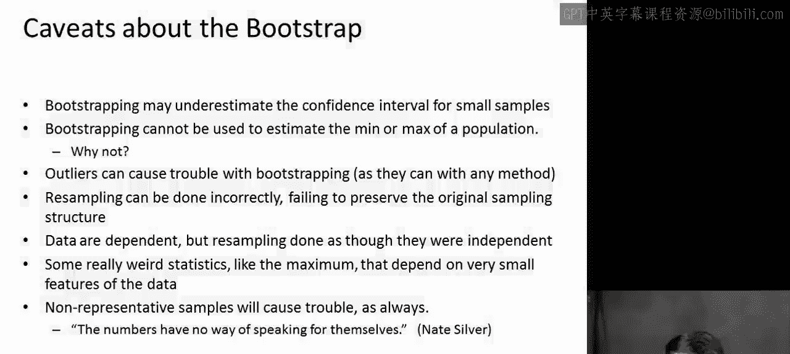

So I mentioned that outliers were problematic for resampling methods as they are for classical methods。

 and I want to make sure you're aware of a common technique to handle outliers。

 which turns out to be pretty useful I think in data science context。

 perhaps because the data is often noisy enough that outliers are pretty common。

 So this is the rank transformation and it's dead simple the idea is to replace each value with its ordinal position in sorted order so that the lowest value receives the value is transformed to the value1。

 the next lowest transform to the value2 and so on。

 So if you had data that looked like this where this is just meaning this observation ID and the actual measurement was here。

 there's all kinds of structure in the oops I'm sorry I'm not using the correct pin here。

There's outliers here。 and this is some measurement of value。

 There's all kinds of structure in the observations down here pegged along zero。

 but these outliers up here are kind of screw up the。Ability to kind of see that structure。

So what you can do。

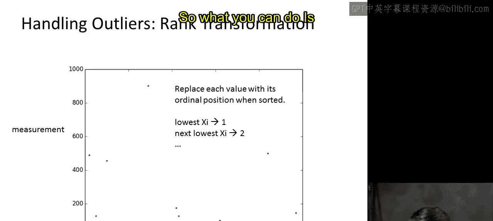

Is sort the out sort the values。 and then you can sort of see what these outliers are doing。 again。

 there's all kinds of structure down here， but these outliers up here at the end are dominating the effect and are going to cause problems for most of the statistics statistics we might want to do after you do this rank transformation you end up with this kind of nice even spread And what we've done is take the again。

 the highest value gets this is no longer in sorted order。

 This is back back in the original observation I order。

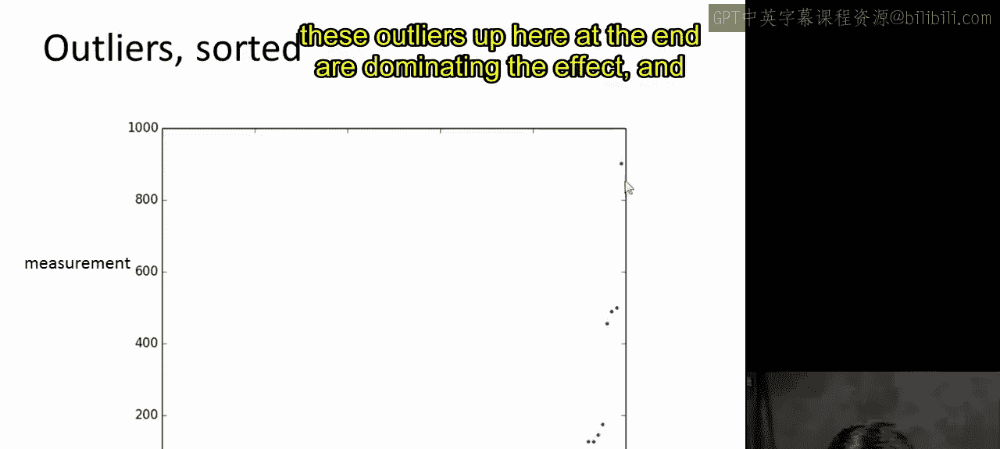

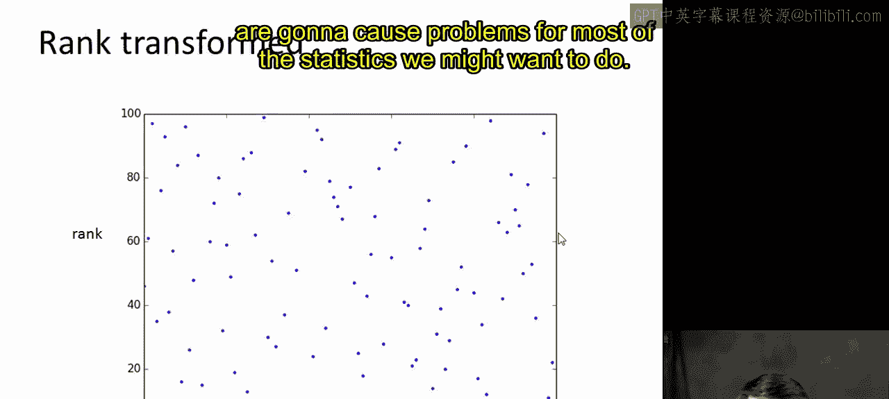

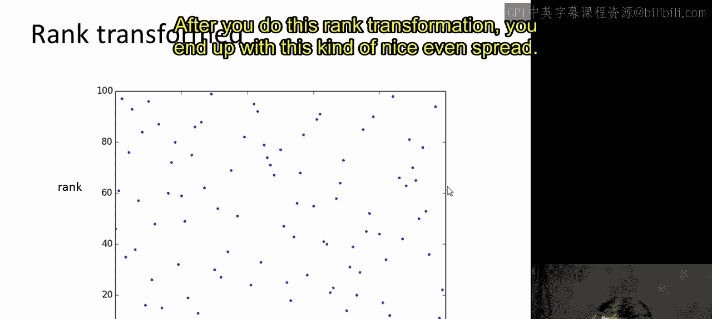

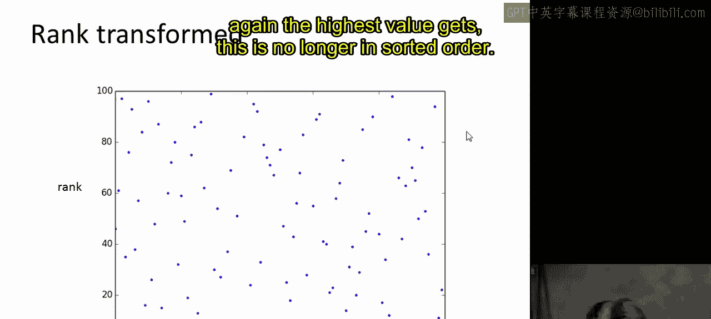

But the highest value up here used to be orders of magnitude higher in the measurement space。

 but now it's just value 100 in the rank space。

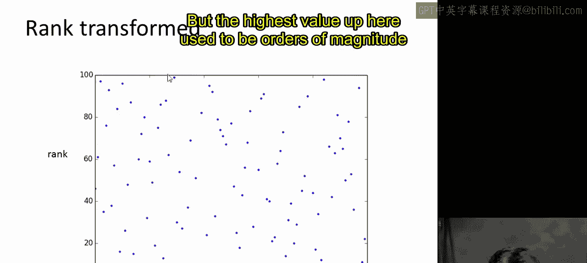

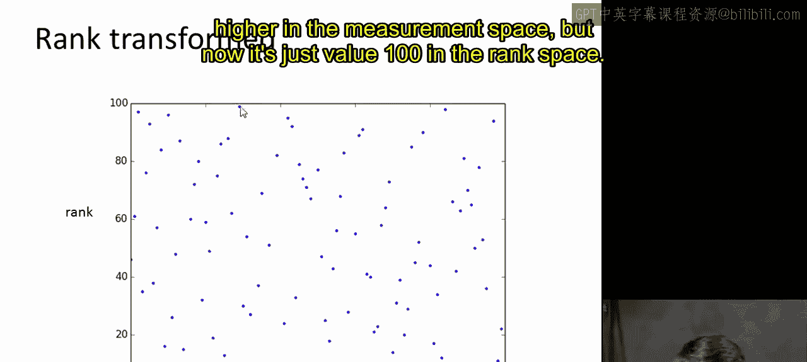

OkayAnd so this is， you know the statistics that you'll compute over this。

 you can still take many of the same statistics and it still works。

 but you should be aware that the questions that you're answering now are now different so for example in our。

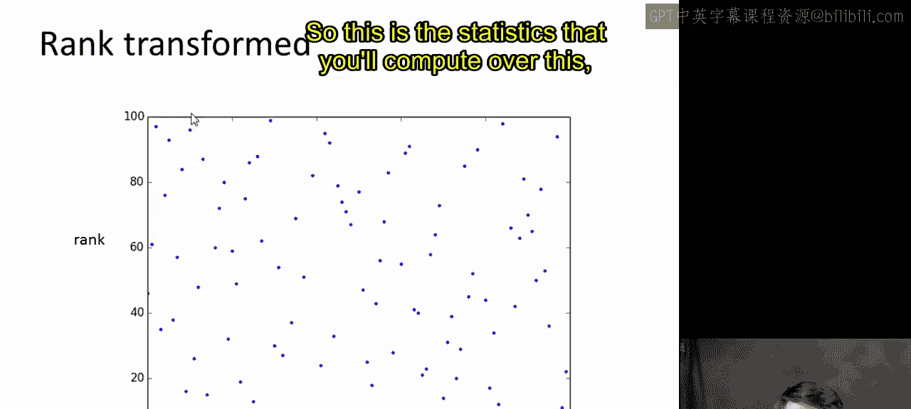

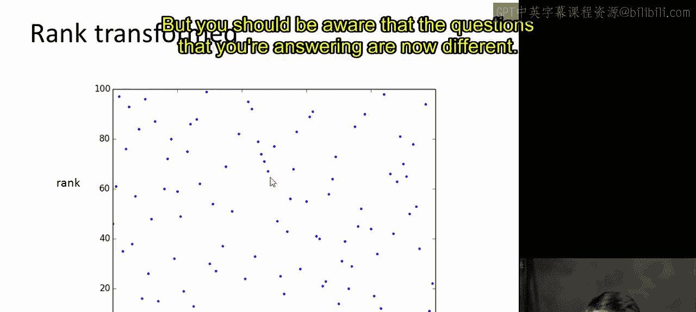

Running example here， the rank transformation answers a different question。

 do the patients who receive the new treatment tend to be among those who live longer as opposed to does the mean number of days survived you know are it higher among those treated patients so for example。

 if you if you're looking at data。

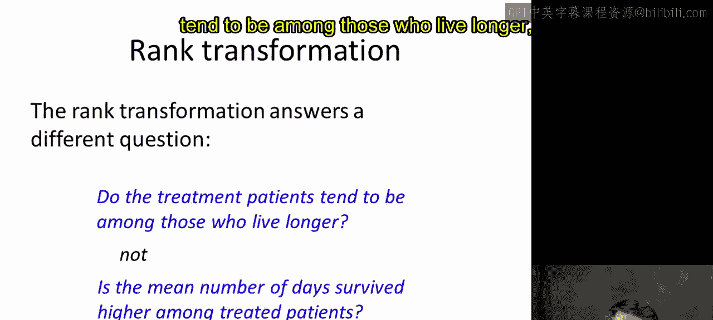

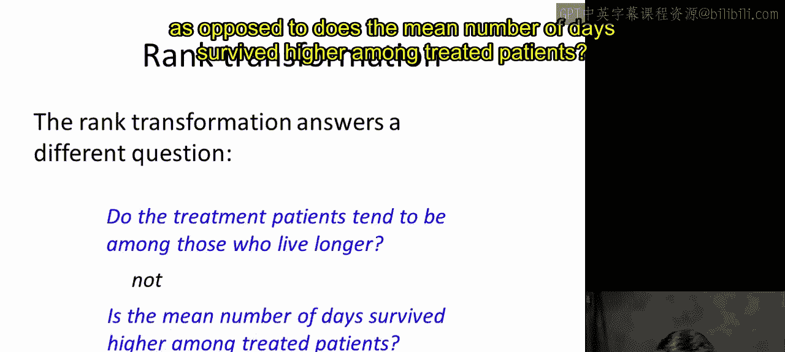

salaryalary。

Measurements， you know， if you have Bill Gates in your。Sample。There's going to be a sw in the。

And the data， although perhaps not anymore more of a salary and maybe maybe net worth and as suppose to salary。

 I'm not sure what kind of salary he's drawing these days。But if you put it in rank order。

 he will still be the highest。ANet worth individual， perhaps。

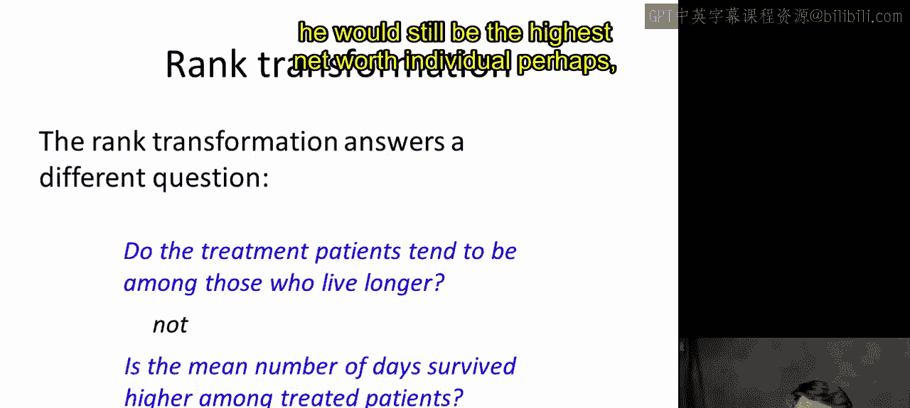

But it won't。It won't won't have that it won't have that skewing effect okay。

 and then you can reason about things you know。

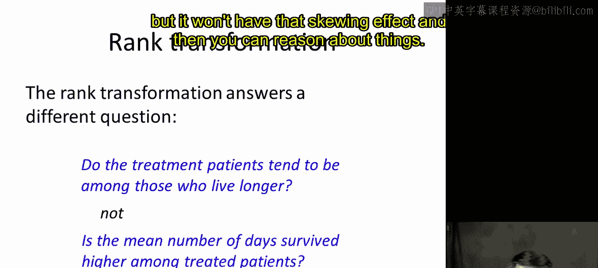

Do people with certain kinds of jobs tend to be among those who have the highest net worth？

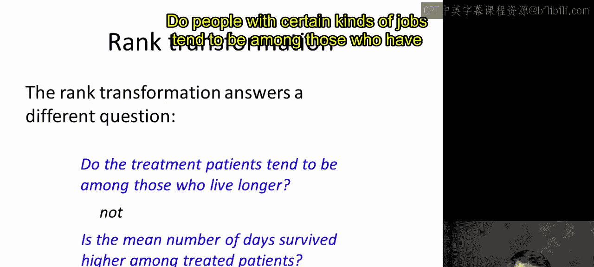

Without reason about the exact value of that net worth， which， again， sometimes doesn't matter。

 You want to be in the， you know， if you want to reason about properties of the top 5% earners。

 those are valid questions you can ask independently of by worried about exactly how much they they make。

 And in fact， this transformation makes sense。

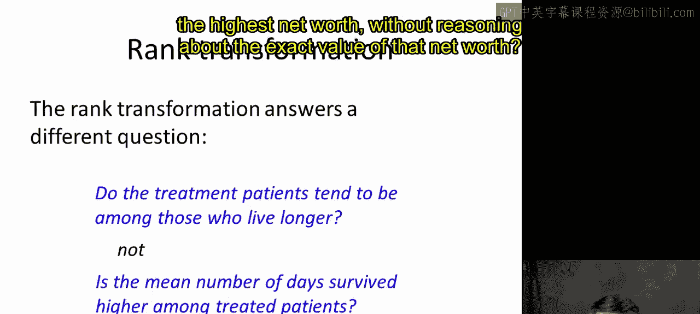

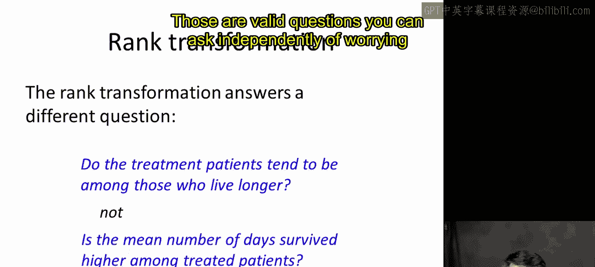

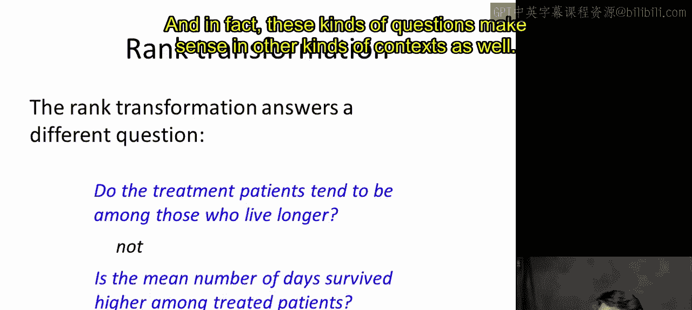

For these kinds of questions make sense in other kinds of contexts as well， for example。

 it kind of naturally takes care of cost of living differences between cities， for example。

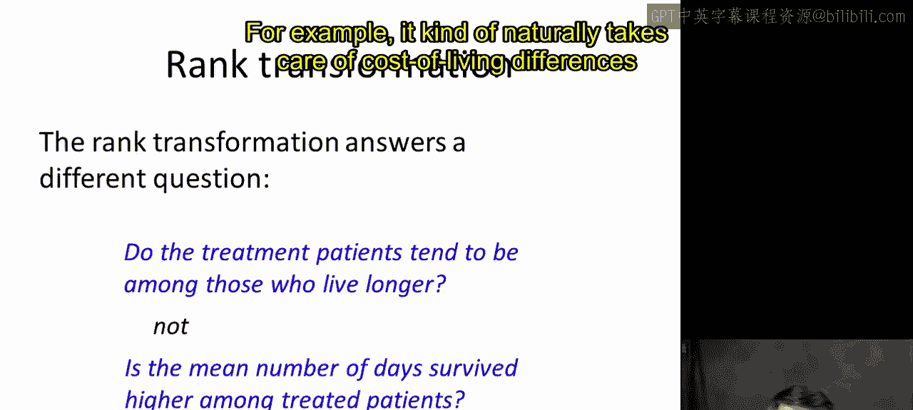

Okay。