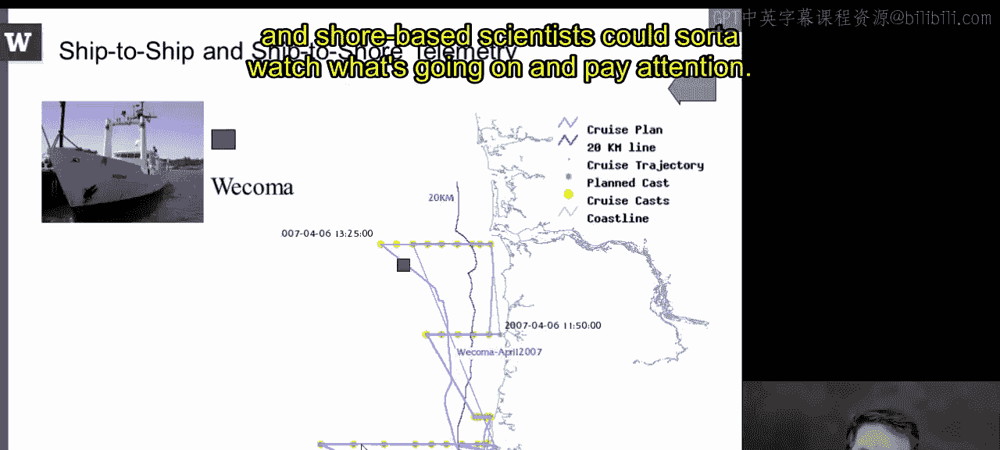

# 杜克大学《大规模数据科学（预测分析，交流数据科学结果，第2、3课⧸共3课有视频）｜Data Science at Scale》中英字幕 p100 30_轶事：海洋设备.zh_en -BV1xf421Q7bH_p100-

。

All right， I want to give just an anecdote about virtualization that actually doesn't involve virtualization itself。

In 2007， I was involved in a project that。Was putting together what we called the ocean appliance at the time。

 and this was a really。Brain dead idea。 This was the idea that in order to distribute software to field。

Stations， and in particular， ocean going vessels。It didn't make a lot of sense to make software available that the ship operations engineers needed to install on the ship's machines for various reasons of security。

You know， skills and expertise。Limited access for debugging。Any other sort of problems？

There was a number of reasons。The software we had involved was nothing terribly complex。 It was。

 a database system。 We had some telemetry system to redate off the sensors， ship it back to shore。

 We had some web interfaces for people on the。The researchers and operations people on the vessel could sort of see what happened even the data in order to debug problems or to even to do some science there and situ on the fly。

嗯。And and this device had some responsibilities。 It basically did this for the shipboard computing。

 It did some data analysis。 It did the acquisition。 It sort of kept safe copies of it。

 It sent it back to store。 It produced some visualizations。 It served as an app server for other。

 for other。You know， laptops。That people wanted to connect to it。

 we could also guarantee a certain amount of a certain environment for it to run in so we could。

Be sure that you know， on one ship， it ran fine， but another one， they had a much。

Weaker computing platform and all of a sudden。User experience sort of broke down or something went wrong。

 There was something we couldn't necessarily control。 So we got rid of all that。

 and it was very cheap。 And here， the price is kind of silly here because it everything's changed drastically in the years since。

 but know 500 bucks。 it wasn't。 it wasn't a terribly expensive。Box。

You know would these are the kind of environments you needed to operate in， right， this is a pact。

This is the lab bench inside on a rather small ship， the R the research vessel barnnes。 and。

 we tuck it up underneath the。Dek here and sort of plug it into the ship's network and plug it into power and that was about it and maybe configure for the network as well。

 but usually that was kind of out worked out ahead of time。And then the kind of work it did。

 you know would would。It would do some interesting things， right。

 It would do ship to ship and ship to shore telemetry。

 This is the western west coast of the United States。

And these are different cruise tracks by three different vessels。

 And one of the ideas at the time and actually still is to do coordinated adaptive sampling among multiple vessels at a time。

 So rather than having。3 independent vessels go three different places sometimes you could look a common phenomena across three vessels。

 but tended to be that it was difficult to collect enough funding together to actually rent time on three ships at once so what you would end up or to fill up the time for three ships at once so what you would do is have lots of different projects involved。

You know， sharing ship time。 But if you're going to share the ship time。

 that you need a lot more coordination And this infrastructure helped do that。 It also。

 the ship to ship telemetry also helped with。Seleenttry back to shore。

 This problem is going away because the satellite communication is becoming more ubiquitous。

 but in some cases， there was。Long range radio。 And as the radio needed to go over the curvature of the earth。

 you couldn't get back to shore。 You could sort of cheat a little bit by bouncing signal off the ionosphere。

 but。You still have a limited range， but if you could sort of connect from ship to ship to ship with in these adaptive sampling situations。

 you could get a longer race for sort of real time telemetry。

Shore based scientists could sort of watch what's going on and pay attention。

