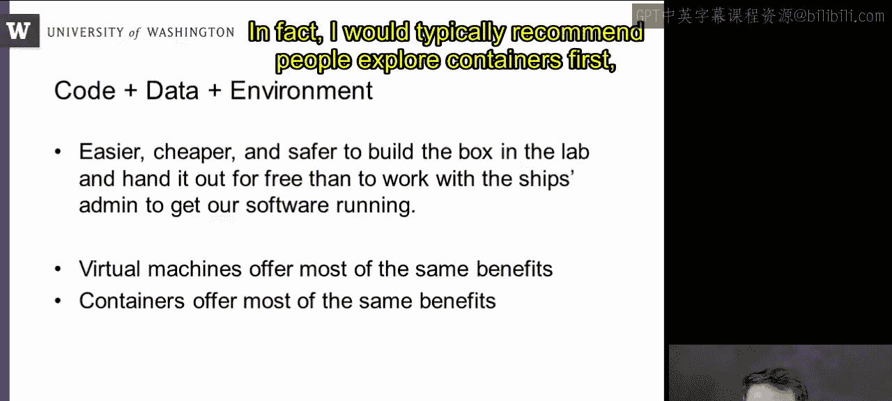

# 杜克大学《大规模数据科学（预测分析，交流数据科学结果，第2、3课⧸共3课有视频）｜Data Science at Scale》中英字幕 p101 31_代码、数据、环境.zh_en -BV1xf421Q7bH_p101-

。

And there's some details about how the network was set up， but we had one ship in the estuary。

 one ship and two ships out of sea， and they were beyond the 20 kilometer limit of radio communications。

 whether we were still able to get data back in real time。And this was， you know。

 not that hard to set up because you had them。 you had the computing platform there to sort of。

Do the work on。You know， in real time， we we were doing things like detecting events。

 So this is the Columbia of estuary。 and you can see the red water there this is。

We used to call this red tide， but it's important not to say that because this is not the stuff that's killing people。

 this is a relatively harmless， but is still an interesting little critter。

 this myriadectubbra is what turns the water red， and you could see in the data these spikes in turbidity。

 which is sort of how cloudy the water is。And that would be a signal that maybe you're detecting。

Red water。 And this is two buckets of water， one from one of these red patches。

 one from one of the clear patches， although the lighting， unfortunately sort of masks。The effect。

 but these real time events， you'd see something happening。

 you'd want to go collect the data and do something with it right then and having the device on the ship helped trigger this automatically。

So why am I bringing this up？It was easier， cheaper and safer to。

Build the box in the lab and hand it out for free。 Then to work work with the ship's admin to try to get our software running and fix things in the field and deal with all the heterogeneity and so on。

And this is the same has some things in common with the reproducibility problem in that you get things working in your environment and then you share the entire environment out with the world。

 as opposed to trying to work with people who want to reproduce your results and walk them through all the necessary steps and help them solve their problems the heterogeneity and platforms out there causes new problems that it's not clear to me that it's any one person's responsibility。

 It's not necessarily the receive， you know if you're on the receiving in and you want to reproduce someone else's results。

 It's a little bit frustrating to have to figure out all kinds of problems。嗯。YouIt doesn't just work。

 something is compiled have to。Troublesshoot problems that don't that aren't described in the paper。

 that don't anything to do with the science。 That's frustrating。

 but it's also not quite realistic for the。Producer of the research too。You know。

 to go through the extra work required to guarantee that it will work on any possible platform。

 you know， any version of the operating system， any kind of environment with anybody with any skill set。

So。There's a tension there， but virtual machines offer most of these same benefits to actually we built a physical box because we had this problem like connectivity of the internet。

Other kinds of constraints。Those problems aren't aren't terribly relevant in too many situations。

 but the same idea basically applies's a controlled in virtual machine gives you a controlled environment。

 and most of what I'm going to say also applies to containers， which is a superior。In most respect。

 in almost all respects， is superior。Way to get these benefits in virtual machines。 You know。

 so I'm not going to talk about containers in detail， but。You know it's without all the redundancy。

 if you get three virtual machines， odds are there quite a lot in common？

Containers get rid of all that while still providing this。

transferransferability of a customized environment。

 and they also have other very nice features like composability and so on。Okay。

 so most of what I say about virtual machines is going to apply to containers as well。

 and in fact I typically would recommend people explore containers first nowadays。

