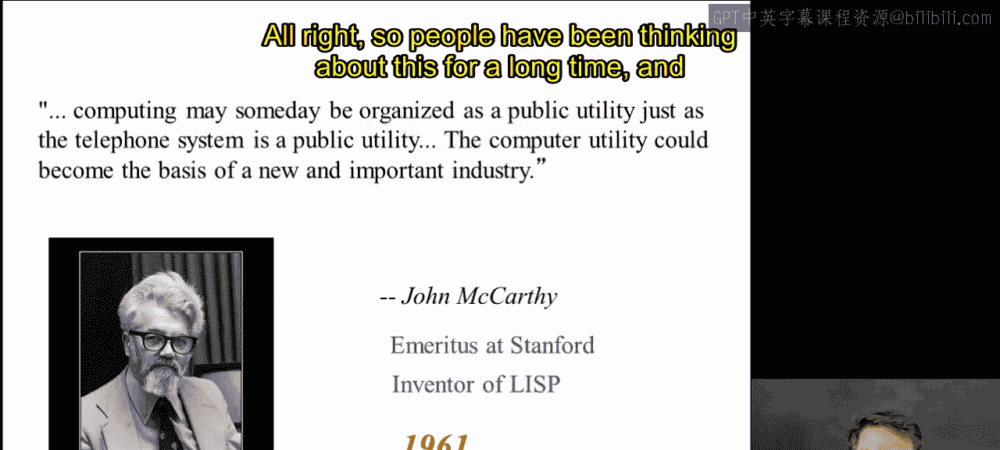

# 杜克大学《大规模数据科学（预测分析，交流数据科学结果，第2、3课⧸共3课有视频）｜Data Science at Scale》中英字幕 p102 32_云计算简介.zh_en -BV1xf421Q7bH_p102-

。

🎼So we spend a few minutes talking about virtualization and the role it can play in reproducibility。

 I want to spend a few minutes talking about cloud computing。

 I think increasingly virtualization and cloud computing go hand in hand。

 even though they're not necessarily one doesn't necessarily imply the other。

 It's making less and less sense。2。Pass virtual machines around to each other point to point and run them without necessarily having that shared environment in which to execute them。

 and I think that's similarly true for containers， although the alternative of passing around containers is not quite as ugly as it is with passing around virtual machines for various reasons of size and scale。

But let's talk about cloud computing a little bit。So。This is a。Generator in the basement of a。

Former factory。 And if you look closely， you can tell that it's not probably not being used as a generator。

 There's people with suits and ties singing around it， and there's art on the walls and so on。

 And it's more or less a conversation piece， right， And the idea here is that。At one point in time。

 it was cheaper or safer or more convenient to produce your own electricity。

And at some point in the past， that became a quaint idea。

 and this became a historic relic of a past era。And the argument goes。

 is that the server room is going to go the same direction， right。

 The idea that you need to physically maintain those machines because of issues of cost。

 because of issues of convenience， because of issues of safety or security or busness。

Are are on their way out。And the process is accelerating。And there is still ways to go。

 especially for larger companies with deep investments in IT。

 but this is the direction that we're headed。Okay， and this is not a new idea， this quote。

Computing may someday be organized as a public utility。

 just as a telephone system as a public utility。 The computer utility would become the basis of a new and important industry。

 This was you might might want to guess when this was said。

It's an emeritus at Stanford and who said this， and emeritus of Stanford。Inventor of Lisp。

So it was John McCarthy， and the year was 1961。 right。

 So we've have been thinking about this for a long time。 And now with cloud computing。

 it's coming to pass。

