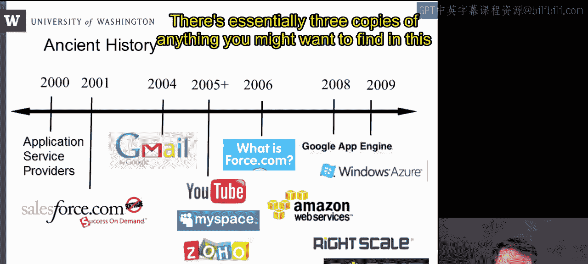
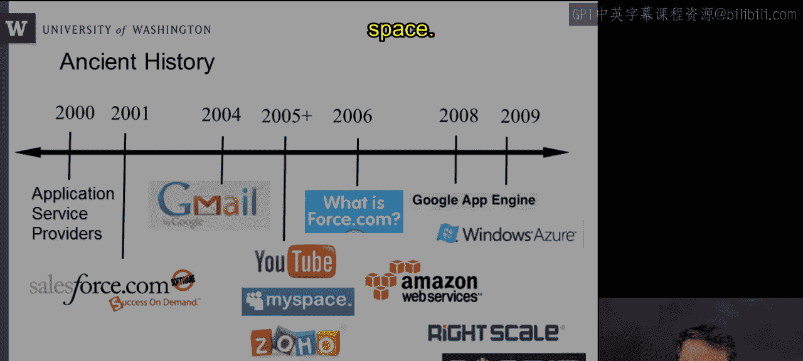

# 杜克大学《大规模数据科学（预测分析，交流数据科学结果，第2、3课⧸共3课有视频）｜Data Science at Scale》中英字幕 p103 33_云计算历史.zh_en -BV1xf421Q7bH_p103-

。

More recently， but still sort of， know， ancient history at the current speed of things theres。

YouYou saw signals of this coming。 You had this notion of application service providers as early as 2000。

 I was at a consulting firm around that time， and。That was on the sort of cover of magazines。

 and that was a hot term。Some of the big three and big five consulting engagements and the idea was just that you serve out an application that others can then use in kind of a business to business context and Salesforce was one of the pioneers of this right so instead of actually installing software and managing the software out for their customers they stood this up as a service did everything through the browser。

And manage things locally。 and as we've seen since then this has enormous advantages， right。

 most importantly for the developer themselves， but also for the client。

 for the developer themselves， they don't have to worry about they don't answer support calls about what's going on wrong on somebody's client side。

 they can just sort of roll out changes。themselves and on the client side there's less IT support required as well。

 okay and a number of other benefits as well。There was still some question about whether you could do this with real applications。

 right， and so I think Gmail， I attribute the first example of showing a classically desktop application。

 a fully featured classic desktop application that could be hosted and run in the browser。

I really think Gmail sort of showed that that could be done。

 I think there was a lot of disbelief that the browser was just for toy web applications。

 But if you wanted to do something real， you really knew that the。The desktop。

And Gmail was a full featured email client。Fully in the browser。 And then since then， of course。

 now that's that's no longer controversial。 This is this is obvious that， of course。

 you can run things in the cloud。 Of course， the browser can。Iulate things and and。Increasingly。

 you don't see any kind of desktop applications at all。

 which is why computing is now sort of on your phone in the tablet。

Although argueguably those are not。In the browser anymore。

 but they're still a very thin presence on the device itself。Okay。

 so you saw all these things happen with YouTube and myspace of the time。

Office applications with Zho， which in Google Docs， of course。

And then I think crucially force co came out， which actually was the exact same company。

 Salesforce com。 But what they kind of realized was that they were a。

Retreating down the application stack a little bit。So instead of delivering their。

 Salesforce was a customer relationship management software。 so for sales associates could。

Manage contacts and clients in a shared way and kind of keep track of their own work and so on。

 And what forcedcom was was， well， look， let's just drop the sales and figure out how to provide an infrastructure for anyone to produce。

Web applications as a service。And so this is really maybe the first。

Beginnings of what's now called platform as a service。

So they provided the hooks and the machinery and the infrastructure to build your own。Salesforest。

com。A little while later， you saw Amazon Web services reveal what they have been working on。

 which is to provide even one step further down， you know， infrastructure as a service。

 So just provide access to raw raw machines。 And what's interesting here is。

You know we we would talk to Amazon around that time and other folks as well and say， look you know。

 how did Amazon sort of come out of nowhere and step into this business of providing computing for people。

 you know， why wasn't this done first by Microsoft or IBM or HP or somebody and the argument。

Was that， look， you know， Amazon has always been a technology company and crucially。

 they know how to work on a margin。 So what they， know did originally were selling books。

 And then they realized that they had kind of the technology there to not just sell books。

 but to also sell。Toothbrushes。 And you know as long as you're selling toothbrushes。

 what you really have is the infrastructure to sell stuff。

 and you might as well rent out that infrastructure for other people。

 And there was a period of time there that's not as well known as Amazon Web services where you could actually set up your own marketplace on Amazon's machines。

 If you wanted to have a storefront。 you could run your storefront application on Amazon。

 And that was kind of a precursor to Amazon Web services。 And then they realize， well。

 look what we really can do is not just sell market not just provide infrastructure for marketplace applications。

 but really provide access to the base computing infrastructure and let anybody do whatever they want。

And because they know how to work on a margin， right。

 they could take pennies on the dollar and kind of make it up on volume。

 and they were kind of comfortable with those kind of business models when the Ims of the world and the Microsoft of the world。

Tend did to go after the big fish。Okay，And so this is at least what was some of the arguments that were。

啊。Explained to the time that sort of made sense to me。Then you saw a Google coming。

 Google app Engine has been there for a while， they've recently this as I mentioned this is ancient history it stoppeds in 2009 right so there's been a lot of work since then and in fact Google and Google Microsoft and Amazon all now compete on essentially all the services they all offer。

 there's essentially three copies of anything you might want to find。

In in this space。

