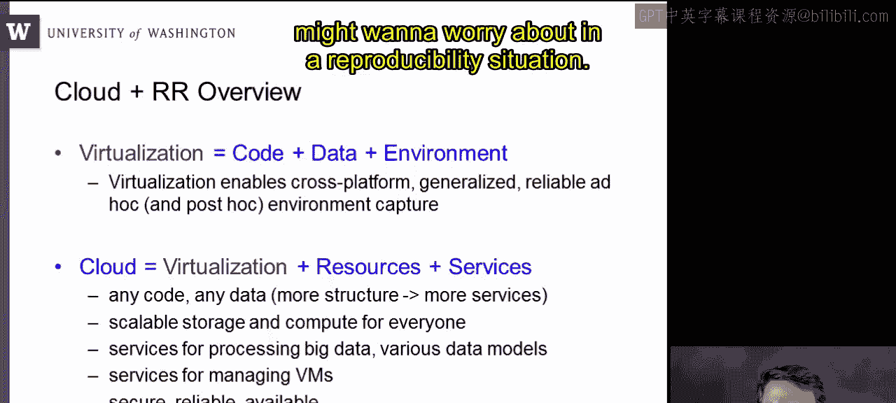

# 杜克大学《大规模数据科学（预测分析，交流数据科学结果，第2、3课⧸共3课有视频）｜Data Science at Scale》中英字幕 p104 34_代码、数据、环境平台.zh_en -BV1xf421Q7bH_p104-

。

I want to make some observations about。Cloud computing。

 virtualization and reproducible research all in one。 we've given you a couple of the arguments。

 and I've talked a little bit about cloud computing in particular。

 but let me see if I can tie these together a little bit。Mented this previously virtualization is。

Code and data and environment。Right so you'll see people talk about tools and services and behaviors and best practices for sharing code and you'll see people talk about best practices for sharing data and you'll see some talk about。

 oh look， we can't just choose one of the other we really have to think about platforms to provide。

Both， but you don't see very many people talk about the need to share the environment。

 And this is becoming increasingly important because just the new code you wrote and just the data that you had hands your hands on is rarely enough to actually reproduce whatever experiment you were doing。

 There's an enormous number of libraries that your code depends on。 There is。Well。

 arguably the libraries are going to be most of it。

 virtualization enables this kind of across platform generalized reliable you know ad hoc environment capture right and and I say and post post hoc here in parentheses。

 I think that's important right because I'll mention this again later。

 But as you're doing the experiment， you don't actually know whether an experiment is the one that you're going to want to package up and share while you're doing it and it wastes enormous effort。

 if you have to apply the same kind of attention and discipline and vigilance。In preparing。

Every activity you do for unlimited reproducibility by everyone。 It's not。

 I don't think it's particularly realistic to ask everyone to do that。

 And so you need some ability to look backwards and say， aha。

 these last series of steps is really what I want to capture and and。

Make available and virtualization and containers， as I mentioned。

 know most of the arguments still apply。Provides this you can know。Take a snapshot。 You can， you can。

Pick your hands up from the desk and walk away slowly and say， that's the environment I want。

 I want to package up。Okay。And so， but， you know， even that's just sort of a virtual machine or a container argument。

 the cloud goes one step further。 It's not just the virtualizations，'s not just the code。

 the data and the environment， but it's also the resources。And the services on which to run。

These virtual machines and that's also a part of reproducibility right。

 if you say I did some great experiment but required this。

 you know GPU server over here and a cluster of machines there and then a database server in between and a web application that I used。

That's not an environment that's realistic to ask someone just kind of recreate in their own world。

 nor is it necessarily reasonable to ask them to。Figure out a different way of rewarding your experiment that uses a different architecture。

 just by throwing your coat over the wall and saying figure it out， okay。So。You know， any code。

 any data。Is supported by the cloud， there's a limit that you don't have to worry about scale。

 scalable storage and compute for everyone。These services layered over this scalable storage and computer are increasingly useful and complex and allowed and specialized for particular tasks。

 you know if you have structured relational data you have a number of choices。

 if you have infrastructured data， you have a number of choices and so on。

 services for managing lots of VMs and again， lots of containers now。

 in fact containers essentially are one of，Inventions。

In response to the problem of having to manage lots and lots of different VMs。You know， it's secure。

 It's reliable。 It's always available。 These， These are not properties you can guarantee about。

 your own competing infrastructure or their competing infrastructure。 So this really。You know。

Packages up every variable that you might wanna worry about in a reproducibility。

Situation。Okay。