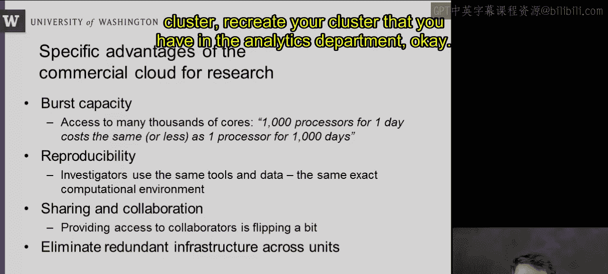

# 杜克大学《大规模数据科学（预测分析，交流数据科学结果，第2、3课⧸共3课有视频）｜Data Science at Scale》中英字幕 p105 35_云计算用于可重复研究.zh_en -BV1xf421Q7bH_p105-

。

So you have these three terms， infrastructure as a service platform is a service and software is a service。

Infrastructure is a service。 And again， now everybody competes in this space。

 but classically was E C2 was the compute engine。 S 3 was a storage service。

 There's many more since then there's a whole family related services that do different things。

 Windowss Azure sort of began life as a platform as a service。

 And now they retreated that well retreatted。I augmented their offerings to include infrastructure as of service。

There's plenty of software as a service with Office 365 Microsoft。

Notably has gone sort of quote all in on the cloud， so they're really trying to push everything。

 everything there when that wasn't true， certainly not in 2009。Okay， but anyway， this across this。

Three terms。As things become more constrained and more application specific， more domain specific。

 more task specific， there's also more automation you can bring to the party and so。

Fillling out this design space。Is what's been happening in the industry over the last 10 years。

The successes is。Pretty obvious now， again， some of these slides stop at an older time， but you know。

One example， bandwidth consumed by Amazon's global websites for selling products have this kind of a growth curve while bandwidth consumed by Amazon Web services just exploded and。

I I。Be interested to see an updated version of this slide for 2015。Similarly。

 the number of objects in S3 is experiencing this kind of exponential growth and it's again。

 stopping in 2009 is almost telling an accurate story here。So fine。Broad overview of the cloud。

 Some of the terminology involves specific advantage of the commercial cloud for research purposes。

 Well， there's this burst capacity right for the first time in history。

1000 processors for one day cost the exact same amount or perhaps less as one processor for 1000 days。

 That's never been true before。And so that allows you to do an experiment and shut everything down at the end of the experiment。

And go off and do other things。For。Steady state data processing type of tasks。

There's not necessarily much of a win there， but for experimental work， for a data science work。

 for science work。This kind of burst capacity the pattern comes up quite a bit。For reproducibility。

 as we'll talk about a little bit more， you've got access to the same tools and data。

 shared location， the exact same computational environment where the experiment was done。

 you can provide access to for someone else， sharing and collaboration， you know。

 providing external access to your work environment literally amounts to。

 flipping a switch in the software， as opposed to having actually moved data to some。

Public server or to。Move code around from one place or the other if your work begins life in the cloud。

 you can just simply provide access to it。And of course。

 you can eliminate redundant infrastructure across units and there's many more advantages to cloud computing。

 but I was trying to highlight some that are specific that are especially emphasized in a research environment。

 so the rera across units， you know if you think about two different universities。

I'm sure there's an advantage there。 But I think even within a company。

 the data scientists may have access to one。Platform。Doing this either in the public cloud。

 as we've been discussing or even within some smoking version of a private cloud。

 but the more centralization， the better in these cases。

 because you can lift the sharing up to a software type of operation as opposed to having to actually have。

Asking the marketing department to reproduce your cluster。

Recreate your cluster that you have in the analytics department。

