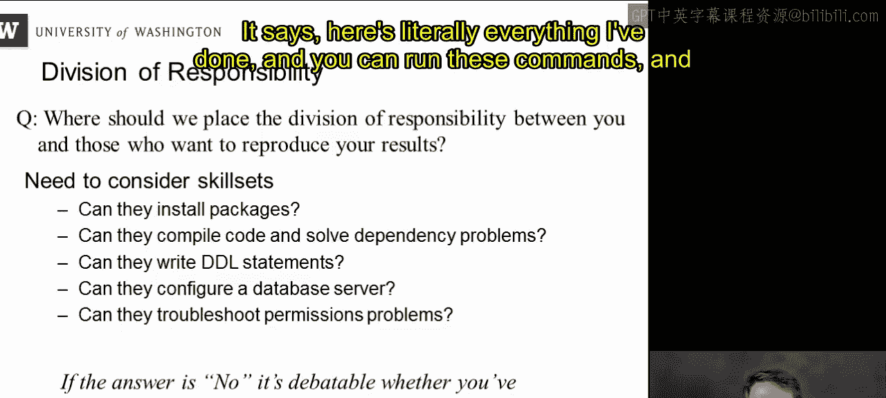
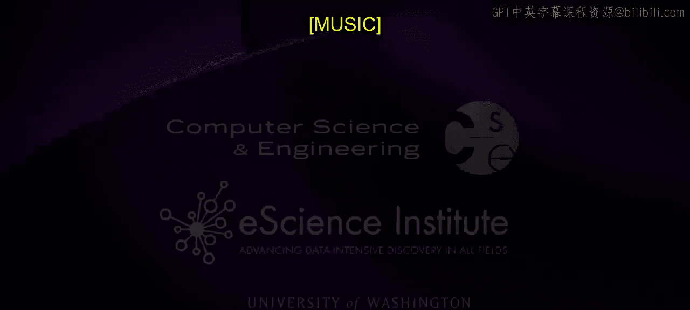

# 杜克大学《大规模数据科学（预测分析，交流数据科学结果，第2、3课⧸共3课有视频）｜Data Science at Scale》中英字幕 p106 36_虚拟化对可重复性的优势.zh_en -BV1xf421Q7bH_p106-

。

🎼An observation about I mentioned this with with the post ho capture of the environment。 You know。

 there will always be experiments and data that are housed outside of some kind of managed。

 protected environment in which reproducibility is made easy， right。

 You're always going to be able to go one off over here and whip up a quick quick script while you're on the airplane and Python or something。

 right， So to do everything within kind of a controlled。

 observed environment that is instrumented with support for reproducibility。

 And this is the approach that many of the tools will will take。啊。Is not realistic to me。 Moreover。

 I think it's dangerous to。Consider that a problem。I think the free experimentation。

Is an important property of software and data science。

 The ability for you just to fire up a text editor and write some code from scratch and tries try out an idea is not something we want to destroy lightly。

 If you have to use managed company environments that sort of watch what you're doing and keep track of things better for you use proper databases as opposed to your own files。

 these things， I think cost。Have hidden costs， They cost money， they cost， you know creativity。

 They cost time and so on。 So I think we should be very conservative about trying to constrain the the data science workflow。

 I think it's a hallmark of data science that it's。There's a resourcefulness that goes along with it。

 and I'm not sure that that's something that we should try to limit。Further。

 there is no difference between in my mind， there's no difference between debugging， you know。

 testing and experiments， right， the process is very blurry you know。

One hour you might be debugging a kind of one off script that you plan to throw away and the next hour you might realize holy cow this really worked。

You know， I' I've got the result I kind of want and you want to watch。

 you want to capture what you did。 Okay， And you know， my joke， I guess here is that when it works。

 it's an experiment when it doesn't it's debugging， but nothing about the code even changes。

 And so you need these post hoc approaches。 You need to be able to capture this stuff after the fact。

And the approach ought to be able to tolerate the messy heterogeneous。

Reality of data science experiments。 And that's why I think virtual machines and containers。Give you。

And you know my cartoon version of this is。That， you know， you've got your pipeline。

 your workflow that you developed that answer some particular statistical question。

 and you want to hand this off to your boss。 And you can hand them that code。

 but it also has a dependency on some database over there and some other external system over there。

 And it uses some visualization library here。 And that each one of those ends up having all kinds of dependencies on other。

啊。Networks of libraries and networks of dependencies。

 and I don't know where to cut the court here besides take the entire environment up。Okay。

 and that's what virtualization ands containers offer。You know， there's。

There's another question of division of responsibility， I think， where。You know我。

At what point does it does it shift to the person who's trying to reproduces your work。

 their responsibility to kind of fill in the gaps， And this was a little bit。

 this wasn't much of an issue when you talk about wet lab chemistry or。

You know biology experiments because of course we can't actually have you come into our physical lab and do the experiment right you have to just do your best to describe it and they'll replicate that。

Their own environment。But I think here we need to consider。

I think further with wet lab chemistry and other kind of wet lab work。

 you could there was a little bit more of a likelihood that you could of assumptions you could make about the skill set of the lab techs and the researchers。

Who are performing the experiment。 There was a little bit more homogeneity among their training。

 I think as things have become more computational， the idea that the biologist who wants to reproduce your computational biology experiment。

 your bioinformatics experiment。Will have the right skills as in order to operate the software you。

have given them and set up the environment in the same way you have becomes increasingly difficult。

 and I think that may also be true in data science。

 although perhaps there' a bit more homogeneity in data science as well。

 but some come with a statistics background who do everything in R。

 others come with a computer science background who are very comfortable kind of operating the say a Linux environment。

And setting up software there。 So， you know， can they install packages at the systems level or at the R level or in Python or whatever。

 whatever you're in， Can they compile code。To use that super fast C library that you depend on for your research。

 can they solve whatever dependency problems that arise， you know can they if it involves a database。

 can they actually write the DDL statements to set up the schema the same way you have。

 can they configure the database server that needs to run those？DDL statements。

 can they troublesho permissions problems with files and so on。

 and there's a long list of things you can do here and if the answer is no to these questions。

You know， perhaps it's debatable whether you've actually achieved reproducibility。 if you just say。

 here's how someone could potentially do it。Maybe that's not a behind a bar for。

We've actually made it easy for someone to do。Maybe， maybe not。But the original machine approach。

helpslps address this division responsibility， it says here's literally everything I've done and you can run these commands and that's all you have do and you'll get the exact same environment。

