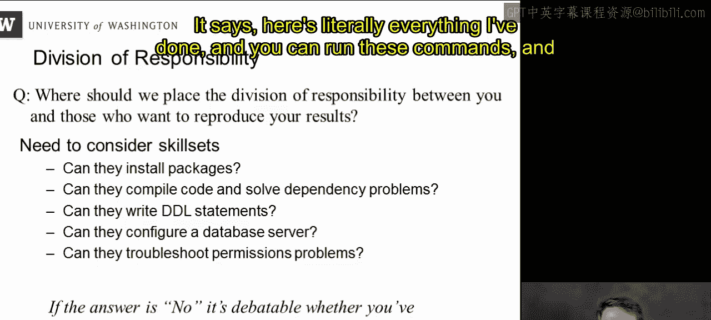
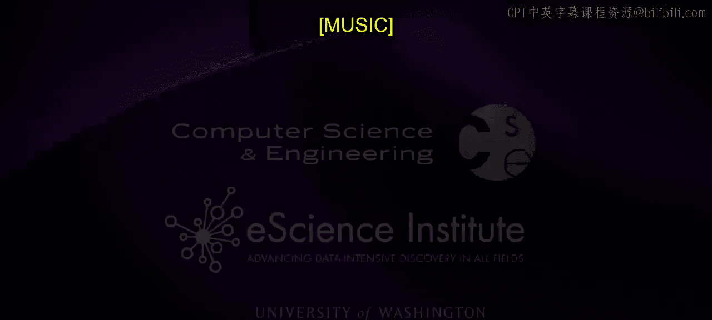

# 大规模数据科学：第2课：虚拟化对可重复性的优势


在本节课中，我们将探讨虚拟化技术（如虚拟机和容器）如何为数据科学工作流中的可重复性问题提供强大的解决方案。我们将分析数据科学实验的“混乱”现实，并理解为什么捕获整个计算环境至关重要。

上一节我们讨论了数据科学中可重复性面临的挑战，本节中我们来看看虚拟化技术如何提供一种优雅的解决方案。

## 数据科学实验的现实

数据科学实验常常发生在受控、受监控的环境之外。总会有一些实验和数据存在于某种便于实现可重复性的、受管理的受保护环境之外。

以下是数据科学工作流的典型特点：
*   **自由实验**：能够随时打开文本编辑器，从头开始编写代码并尝试新想法，这是软件和数据科学的一个重要特性，不应轻易破坏。
*   **流程模糊**：调试、测试和实验之间的界限非常模糊。同一段代码，当它成功时是“实验”，当它失败时是“调试”。
*   **环境异构**：实验依赖于复杂的、相互关联的网络，包括数据库、外部系统、可视化库及其各自的依赖项。

因此，我们需要一种能够**事后捕获**实验环境的方法，并且这种方法必须能够容忍数据科学实验混乱、异构的现实。

## 虚拟化的核心优势

虚拟化技术（虚拟机和容器）的核心优势在于，它们允许我们捕获并复制**整个计算环境**。

我的卡通版理解是：你开发了一个回答特定统计问题的工作流管道，并想把它交给你的老板。你不仅可以移交代码，还能连同其所有依赖一起打包。代码依赖于某个数据库、某个外部系统、某个可视化库，而它们各自又有一系列复杂的库和依赖网络。除了获取整个环境，没有更好的切割点。这正是虚拟化和容器所提供的。

**核心概念**：通过虚拟化，可复现的环境可以打包为一个文件（如 `Dockerfile` 或虚拟机镜像），并通过简单的命令（如 `docker build` 和 `docker run`）来重建。

```dockerfile
# 示例 Dockerfile
FROM python:3.9-slim
COPY requirements.txt .
RUN pip install -r requirements.txt
COPY my_analysis_script.py .
CMD ["python", "./my_analysis_script.py"]
```

## 责任划分问题

在传统湿实验室（如化学、生物学）中，可重复性依赖于研究者对实验步骤的描述，由他人在自己的环境中复现。这里存在一个责任划分的问题：在多大程度上，复现者需要自己填补环境配置的空白？

随着计算科学的普及，这个问题变得更加尖锐。想复现你计算生物学实验的生物学家，可能不具备操作你提供的软件、以同样方式设置环境的技能。

以下是复现者可能面临的挑战列表：
*   能否在系统级、R 或 Python 环境中安装软件包？
*   能否编译代码以使用你所依赖的快速 C 库？
*   能否解决出现的依赖问题？
*   如果涉及数据库，能否编写 DDL 语句来建立与你相同的模式？
*   能否配置运行这些 DDL 语句所需的数据库服务器？
*   能否解决文件权限等问题？

如果对这些问题的答案是“否”，那么即使你提供了“潜在可行”的方法，也可能并未真正实现“易于复现”。虚拟化方法有助于解决这种责任划分问题，它明确表示：“这就是我所做的一切，你只需运行这些命令，就能获得完全相同的环境。”





本节课中我们一起学习了虚拟化技术如何应对数据科学中的可重复性挑战。我们认识到数据科学自由、模糊的工作特性需要一种能够事后捕获完整环境的方法。虚拟机和容器通过打包整个计算环境，提供了一种清晰、可靠且能明确责任划分的解决方案，使得复现实验变得像执行几条命令一样简单。