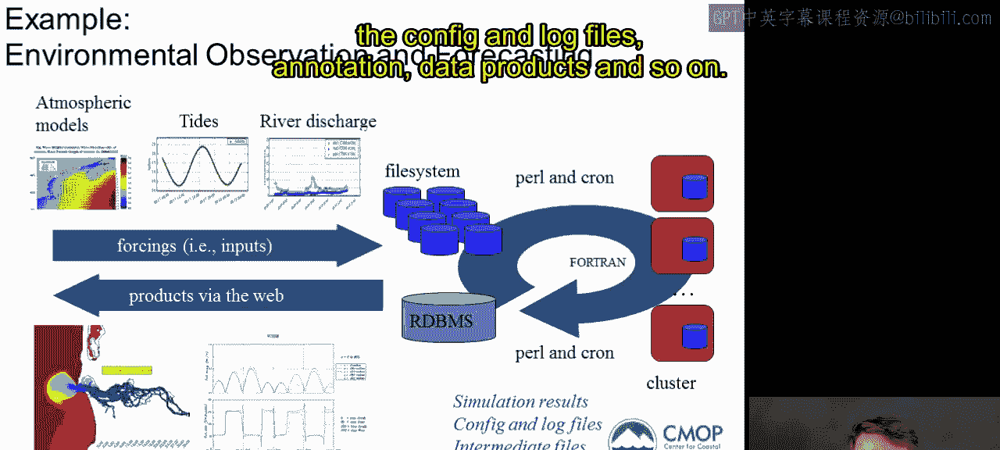

# 杜克大学《大规模数据科学（预测分析，交流数据科学结果，第2、3课⧸共3课有视频）｜Data Science at Scale》中英字幕 p107 37_复杂虚拟化场景.zh_en -BV1xf421Q7bH_p107-

。

All right we made this observation earlier so I't dwell on a code plus data plus environment plus the platform to run it on the idea of just download everything to your laptop is increasingly insufficient and the context for this particular way of putting this observation was around big data as data sets become larger and larger。

 it becomes increasingly nonsensical to suggest that someone just download your 300 terabytes of MRI images in order to reproduce your experiments。

You to more than share your V and。 you need to provide access to a place to run and access to the data that it was dependent on。

 And I made a side comment here that inside a commercial environment。

 you may be able to assume shared access to a common infrastructure resource， you may be able to say。

 here's my Python script。 and it makes all kinds of call to a shared environment， But don't worry。

 because you have access to the same shared environment， in which case。

 the bar for reproducibility becomes easier for you。

 if you need to share across institutional boundaries。The public cloud starts to become。

The public commercialmer cloud has to become the only feasible option in my mind。

But your mileage may vary inside inside of a company。So as we alluded to， you know。

 we talking about virtual machines as if you could just sort of package it up with one virtual machine and hand it off。

As we mentioned， you know， some of these architectures， especially around data intensive experiments。

 require。Multiple resources of different types。All kind of functioning together in a coordinated environment。

 right there's application servers and databases， database servers。

 clusters with Hadoop installed and so on。 So one VM is not really enough。

And as an example of this that comes from the， again， from science。

 this is around the same time as the ocean appliance example I gave earlier。

 you know an environmental observation and forecasting system。Was set up to run daily forecasts。

Using data that were pulled from sensors that were managed by this institution。

 also sensors that managed by other people， also satellite images and also other models that were run by others at a larger scale。

Lower resolution sort of。Models that run at the size of the Western hemisphere of the Earth。

We uses input to models on a much smaller scale to figure out the plume of fresh water pushing it out of the Columbia River。

Okay， so these fors， which are just inputs， went in to a。Significant file system。

 along with some relational database stuff to manage the metadata and some。

Combination of pearl scripts and other kind of configuration scripts and other kinds of。Legacy。

Management infrastructure。Would kick off the fortran models that would run the ocean the oceanographic。

Field models。我不是。A ventt the water around and watch what happens。And then， those results would be。

Dumped out and a series of other scripts would be kicked off that would extract statistics from them。

 extract visualizations， create these visualizations。

 serve out the visualizations on the web and so on。 So this entire infrastructure。

Offered a reproducible experiment in many cases， you'd want to reproduce this whole thing。

 but to imagine there it was all going to be sort of1 VM， it didn't make a lot of sense。But。

And there's a bunch of digital artifacts here， The simulation results themselves the con log files。

 annotation data products and so on。

