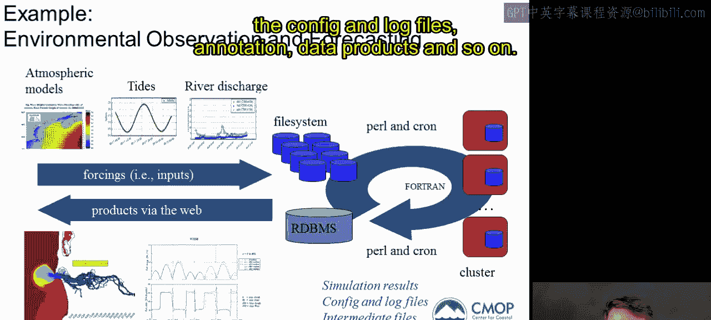

# 大规模数据科学：第2课：复杂虚拟化场景 🖥️

在本节课中，我们将探讨在数据密集型科学实验中，如何超越单一虚拟机的限制，实现复杂、多组件环境的可复现性。我们将理解为何简单的“代码+数据”打包方式已不足以应对现代大规模数据分析的需求。

## 从单一虚拟机到复杂环境

上一节我们介绍了将代码、数据、环境和运行平台打包在一起的基本理念。本节中我们来看看，当实验架构变得复杂时，这种单一虚拟机的方案为何会失效。

随着数据集变得越来越大，建议他人仅仅为了复现你的实验就去下载数百TB的数据（例如300TB的MRI图像）变得越来越不切实际。因此，你需要提供的远不止代码本身。你需要提供一个可以运行的环境，以及对其所依赖数据的访问权限。

在商业环境中，你可能可以假设大家共享访问一个通用的基础设施资源。例如，你可以说“这是我的Python脚本，它调用了共享环境中的各种东西，但不用担心，因为你也能访问同一个共享环境”。在这种情况下，实现可复现性的门槛对你来说就降低了。

然而，如果你需要跨越机构边界进行共享，公共云在我看来就成为了唯一可行的选择。当然，在公司内部，情况可能有所不同。

## 多组件协调架构

正如我们之前提到的，有些架构，尤其是围绕数据密集型实验的架构，需要多种不同类型的资源协调一致地共同工作。

以下是这类架构中常见的组件：
*   **应用服务器**：负责运行业务逻辑。
*   **数据库服务器**：存储和管理结构化数据。
*   **安装有Hadoop等工具的集群**：用于处理大规模数据。

因此，一个虚拟机通常是不够的。

## 一个科学案例：环境观测与预报系统

为了具体说明这一点，我们来看一个来自科学领域的例子，这个例子与我之前提到的“海洋设备”案例大约处于同一时期。

这是一个环境观测与预报系统，它被设置为运行每日预报。其工作流程非常复杂，涉及多个步骤和外部依赖。

以下是该系统的工作流程与组件：
1.  **数据输入**：系统整合来自多方的数据，包括本机构管理的传感器、他人管理的传感器、卫星图像，以及其他机构运行的大尺度、低分辨率模型（例如覆盖地球西半球的模型）的输出。
2.  **数据处理与存储**：这些预报输入数据被存入一个**大型文件系统**，同时用一个**关系型数据库**来管理元数据。
3.  **模型执行**：一系列由Perl脚本、配置脚本和其他**遗留管理基础设施**组成的系统会启动**Fortran模型**。这些模型是海洋学现场模型，用于模拟水体的运动并观察其变化。
4.  **结果后处理**：模型运行结果输出后，会触发另一系列脚本，从结果中**提取统计数据**、**生成可视化图表**，并将这些可视化结果**发布到网络上**。

整个基础设施提供了一个在许多情况下都可复现的实验。但要想象将这一切都塞进一个虚拟机里，是行不通的。

## 数字产物的多样性

在这样的复杂实验中，会产生多种数字产物，远不止最终结果。

以下是一些关键的数字产物类型：
*   **模拟结果本身**：模型运行产生的核心数据。
*   **配置与日志文件**：记录运行环境和过程的文件。
*   **注释数据产品**：对原始数据进行标注和解释后生成的数据。

---

本节课中我们一起学习了复杂虚拟化场景的挑战。我们认识到，对于依赖多种资源（如专用服务器、数据库、集群和外部数据源）的现代数据科学工作流，单一虚拟机的封装方式已不再适用。通过一个环境预报系统的具体案例，我们看到了一个可复现实验如何由多个协调工作的组件构成，并产生了多样化的数字产物。这为理解更高级的虚拟化和容器化技术（如Docker Compose、Kubernetes）的必要性奠定了基础。