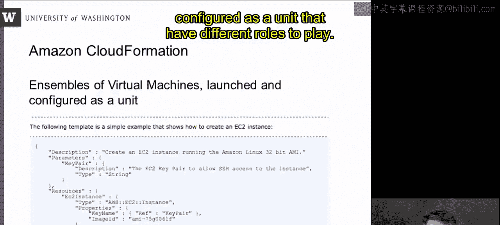
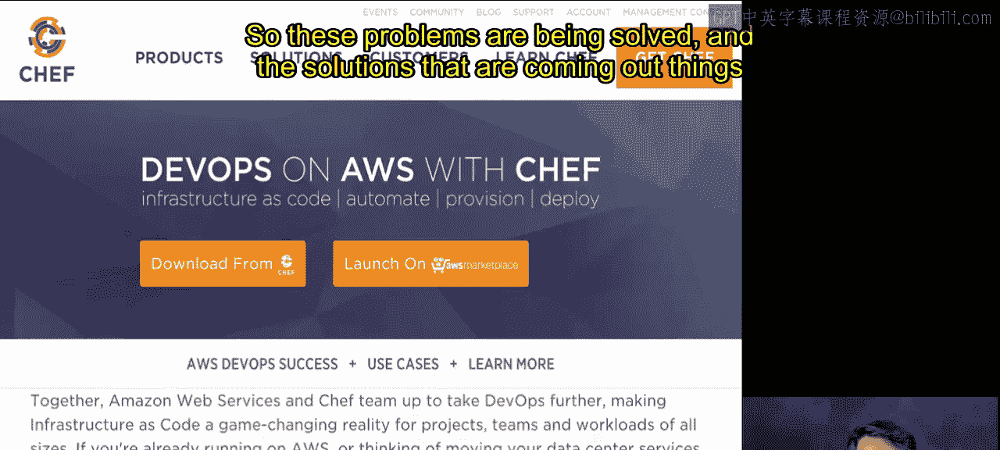
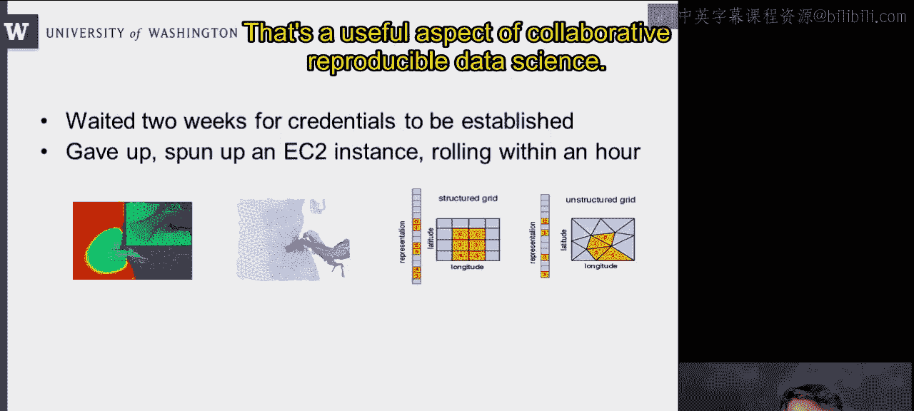

# 杜克大学《大规模数据科学（预测分析，交流数据科学结果，第2、3课⧸共3课有视频）｜Data Science at Scale》中英字幕 p108 38_共享实验室.zh_en -BV1xf421Q7bH_p108-

。

🎼This problem has been observed。 Amazon Cloud formation is one solution to this。 This is you know。

 scripts to to launch ensembles of coordinated virtual machines launched and configured as a unit that have different roles to play。

And there are tools like Che that work in a DevOs environment where you。Do the same thing。 The。

 The overall push here is to add infrastructure as code， right。

 So you're acting scripts to launch and set up and。Opererate。

Infrastructure and now sharing those chef scripts。With someone else provides them the same capability to be able to launch a large。

 complicated heterogeneous architecture to run experiment。

 So these problems are being solved and the solutions that are coming out。

 things like Chef are tightly coupled with。

The public cloud， commercial cloud。All right， the third observation here is that the cloud offers。

Kind of a Google Docs for developers。 And this is the， the idea that if know。

 data science is fundamentally a collaborative exercise and reproducibility is part of collaboration。

 But it's also a。We've got a crazy idea we need to try it and we need the expertise with someone over there in another unit。

Doing similar kind of work and when those two people need to work together。You know。

 kicking off a Google Doc that we can both access to that we both access makes a lot of sense。

 but that's really， you know for document work， if you are ideas to do some shared development together。

 you need a shared development environment and what we see in the university is。

 you know every project is essentially collaborative now。

 you routinely need to work across institutional boundaries together。And。

A temporary shared development environment outside of the jurisdiction of。

Anybody's particular ci admin？Is really important。 so this is， you know。

The example we had here was working across institutional boundaries。

 waiting two weeks for either their ciss admin to provide accounts on their machines for me or our ci admins to provide accounts on our machines to them。

What was what we were waiting for when。We said this is ridiculous and you launch a shared virtual machine。

 provide access to everybody。Work together side by side and and then shut it down。

 tear it down when you're done。 So this was。A fantastic solution to the problem。

 And it's not just that it was It was lower friction， but it was also that you could。

 instead of having to email。Arror messages to each other and say， hey， I think in your code。

 I'm trying to use your code to do X。 And I I ran into this problem。

 Could you help me figure it out and trying to describe the problems so that they can then go replicate in their own environment。

 You could just say， run this command。 and you'll see the error message。

 It was the exact same environment。 We both had access to it。

 But there's no way we're going to give each other access to our own。Private environments。

 at least not without。The cis admans getting pretty upset。Okay， you know。

 so so so I guess the way I put it here is no bugs closes can't replicate， right。

 because of course you can replicate it， if I see the problem， then you see the problem。Yeah。

 and that's what we say said we said waited two weeks for credentials to be established。

 we gave that up， spun up in East to two instance and we were rolling within an hour and this is。

 I think， true in a departmental environment as well in a commercial environment as well。

 even if the clouds you're using is not necessarily the public cloud for whatever reason。

 a shared environment that can support。Spning up a new virtual machine that has access to people。

They can support access from different people and then tear that down when you're done that's a useful。

Aspect of of。Collaborative reproducible data science。

