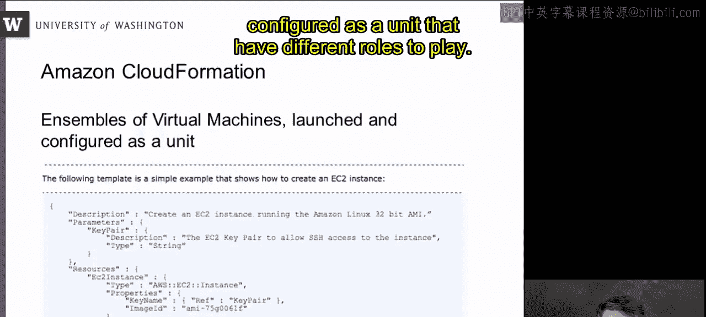
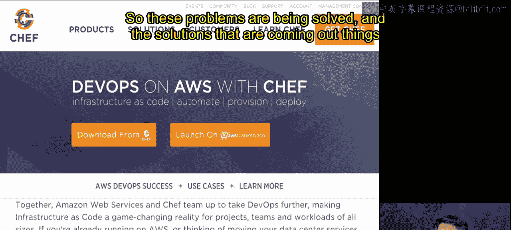
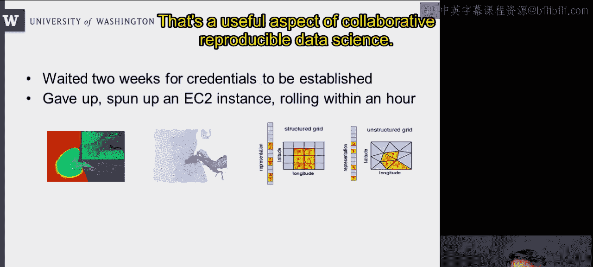

# 大规模数据科学：第2课：共享实验室


## 概述
在本节课中，我们将探讨数据科学协作中的一个核心挑战：如何快速建立共享、可复现的开发环境。我们将了解传统协作方式的痛点，并学习如何利用现代云基础设施和“基础设施即代码”的理念来解决这些问题。



---

## 共享开发环境的挑战与解决方案

### 问题的普遍性
这个问题已被广泛观察到。在数据科学项目中，跨团队或跨机构协作时，经常需要共享代码、数据和计算环境。



### 解决方案：基础设施即代码
上一节我们提到了协作的挑战，本节中我们来看看一种核心解决方案：基础设施即代码。其核心思想是使用脚本或配置文件来定义和启动整个计算基础设施。

亚马逊的 **CloudFormation** 是此类解决方案之一。它允许你通过脚本启动和配置一组协调工作的虚拟机集群，这些虚拟机作为一个单元被部署，并扮演不同的角色。

**公式/代码示例：基础设施即代码**
```yaml
# 一个简化的 CloudFormation 模板示例，用于定义资源
Resources:
  MyEC2Instance:
    Type: 'AWS::EC2::Instance'
    Properties:
      InstanceType: t2.micro
      ImageId: ami-0abcdef1234567890
```

### 同类工具
在 DevOps 环境中，也有像 **Chef** 这样的工具可以实现类似功能。它们都致力于将基础设施作为代码来管理。

以下是此类工具的核心价值：
*   你可以编写脚本来启动、设置和操作基础设施。
*   共享这些脚本（如 Chef 脚本）能为他人提供相同的能力，使其能够启动一个大型、复杂、异构的架构来运行实验。

这些问题正在被解决，而涌现出的解决方案（如 Chef）通常与公有云、商业云服务紧密耦合。

---

## 云环境：开发者的“Google Docs”

### 协作的本质需求
数据科学本质上是一项协作性工作，而可复现性是协作的一部分。同时，协作也意味着当我们需要尝试一个大胆的想法，或者需要与另一个部门具有类似专业知识的同事合作时，能有一个高效的共同工作空间。

### 传统协作方式的瓶颈
当两个人需要一起工作时，启动一个双方都能访问的“Google 文档”非常有意义，但这仅限于文档工作。如果你们需要一起进行一些共享开发，就需要一个共享的开发环境。

我们在大学环境中观察到，现在几乎每个项目本质上都是协作的，经常需要跨越机构边界一起工作。一个临时的、不受任何特定系统管理员管辖的共享开发环境变得非常重要。

### 一个具体案例
例如，在跨机构协作时，我们曾经需要等待两周，让对方的系统管理员在我们的机器上提供账户，或者让我们的系统管理员在他们的机器上提供账户。我们当时觉得这很荒谬。

于是，我们转而启动了一个共享虚拟机，为所有人提供访问权限，让大家可以并肩工作，完成后便将其关闭、拆除。这是一个极佳的解决方案。

### 共享环境的优势
这不仅降低了协作的摩擦，更重要的是解决了沟通效率问题。你不再需要通过电子邮件互相发送错误信息，并试图描述问题以便对方在自己的环境中复现。你可以直接说：“运行这个命令，你就会看到错误信息。”因为你们访问的是完全相同的环境。

我们不可能轻易地互相访问对方私有的内部环境，至少在没有让系统管理员相当不满的情况下是不可能的。正如这里总结的：**没有“无法复现”的漏洞**。因为如果我看到了问题，那么你也能看到同样的问题。

我们放弃了等待两周建立凭证，转而启动了一个 EC2 实例，在一小时内就开始了工作。我认为，这在部门环境或商业环境中也同样适用。即使由于某些原因你使用的云不一定是公有云，一个能够支持启动新虚拟机、允许不同人员访问、并在完成后可拆除的共享环境，仍然是支持协作性、可复现数据科学的一个非常有用的方面。

---



## 总结
本节课中，我们一起学习了数据科学协作中关于环境共享的核心挑战。我们探讨了“基础设施即代码”的理念及其工具（如 AWS CloudFormation 和 Chef），它们通过脚本化方式管理复杂环境。更重要的是，我们认识到云平台能够提供类似“Google Docs”的共享开发环境，这种环境极大地提升了协作效率，消除了“环境不一致”导致的沟通障碍，使得跨团队、跨机构的协同数据科学工作变得更加流畅和可复现。